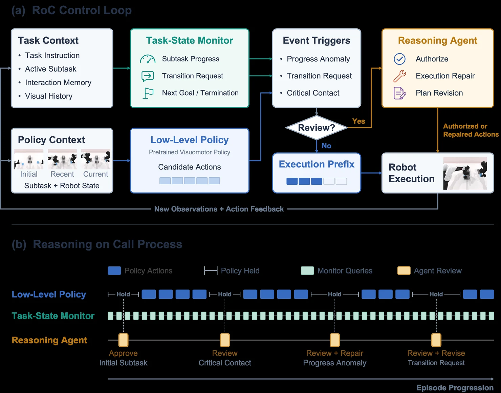

<!-- Generated by scripts/generate.py; edit data/works.json and data/media.json. -->

[← Back to the Awesome index](../../../README.md) · [Interactive website](https://chang-xinhai.github.io/Awesome-RGBDT-Manipulation/?collection=policy&item=reasoning-on-call#library)

# RoC

Reasoning on Call: Efficient Agentic Robot Control for Long-Horizon Robot Manipulation

**2026-11-19 · Preprint · Wuhan University and collaborators**

**[Paper](https://arxiv.org/abs/2611.26341)**

A task monitor invokes a reasoning agent selectively to recover subtask plans and robot execution during long-horizon manipulation.

*Reasoning on Call authors · [Figure source](https://arxiv.org/html/2611.26341v1) · Original rights retained.*

| Field | Reported value and source scope |
| :-- | :-- |
| Record type | policy |
| Policy family | Event-triggered reasoning and task feedback [1](https://arxiv.org/html/2611.26341v1)  |
| Base model and architecture | FastWAM low-level policy in the simulation setting and an online task-state monitor. [1](https://arxiv.org/html/2611.26341v1)  |
| Model size and component | Not reported [1](https://arxiv.org/html/2611.26341v1)  |
| Deployment inputs | Temporal RGB frames, current task text, interaction history and robot state in the paper’s simulation policy. [1](https://arxiv.org/html/2611.26341v1)  |
| Action outputs and horizon | Low-level robot commands with separate execution-repair and plan-revision decisions. [1](https://arxiv.org/html/2611.26341v1)  |
| Training method | Train a monitor for subtask progression and use verified outcomes to update memory. Call the high-level agent only when monitor criteria are met. [1](https://arxiv.org/html/2611.26341v1)  |
| Training data | Authors train the simulation monitor for one epoch across nine RMBench tasks. [1](https://arxiv.org/html/2611.26341v1)  |
| Training duration | Not reported [1](https://arxiv.org/html/2611.26341v1)  |
| Training hardware | Not reported [1](https://arxiv.org/html/2611.26341v1)  |
| Inference and control rates | Not reported [1](https://arxiv.org/html/2611.26341v1)  |
| Evaluation scope | All nine RMBench tasks and three physical long-horizon manipulation settings; compares success with token usage and agent intervention frequency. [1](https://arxiv.org/html/2611.26341v1)  |
| Observations / modalities | RGB · Proprioception |
| Evaluation domain | Simulation · Real world |
| Embodiment |  |
| Release: code | Not verified |
| Release: weights | Not verified |
| Release: data | Not verified |
| Release: license | Not verified |
| Release: notes | The inspected paper documents the protocol and model components. Code, weights and data downloads were not verified. |

**Scope and qualifications**

- Online state and memory updates are distinct from training the monitor. No additional inference-time gradient update is claimed.

**Primary evidence**

1. [Original author paper or dataset description](https://arxiv.org/html/2611.26341v1)
