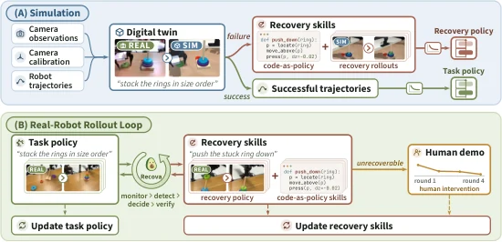

<!-- Generated by scripts/generate.py; edit data/works.json and data/media.json. -->

[← Back to the Awesome index](../../../README.md) · [Interactive website](https://chang-xinhai.github.io/Awesome-RGBDT-Manipulation/?collection=policy&item=recova#library)

# Recova

Recova: Agent-Guided Failure Recovery for Autonomous Robotic Manipulation

**2026-10-01 · Preprint · University of California, San Diego and collaborators**

**[Paper](https://arxiv.org/abs/2610.01178)** · [Project](https://research.nvidia.com/labs/gear/recova/)

Develops task and recovery policies in a reconstructed scene, then routes physical rollouts and human corrections to the relevant policy.

*Recova authors · [Figure source](https://arxiv.org/html/2610.01178v1) · Original rights retained.*

| Field | Reported value and source scope |
| :-- | :-- |
| Record type | policy |
| Policy family | Robot agent with task and recovery policies [1](https://arxiv.org/html/2610.01178)  |
| Base model and architecture | Vision-language reasoning agent with learned policy skills [1](https://arxiv.org/html/2610.01178)  |
| Model size and component | Not reported [1](https://arxiv.org/html/2610.01178)  |
| Deployment inputs | Camera observations and robot state; calibrated scene reconstruction for digital-twin development. [1](https://arxiv.org/html/2610.01178)  |
| Action outputs and horizon | Task actions, selected recovery program or recovery-policy actions, and progress verification. [1](https://arxiv.org/html/2610.01178)  |
| Training method | Agent programs corrective trials in simulation; physical rollouts and human takeover demonstrations feed DAgger updates to task or recovery policies. [1](https://arxiv.org/html/2610.01178)  |
| Training data | Successful twin trajectories and separately collected real-world rollouts/recovery demonstrations. [1](https://arxiv.org/html/2610.01178)  |
| Training duration | Not reported [1](https://arxiv.org/html/2610.01178)  |
| Training hardware | Not reported [1](https://arxiv.org/html/2610.01178)  |
| Inference and control rates | Not reported [1](https://arxiv.org/html/2610.01178)  |
| Evaluation scope | Six LIBERO-Pro settings and four MolmoSpaces categories; in the four-workstation physical study DAgger raises mean success to 77.5%, and recovery raises it to 87.5%. [1](https://arxiv.org/html/2610.01178)  |
| Observations / modalities | RGB · Proprioception · Language |
| Evaluation domain | Simulation · Real world |
| Embodiment |  |
| Release: code | Not verified [2](https://research.nvidia.com/labs/gear/recova/)  |
| Release: weights | Not verified [2](https://research.nvidia.com/labs/gear/recova/)  |
| Release: data | Not verified [2](https://research.nvidia.com/labs/gear/recova/)  |
| Release: license | Not verified [2](https://research.nvidia.com/labs/gear/recova/)  |
| Release: notes | Author page and paper document the stages and physical rollouts. Standalone repository, policy weights and rollout corpus were not verified. [2](https://research.nvidia.com/labs/gear/recova/)  |

**Scope and qualifications**

- The agent can invoke learned or programmatic recovery and request a human demonstration when neither suffices.
- Human takeover results describe four rounds on one task. Digital-twin geometry and the real-world control logs have separate scope.

**Primary evidence**

1. [Primary paper and evaluated setting](https://arxiv.org/html/2610.01178)
2. [Author project and artifact status](https://research.nvidia.com/labs/gear/recova/)
