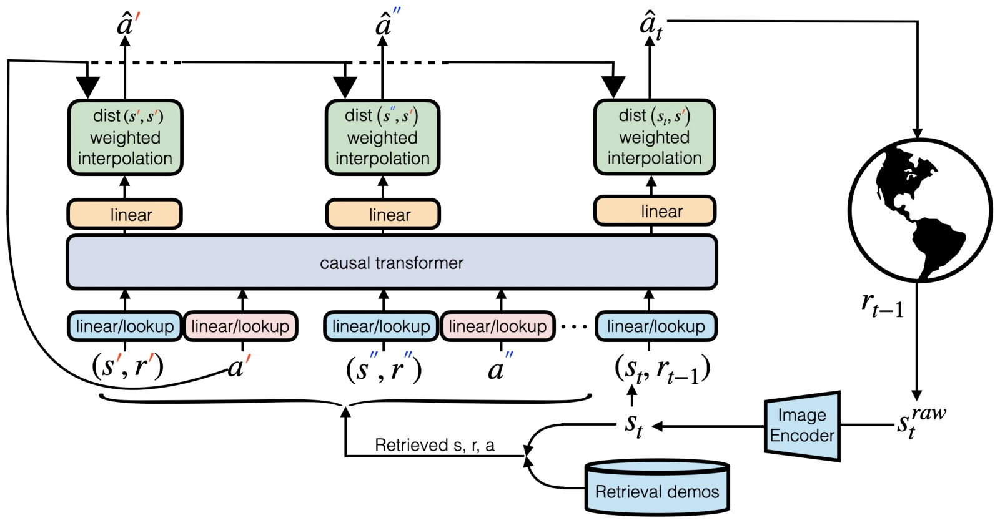

<!-- Generated by scripts/generate.py; edit data/works.json and data/media.json. -->

[← Back to the Awesome index](../../../README.md) · [Interactive website](https://chang-xinhai.github.io/Awesome-RGBDT-Manipulation/?collection=policy&item=regent#library)

# REGENT

REGENT: A Retrieval-Augmented Generalist Agent That Can Act In-Context in New Environments

**2024-12-06 · ICLR 2025 · University of Pennsylvania**

**[Paper](https://arxiv.org/abs/2412.04759)** · [Project](https://kaustubhsridhar.github.io/regent-research) · [Code](https://github.com/regent-research/regent) · [Data](https://huggingface.co/datasets/regent-research/regent-subset-of-jat-dataset-tokenized) · [Weights](https://huggingface.co/regent-research/regent-medium-embeddings)

A retrieval-augmented transformer acts in new environments by combining demonstration neighbors with learned action prediction.

*REGENT authors · [Figure source](https://arxiv.org/abs/2412.04759) · Original rights retained.*

| Field | Reported value and source scope |
| :-- | :-- |
| Record type | policy |
| Policy family | Retrieval policy [1](https://arxiv.org/abs/2412.04759)  |
| Base model and architecture | Transformer policy combined with retrieval-and-play action interpolation. [1](https://arxiv.org/abs/2412.04759)  |
| Model size and component | 138.6M parameters for REGENT. [1](https://arxiv.org/abs/2412.04759)  |
| Deployment inputs | Current observations, prior reward and retrieved state/action examples; simulated arm tasks use vector observations. [1](https://arxiv.org/abs/2412.04759)  |
| Action outputs and horizon | Continuous arm actions in manipulation domains; the general agent also supports discrete game actions. [1](https://arxiv.org/abs/2412.04759)  |
| Training method | Pretrain on query/retrieved-neighbor sequences; adapt to new environments by adding demonstrations to retrieval context without gradient updates. [1](https://arxiv.org/abs/2412.04759)  |
| Training data | 14.5M transitions: 100k each from 45 Meta-World, nine MuJoCo, 52 Atari and 39 BabyAI environments. [1](https://arxiv.org/abs/2412.04759)  |
| Training duration | Not reported [1](https://arxiv.org/abs/2412.04759)  |
| Training hardware | Not reported [1](https://arxiv.org/abs/2412.04759)  |
| Inference and control rates | Not reported [1](https://arxiv.org/abs/2412.04759)  |
| Evaluation scope | Held-out Meta-World manipulation environments and MuJoCo, alongside game/navigation environments. [1](https://arxiv.org/abs/2412.04759)  |
| Observations / modalities | Proprioception |
| Evaluation domain | Simulation |
| Embodiment | Parallel-jaw gripper |
| Release: code | Available [2](https://kaustubhsridhar.github.io/regent-research) [3](https://github.com/regent-research/regent)  |
| Release: weights | Available [2](https://kaustubhsridhar.github.io/regent-research) [3](https://github.com/regent-research/regent)  |
| Release: data | Available [2](https://kaustubhsridhar.github.io/regent-research) [3](https://github.com/regent-research/regent)  |
| Release: license | Apache-2.0 for repository code; external model, dataset and dependency terms remain separate. [2](https://kaustubhsridhar.github.io/regent-research) [3](https://github.com/regent-research/regent) [4](https://github.com/regent-research/regent/blob/HEAD/LICENSE)  |
| Release: notes | Official REGENT checkpoint and pretraining subset are public. Game-domain image inputs are not evidence of visual arm-policy evaluation. [2](https://kaustubhsridhar.github.io/regent-research) [3](https://github.com/regent-research/regent)  |

**Scope and qualifications**

- Manipulation experiments are simulated state-based control.
- The corpus includes games and locomotion; total transition count is not a manipulation-only data scale.

**Primary evidence**

1. [Original paper / author report](https://arxiv.org/abs/2412.04759) — Original full paper and supplementary experimental / implementation details; deployment inputs are separated from supervision and benchmark state.
2. [Official project](https://kaustubhsridhar.github.io/regent-research) — Author-linked project and current release checked on the catalog cutoff.
3. [Official code / release documentation](https://github.com/regent-research/regent) — Current repository documentation; paper settings and subsequently released artifacts are distinguished.
4. [Repository LICENSE](https://github.com/regent-research/regent/blob/HEAD/LICENSE) — Actual license file inspected; code license does not automatically license data or weights.
