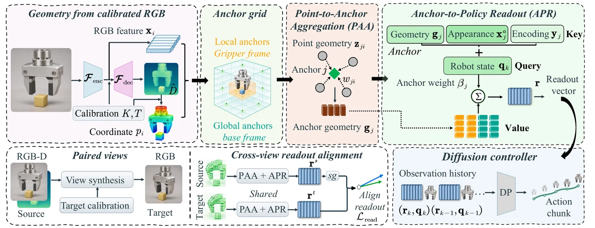

<!-- Generated by scripts/generate.py; edit data/works.json and data/media.json. -->

[← Back to the Awesome index](../../../README.md) · [Interactive website](https://chang-xinhai.github.io/Awesome-RGBDT-Manipulation/?collection=policy&item=regeoanch#library)

# ReGeoAnch

Reading Geometric Anchors: Viewpoint Generalization in Imitation Learning for Robotic Manipulation with RGB-Only Deployment

**2026-11-24 · Preprint · Hunan University**

**[Paper](https://arxiv.org/abs/2611.32162)**

Anchors geometry to the robot base and gripper to transfer an imitation policy from RGB-D demonstrations to new calibrated RGB views.

*Chengyu Tao and coauthors · [Figure source](https://arxiv.org/html/2611.32162v1) · Original rights retained.*

| Field | Reported value and source scope |
| :-- | :-- |
| Record type | policy |
| Policy family | Viewpoint-robust geometric imitation learning [1](https://arxiv.org/html/2611.32162v1)  |
| Base model and architecture | Not reported [1](https://arxiv.org/html/2611.32162v1)  |
| Model size and component | Not reported [1](https://arxiv.org/html/2611.32162v1)  |
| Deployment inputs | One calibrated RGB image, target-view intrinsics and camera-to-base pose, plus robot state to place the local gripper anchors. Depth is predicted from RGB. [1](https://arxiv.org/html/2611.32162v1)  |
| Action outputs and horizon | Robot control actions conditioned on appearance-guided geometric readout. [1](https://arxiv.org/html/2611.32162v1)  |
| Training method | RGB-D demonstration pairs synthesized into target views; supervised depth prediction and readout consistency across views. [1](https://arxiv.org/html/2611.32162v1)  |
| Training data | Calibrated RGB-D expert demonstrations in MetaWorld and ManiSkill3 with reprojected synthetic target images. [1](https://arxiv.org/html/2611.32162v1)  |
| Training duration | Not reported [1](https://arxiv.org/html/2611.32162v1)  |
| Training hardware | Not reported [1](https://arxiv.org/html/2611.32162v1)  |
| Inference and control rates | Not reported [1](https://arxiv.org/html/2611.32162v1)  |
| Evaluation scope | Twelve manipulation tasks across MetaWorld and ManiSkill3, evaluated over azimuth, elevation and distance changes. Paper comparison is simulated. [1](https://arxiv.org/html/2611.32162v1)  |
| Observations / modalities | RGB · Proprioception |
| Evaluation domain | Simulation |
| Embodiment | Parallel-jaw gripper |
| Release: code | Not verified |
| Release: weights | Not verified |
| Release: data | Not verified |
| Release: license | Not verified |
| Release: notes | Paper or official project reviewed. Code, weights and data are tracked independently. |

**Scope and qualifications**

- RGB-D is a training source. Deployment uses RGB and calibration; predicted depth does not require a depth sensor.

**Primary evidence**

1. [Original paper and evaluation settings](https://arxiv.org/html/2611.32162v1)
