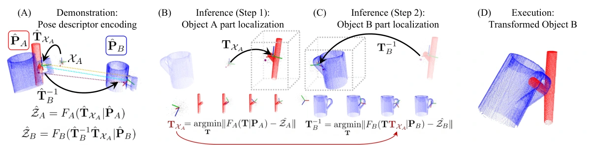

<!-- Generated by scripts/generate.py; edit data/works.json and data/media.json. -->

[← Back to the Awesome index](../../../README.md) · [Interactive website](https://chang-xinhai.github.io/Awesome-RGBDT-Manipulation/?collection=policy&item=relational-ndf#library)

# Relational NDF

SE(3)-Equivariant Relational Rearrangement with Neural Descriptor Fields

**2022-11-17 · CoRL 2022 · Massachusetts Institute of Technology**

**[Paper](https://arxiv.org/abs/2211.09786)** · [Project](https://anthonysimeonov.github.io/r-ndf/) · [Code](https://github.com/anthonysimeonov/relational_ndf)

Equivariant neural descriptor fields identify corresponding interaction frames for rearranging two novel objects.

*Relational NDF authors · [Figure source](https://arxiv.org/html/2211.09786) · Original rights retained.*

| Field | Reported value and source scope |
| :-- | :-- |
| Record type | policy |
| Policy family | Geometric transfer [1](https://arxiv.org/abs/2211.09786)  |
| Base model and architecture | SE(3)-equivariant relational geometric policy. Category-specific Neural Descriptor Fields, local-frame matching and optional energy-based relation refinement. [1](https://arxiv.org/abs/2211.09786)  |
| Model size and component | Not reported [1](https://arxiv.org/abs/2211.09786)  |
| Deployment inputs | Two accurately instance-segmented point clouds with known object identities, approximately five to ten relational demonstrations and one annotated 3D interaction keypoint. [1](https://arxiv.org/abs/2211.09786)  |
| Action outputs and horizon | Relative object transformation, grasp/placement poses and a MoveIt joint trajectory. [1](https://arxiv.org/abs/2211.09786)  |
| Training method | Pretrain implicit category shape descriptors, optimize consistent interaction frames and match them on novel instances. [1](https://arxiv.org/abs/2211.09786)  |
| Training data | Approximately 100,000 synthetic 3D samples per category; five to ten demonstrations specify a relation. [1](https://arxiv.org/abs/2211.09786)  |
| Training duration | 150,000 NDF iterations, approximately half a day per category. [1](https://arxiv.org/abs/2211.09786)  |
| Training hardware | One NVIDIA RTX 3090, batch size 16. [1](https://arxiv.org/abs/2211.09786)  |
| Inference and control rates | Pose inference optimization uses 650 iterations and multiple starts; universal control Hz not reported. [1](https://arxiv.org/abs/2211.09786)  |
| Evaluation scope | Three multi-object rearrangement tasks in simulation and on a real robot, with arbitrary initial SE(3) poses. [1](https://arxiv.org/abs/2211.09786)  |
| Observations / modalities | RGB · Depth · Proprioception |
| Evaluation domain | Simulation · Real world |
| Embodiment | Parallel-jaw gripper |
| Release: code | Available [2](https://anthonysimeonov.github.io/r-ndf/) [3](https://github.com/anthonysimeonov/relational_ndf)  |
| Release: weights | Available [2](https://anthonysimeonov.github.io/r-ndf/) [3](https://github.com/anthonysimeonov/relational_ndf)  |
| Release: data | Partial [2](https://anthonysimeonov.github.io/r-ndf/) [3](https://github.com/anthonysimeonov/relational_ndf)  |
| Release: license | MIT code; dependency/model/data terms separate [2](https://anthonysimeonov.github.io/r-ndf/) [3](https://github.com/anthonysimeonov/relational_ndf) [4](https://raw.githubusercontent.com/anthonysimeonov/relational_ndf/master/LICENSE.md)  |
| Release: notes | Author-linked repository and actual README/tree inspected; weights/data are tracked separately. No installation or reproduction attempted. [2](https://anthonysimeonov.github.io/r-ndf/) [3](https://github.com/anthonysimeonov/relational_ndf)  |

**Scope and qualifications**

- Requires known categories and accurately segmented object point clouds.
- The first public paper is November 17, 2022; PMLR volume publication in 2023 does not change that first date.

**Primary evidence**

1. [Original manuscript and first submission history](https://arxiv.org/abs/2211.09786) — Original method, evaluation and available implementation/appendix sections inspected. The survey is discovery evidence only.
2. [Official project](https://anthonysimeonov.github.io/r-ndf/) — Author-linked source. Component and artifact release terms may differ.
3. [Official code](https://github.com/anthonysimeonov/relational_ndf) — Author-linked source. Component and artifact release terms may differ.
4. [Actual source license file](https://raw.githubusercontent.com/anthonysimeonov/relational_ndf/master/LICENSE.md) — Scope limited to the file/repository subtree carrying these terms, not paper figures or external models/data.
