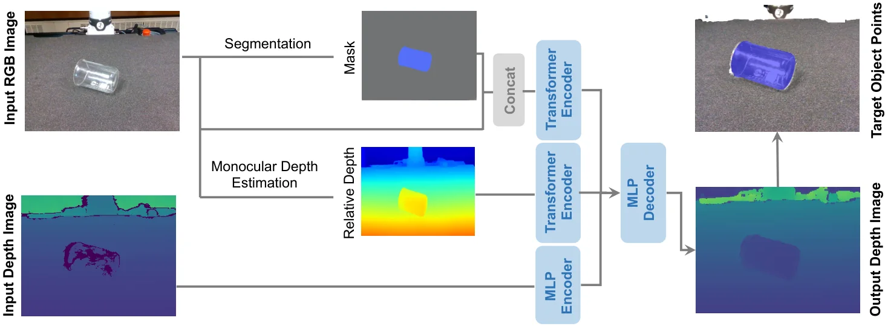

<!-- Generated by scripts/generate.py; edit data/works.json and data/media.json. -->

[← Back to the Awesome index](../../../README.md) · [Interactive website](https://chang-xinhai.github.io/Awesome-RGBDT-Manipulation/?collection=policy&item=remake-depth#library)

# ReMake

Rethinking Transparent Object Grasping: Depth Completion with Monocular Depth Estimation and Instance Mask

**2025-08-04 · IEEE RA-L 2026 · Not reported**

**[Paper](https://arxiv.org/abs/2508.02507)** · [Project](https://chengyaofeng.github.io/ReMake.github.io/) · [Code](https://github.com/ChengYaofeng/ReMake)

RGB-D depth completion guided by instance masks and monocular depth improves transparent-object grasp perception.

*ReMake authors · [Figure source](https://arxiv.org/abs/2508.02507) · Original rights retained.*

| Field | Reported value and source scope |
| :-- | :-- |
| Record type | model |
| Model role and downstream interface | Depth and geometry perception reference [1](https://arxiv.org/html/2508.02507v1)  |
| Model family | Depth estimation [1](https://arxiv.org/html/2508.02507v1)  |
| Model architecture | See original paper [1](https://arxiv.org/html/2508.02507v1)  |
| Model size and component | Not reported [1](https://arxiv.org/html/2508.02507v1)  |
| Model inputs | RGB-D image, instance mask and monocular predicted relative depth. [1](https://arxiv.org/html/2508.02507v1)  |
| Model outputs | Completed depth for transparent-object geometry. [1](https://arxiv.org/html/2508.02507v1)  |
| Training method | Depth completion with instance masks and monocular depth priors. [1](https://arxiv.org/html/2508.02507v1)  |
| Training data and scale | See original paper for dataset scope [1](https://arxiv.org/html/2508.02507v1)  |
| Training duration | Not reported [1](https://arxiv.org/html/2508.02507v1)  |
| Training hardware | Not reported [1](https://arxiv.org/html/2508.02507v1)  |
| Inference setting and runtime | See original paper and official implementation [1](https://arxiv.org/html/2508.02507v1)  |
| Downstream evaluation and scope | Transparent-object depth benchmarks and physical robot grasping. [1](https://arxiv.org/html/2508.02507v1)  |
| Observations / modalities | RGB · Depth |
| Evaluation domain |  |
| Embodiment |  |
| Release: code | Available [2](https://github.com/ChengYaofeng/ReMake)  |
| Release: weights | Not verified [2](https://github.com/ChengYaofeng/ReMake)  |
| Release: data | Not verified [2](https://github.com/ChengYaofeng/ReMake)  |
| Release: license | MIT source; checkpoints and data terms remain separate. [2](https://github.com/ChengYaofeng/ReMake)  |
| Release: notes | Depth completion is a geometry model rather than an action policy. [2](https://github.com/ChengYaofeng/ReMake)  |

**Scope and qualifications**

- Input depth is sensor-derived; completed depth is model-predicted, and is not an additional measured sensor.

**Primary evidence**

1. [Author paper](https://arxiv.org/html/2508.02507v1)
2. [Author source repository](https://github.com/ChengYaofeng/ReMake)
