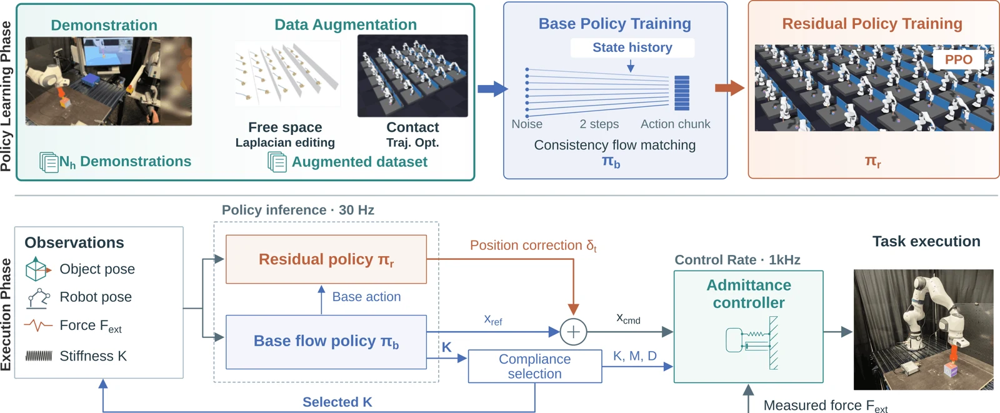

<!-- Generated by scripts/generate.py; edit data/works.json and data/media.json. -->

[← Back to the Awesome index](../../../README.md) · [Interactive website](https://chang-xinhai.github.io/Awesome-RGBDT-Manipulation/?collection=policy&item=residual-compliant-policy#library)

# Residual Compliant Policy

Residual Compliant Policy: Learning Compliant Policies from Few Demonstrations

**2026-10-01 · arXiv preprint · University of Pennsylvania**

**[Paper](https://arxiv.org/abs/2610.14035)** · [Project](https://residual-compliant-policy.github.io/)

Combines visible compliance during teaching, simulation augmentation and residual RL for contact-rich control.

*Residual Compliant Policy authors; original rights retained. · [Figure source](https://arxiv.org/html/2610.14035v1) · Original rights retained.*

| Field | Reported value and source scope |
| :-- | :-- |
| Record type | policy |
| Policy family | Hybrid [2](https://arxiv.org/html/2610.14035v1)  |
| Base model and architecture | Consistency flow-matching base policy with residual RL over an admittance controller. [2](https://arxiv.org/html/2610.14035v1)  |
| Model size and component | Not reported [2](https://arxiv.org/html/2610.14035v1)  |
| Deployment inputs | Four-step history of digital-twin object pose, end-effector pose, filtered F/T feedback and commanded stiffness. [2](https://arxiv.org/html/2610.14035v1)  |
| Action outputs and horizon | 16-step reference-pose/stiffness chunks; residual policy corrects reference position while base retains orientation/stiffness. [2](https://arxiv.org/html/2610.14035v1)  |
| Training method | Imitation learning followed by simulation residual RL over a frozen base policy. [2](https://arxiv.org/html/2610.14035v1)  |
| Training data | Seven physical demonstrations across three tasks, augmented using Laplacian editing and simulation trajectory optimization. [2](https://arxiv.org/html/2610.14035v1)  |
| Training duration | Not reported [2](https://arxiv.org/html/2610.14035v1)  |
| Training hardware | Not reported [2](https://arxiv.org/html/2610.14035v1)  |
| Inference and control rates | Base observations at 30 Hz; F/T acquisition 1 kHz. [2](https://arxiv.org/html/2610.14035v1)  |
| Evaluation scope | Franka FR3 flipping/pushing tasks with out-of-distribution object poses; Newton digital twin and haptic teleoperation. [2](https://arxiv.org/html/2610.14035v1)  |
| Observations / modalities | Force/Torque · Proprioception |
| Evaluation domain | Simulation · Real world |
| Embodiment | Other |
| Release: code | Not verified [3](https://residual-compliant-policy.github.io/)  |
| Release: weights | Not verified [3](https://residual-compliant-policy.github.io/)  |
| Release: data | Not verified [3](https://residual-compliant-policy.github.io/)  |
| Release: license | Not verified [3](https://residual-compliant-policy.github.io/)  |
| Release: notes | Paper and public presentation verified; no implementation, weight or data release is inferred from a publication or demonstration. [3](https://residual-compliant-policy.github.io/)  |

**Scope and qualifications**

- RGB-D supports the digital twin; raw images/depth are not direct inputs to the described state-based policy.
- Physical evaluation uses a pusher, not a claim of dexterous-hand or parallel-gripper deployment.

**Primary evidence**

1. [Canonical author manuscript and arXiv submission history](https://arxiv.org/abs/2610.14035) — Date retains the initial v1 submission, independently of revisions or current artifact releases.
2. [Full author paper: method, observations and evaluation scope](https://arxiv.org/html/2610.14035v1) — Physical sensors, predicted signals, training labels and policy inputs are recorded separately; undisclosed quantities remain unknown.
3. [Official paper-linked project page; release review on 19 October 2026](https://residual-compliant-policy.github.io/) — Current artifacts are checked separately from paper experiments. A project-only link is not proof of an implementation release.
