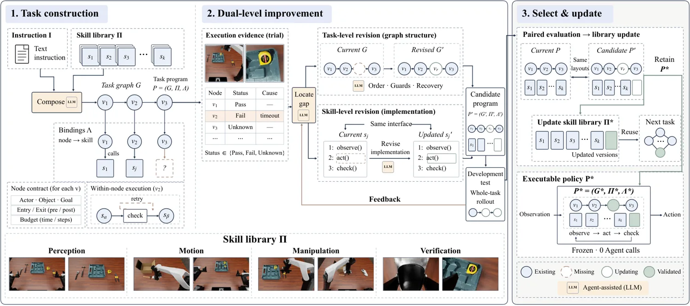

<!-- Generated by scripts/generate.py; edit data/works.json and data/media.json. -->

[← Back to the Awesome index](../../../README.md) · [Interactive website](https://chang-xinhai.github.io/Awesome-RGBDT-Manipulation/?collection=policy&item=reskill-agent#library)

# ReSkill

ReSkill: Selective Self-Improvement for Robot Manipulation

**2026-11-07 · Preprint · The Chinese University of Hong Kong**

**[Paper](https://arxiv.org/abs/2611.10510)**

A coding agent targets failing task-graph nodes and retains evaluated skill revisions.

*ReSkill authors · [Figure source](https://arxiv.org/abs/2611.10510) · Original rights retained.*

| Field | Reported value and source scope |
| :-- | :-- |
| Record type | policy |
| Policy family | Robot agent [1](https://arxiv.org/abs/2611.10510)  |
| Base model and architecture | Coding agent, exact base model varies [1](https://arxiv.org/abs/2611.10510)  |
| Model size and component | Not reported [1](https://arxiv.org/abs/2611.10510)  |
| Deployment inputs | Task, visual observations, execution records and skill library. [1](https://arxiv.org/abs/2611.10510)  |
| Action outputs and horizon | Revised task graphs, skills and independently executable robot program. [1](https://arxiv.org/abs/2611.10510)  |
| Training method | Coding agent revises task graph and reusable skills during development; paired evaluations determine which changes are retained. [1](https://arxiv.org/abs/2611.10510)  |
| Training data | One teleoperated demonstration per physical-task reconstruction. [1](https://arxiv.org/abs/2611.10510)  |
| Training duration | Not reported [1](https://arxiv.org/abs/2611.10510)  |
| Training hardware | Not reported [1](https://arxiv.org/abs/2611.10510)  |
| Inference and control rates | Not reported [1](https://arxiv.org/abs/2611.10510)  |
| Evaluation scope | Ten RoboDojo tasks and eight physical Xtrainer tasks; real-task development in reconstructed simulation. [1](https://arxiv.org/abs/2611.10510)  |
| Observations / modalities | RGB · Proprioception · Language |
| Evaluation domain | Simulation · Real world |
| Embodiment |  |
| Release: code | Not verified |
| Release: weights | Not verified |
| Release: data | Not verified |
| Release: license | Not verified |
| Release: notes | Availability is distinguished for source, data and model weights. |

**Scope and qualifications**

- Evaluation layouts were available during model selection. Real-world skill revision occurred in rebuilt simulation; the frozen program makes no agent calls at runtime.

**Primary evidence**

1. [Original paper and first submission](https://arxiv.org/abs/2611.10510)
