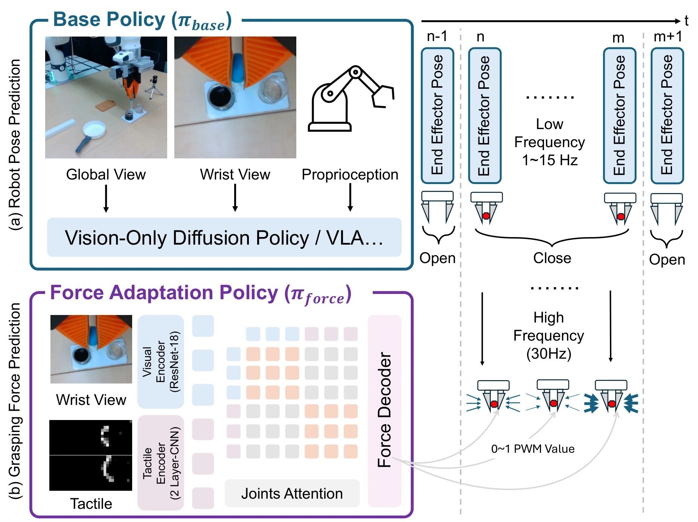

<!-- Generated by scripts/generate.py; edit data/works.json and data/media.json. -->

[← Back to the Awesome index](../../../README.md) · [Interactive website](https://chang-xinhai.github.io/Awesome-RGBDT-Manipulation/?collection=policy&item=retaf#library)

# RETAF / TF-Gripper

Learning Force-Regulated Robotic Manipulation with a Low-Cost Tactile-Force-Controlled Gripper

**2026-02-10 · Preprint · University of Virginia / Columbia University**

**[Paper](https://arxiv.org/abs/2602.10013)** · [Project](https://force-gripper.github.io/) · [Code](https://github.com/Shua-Kang/force_gripper_hardware)

A separate high-rate tactile force policy regulates grasping while a base policy predicts arm pose and gripper open/close.

*Learning Force-Regulated Robotic Manipulation with a Low-Cost Tactile-Force-Controlled Gripper authors · [Figure source](https://arxiv.org/abs/2602.10013) · Original rights retained.*

| Field | Reported value and source scope |
| :-- | :-- |
| Record type | policy |
| Policy family | Hybrid [1](https://arxiv.org/abs/2602.10013)  |
| Base model and architecture | REactive Tactile Adaptation of Force; modular pose policy plus wrist/tactile force adaptation policy. [1](https://arxiv.org/abs/2602.10013)  |
| Model size and component | Not reported [1](https://arxiv.org/abs/2602.10013)  |
| Deployment inputs | Global/wrist RGB, tactile feedback and robot state; force branch activates during grasping. [1](https://arxiv.org/abs/2602.10013)  |
| Action outputs and horizon | End-effector pose and open/close from base policy; continuous target grip force from reactive branch. [1](https://arxiv.org/abs/2602.10013)  |
| Training method | Imitation learning with decoupled force/pose prediction and joint attention. [1](https://arxiv.org/abs/2602.10013)  |
| Training data | Six tasks with 50 human demonstrations/task, recorded at 15 Hz; separate chip-variant generalization cohort 20 demos/seen variant. [1](https://arxiv.org/abs/2602.10013)  |
| Training duration | Not reported [1](https://arxiv.org/abs/2602.10013)  |
| Training hardware | Not reported [1](https://arxiv.org/abs/2602.10013)  |
| Inference and control rates | Force adaptation &gt;30 Hz; demos 15 Hz; slower arm policy rate is separate. [1](https://arxiv.org/abs/2602.10013)  |
| Evaluation scope | Six real force-sensitive tasks with TF-Gripper, including chip/cherry-tomato picking and liquid transfer. [1](https://arxiv.org/abs/2602.10013)  |
| Observations / modalities | RGB · Tactile · Proprioception |
| Evaluation domain | Real world |
| Embodiment | Parallel-jaw gripper |
| Release: code | Partial [2](https://force-gripper.github.io/) [3](https://github.com/Shua-Kang/force_gripper_hardware)  |
| Release: weights | Not verified [2](https://force-gripper.github.io/) [3](https://github.com/Shua-Kang/force_gripper_hardware)  |
| Release: data | Not verified [2](https://force-gripper.github.io/) [3](https://github.com/Shua-Kang/force_gripper_hardware)  |
| Release: license | Not verified; no unambiguous repository license identified. [2](https://force-gripper.github.io/) [3](https://github.com/Shua-Kang/force_gripper_hardware)  |
| Release: notes | Released repository covers TF-Gripper hardware/control; full RETAF policy training/checkpoints not established by this hardware repository. [2](https://force-gripper.github.io/) [3](https://github.com/Shua-Kang/force_gripper_hardware)  |

**Scope and qualifications**

- Sensor feedback regulates grip force, not just an additional position observation.
- Chip-variant cohort is a separate experiment and is not added to the six-task demo count.

**Primary evidence**

1. [Original paper and supplementary implementation details](https://arxiv.org/abs/2602.10013) — Primary full text reviewed; dataset, deployment modalities and training-only privileges are scoped separately.
2. [Official author project](https://force-gripper.github.io/) — Live project artifact links inspected on2026-10-17.
3. [Official released implementation and LICENSE](https://github.com/Shua-Kang/force_gripper_hardware) — Repository metadata,README and actualNone inspected; availability scoped to the listed component.
