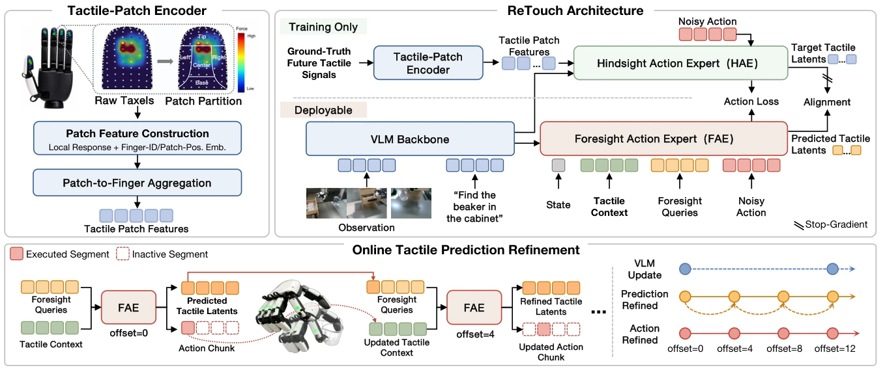

<!-- Generated by scripts/generate.py; edit data/works.json and data/media.json. -->

[← Back to the Awesome index](../../../README.md) · [Interactive website](https://chang-xinhai.github.io/Awesome-RGBDT-Manipulation/?collection=policy&item=retouch#library)

# ReTouch

ReTouch: Empowering Contact-Rich Dexterous Manipulation with Online-Refined Tactile Prediction

**2026-08-03 · Preprint · University of Science and Technology of China / iFLYTEK / The Chinese University of Hong Kong**

**[Paper](https://arxiv.org/abs/2608.01824)**

A tactile-patch VLA refines predicted future contact latents and remaining actions as new hand feedback arrives.

*ReTouch: Empowering Contact-Rich Dexterous Manipulation with Online-Refined Tactile Prediction authors · [Figure source](https://arxiv.org/abs/2608.01824) · Original rights retained.*

| Field | Reported value and source scope |
| :-- | :-- |
| Record type | policy |
| Policy family | VLA [1](https://arxiv.org/abs/2608.01824)  |
| Base model and architecture | Pretrained π0; separate hindsight and foresight 18-layer, width-1024 action Transformers. [1](https://arxiv.org/abs/2608.01824)  |
| Model size and component | Total parameter count Not reported. [1](https://arxiv.org/abs/2608.01824)  |
| Deployment inputs | Three RGB views, instruction, 18 joint positions and a ten-frame window (nine past plus current) of 5×120×3 tactile force readings; patch/finger identity retained. [1](https://arxiv.org/abs/2608.01824)  |
| Action outputs and horizon | 16-step chunks of 18-dimensional absolute joint-position targets for UR7e and XHand, plus internally maintained future tactile latents. [1](https://arxiv.org/abs/2608.01824)  |
| Training method | 20k-step tactile-patch pretraining; joint flow-matching and hindsight-latent alignment. Privileged hindsight expert and alignment projector removed at deployment; foresight expert recursively revises chunks. [1](https://arxiv.org/abs/2608.01824)  |
| Training data | XHT-Dataset: 900 successful demonstrations over seven tasks; trajectory-level split of 800 common training / 100 held-out offline test episodes. One policy trains jointly across tasks. [1](https://arxiv.org/abs/2608.01824)  |
| Training duration | 20k encoder pretraining + 80k policy steps; encoder frozen for the first 5k policy steps. Wall-clock time Not reported. [1](https://arxiv.org/abs/2608.01824)  |
| Training hardware | 8 NVIDIA A800 GPUs, bfloat16. [1](https://arxiv.org/abs/2608.01824)  |
| Inference and control rates | RTX 5090 model-only benchmark: 9.02 full cycles / 36.08 FAE passes per second, excluding communication, execution and scheduling; physical achieved control Hz Not reported. Full variant blocks while refinements return. [1](https://arxiv.org/abs/2608.01824)  |
| Evaluation scope | UR7e–XHand: Pipette Press, Bottle Grasp, Cob Grasp, Sponge Wipe, Button Press, Cabinet Retrieval and Liquid Transfer; 20 trials per task plus four robustness conditions. Reported “success rate” is mean normalized staged completion, binary only for Button Press. [1](https://arxiv.org/abs/2608.01824)  |
| Observations / modalities | RGB · Tactile · Proprioception · Language |
| Evaluation domain | Real world |
| Embodiment | Dexterous hand |
| Release: code | Not verified |
| Release: weights | Not verified |
| Release: data | Not verified |
| Release: license | Not verified |
| Release: notes | No retrievable official policy code/checkpoint/data release was verified. |

**Scope and qualifications**

- Reviewed arXiv v2 implementation appendices. Future ground-truth touch is a training-only hindsight signal.
- The advertised 9/36 Hz comes from model-compute timings, not end-to-end robot throughput.
- Except Button Press, scores grant partial completion credit and must not be treated as binary task success frequencies.

**Primary evidence**

1. [Original paper and reviewed full text](https://arxiv.org/abs/2608.01824) — Full primary text, including available supplementary implementation details; first public date retained separately from reviewed revision.
