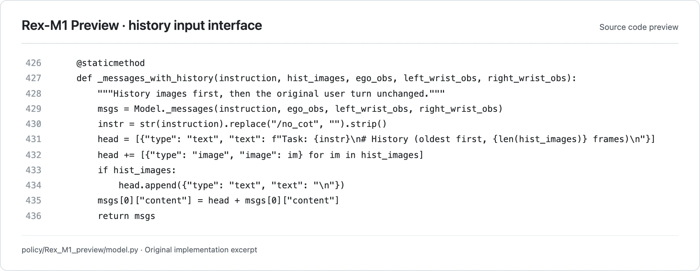

<!-- Generated by scripts/generate.py; edit data/works.json and data/media.json. -->

[← Back to the Awesome index](../../../README.md) · [Interactive website](https://chang-xinhai.github.io/Awesome-RGBDT-Manipulation/?collection=policy&item=rex-m1-preview#library)

# Rex-M1 Preview

Rex-M1 Preview long-context RoboDojo policy

**Undated · Official project / technical release · Futian Lab / VisIncept**

**[Project](https://github.com/XPolicyLab/XPolicyLab/tree/main/policy/Rex_M1_preview)** · [Code](https://github.com/XPolicyLab/XPolicyLab/tree/main/policy/Rex_M1_preview) · [Weights](https://modelscope.cn/models/gzx2019/Rex-M1-preview)

Extends Xiaomi-Robotics-1 inference with sampled head-camera history and fixed-budget history tokens for bimanual RoboDojo evaluation.

*Futian Lab / VisIncept / XPolicyLab contributors · [Figure source](https://github.com/XPolicyLab/XPolicyLab/blob/94dbf9505f2f87cf59c3ee8ba5912cd236781771/policy/Rex_M1_preview/model.py#L426-L436) · Original rights retained.*

**Preview scope:** Exact source lines 426–436 rendered for legibility. This is an implementation/interface preview, not an author-provided neural architecture figure. Original source rights retained.

| Field | Reported value and source scope |
| :-- | :-- |
| Record type | policy |
| Policy family | VLA [1](https://github.com/XPolicyLab/XPolicyLab/tree/94dbf9505f2f87cf59c3ee8ba5912cd236781771/policy/Rex_M1_preview)  |
| Base model and architecture | Xiaomi-Robotics-1-5B derivative with Qwen3-VL-4B-Instruct and its action model; modified constant-budget history-token pooling. [1](https://github.com/XPolicyLab/XPolicyLab/tree/94dbf9505f2f87cf59c3ee8ba5912cd236781771/policy/Rex_M1_preview) [2](https://modelscope.cn/models/gzx2019/Rex-M1-preview)  |
| Model size and component | Xiaomi-Robotics-1-5B is the declared base checkpoint; complete Rex-M1 Preview parameter count Not reported. [1](https://github.com/XPolicyLab/XPolicyLab/tree/94dbf9505f2f87cf59c3ee8ba5912cd236781771/policy/Rex_M1_preview)  |
| Deployment inputs | Current head and two wrist RGB views, language and robot state; released config samples up to 20 head-camera history frames at stride 25 and pools each to 16 tokens. [1](https://github.com/XPolicyLab/XPolicyLab/tree/94dbf9505f2f87cf59c3ee8ba5912cd236781771/policy/Rex_M1_preview) [2](https://modelscope.cn/models/gzx2019/Rex-M1-preview)  |
| Action outputs and horizon | 30-step action chunks; default adapter executes 15 before replanning. The internal packed 60-dimensional layout contains end-effector slots and is decoded to dual-ARX5 EE/gripper commands, not 60 independently controlled joints. [1](https://github.com/XPolicyLab/XPolicyLab/tree/94dbf9505f2f87cf59c3ee8ba5912cd236781771/policy/Rex_M1_preview) [2](https://modelscope.cn/models/gzx2019/Rex-M1-preview)  |
| Training method | Released derivative uses visual history at inference. Upstream training entry points remain vendored, but the required history sampling/collation is absent; checkpoint ptp_length=0 disables the retained past-reconstruction auxiliary path. [1](https://github.com/XPolicyLab/XPolicyLab/tree/94dbf9505f2f87cf59c3ee8ba5912cd236781771/policy/Rex_M1_preview)  |
| Training data | Not disclosed for the released Rex-M1 Preview checkpoint; upstream Xiaomi pretraining corpus is not asserted to be this derivative’s training dataset. [1](https://github.com/XPolicyLab/XPolicyLab/tree/94dbf9505f2f87cf59c3ee8ba5912cd236781771/policy/Rex_M1_preview)  |
| Training duration | Not reported [1](https://github.com/XPolicyLab/XPolicyLab/tree/94dbf9505f2f87cf59c3ee8ba5912cd236781771/policy/Rex_M1_preview)  |
| Training hardware | Not reported [1](https://github.com/XPolicyLab/XPolicyLab/tree/94dbf9505f2f87cf59c3ee8ba5912cd236781771/policy/Rex_M1_preview)  |
| Inference and control rates | 30-step chunk / default 15-step replan; physical feedback/control Hz Not reported. [1](https://github.com/XPolicyLab/XPolicyLab/tree/94dbf9505f2f87cf59c3ee8ba5912cd236781771/policy/Rex_M1_preview)  |
| Evaluation scope | Author-contributed RoboDojo simulation adapter: dual ARX5 with action_type=ee. One policy server per evaluation to avoid mixing environment history. [1](https://github.com/XPolicyLab/XPolicyLab/tree/94dbf9505f2f87cf59c3ee8ba5912cd236781771/policy/Rex_M1_preview)  |
| Observations / modalities | RGB · Proprioception · Language |
| Evaluation domain | Simulation |
| Embodiment | Parallel-jaw gripper · Bimanual |
| Release: code | Partial [1](https://github.com/XPolicyLab/XPolicyLab/tree/94dbf9505f2f87cf59c3ee8ba5912cd236781771/policy/Rex_M1_preview)  |
| Release: weights | Available [1](https://github.com/XPolicyLab/XPolicyLab/tree/94dbf9505f2f87cf59c3ee8ba5912cd236781771/policy/Rex_M1_preview) [2](https://modelscope.cn/models/gzx2019/Rex-M1-preview)  |
| Release: data | Not verified [1](https://github.com/XPolicyLab/XPolicyLab/tree/94dbf9505f2f87cf59c3ee8ba5912cd236781771/policy/Rex_M1_preview)  |
| Release: license | Apache-2.0 for vendored Xiaomi source and Rex modifications, verified from LICENSE/NOTICE. The ModelScope checkpoint card declares Apache-2.0; no separate weight-license file was present in its inspected inventory. [1](https://github.com/XPolicyLab/XPolicyLab/tree/94dbf9505f2f87cf59c3ee8ba5912cd236781771/policy/Rex_M1_preview) [2](https://modelscope.cn/models/gzx2019/Rex-M1-preview) [3](https://github.com/XPolicyLab/XPolicyLab/blob/94dbf9505f2f87cf59c3ee8ba5912cd236781771/policy/Rex_M1_preview/NOTICE)  |
| Release: notes | ModelScope revision aeb65fc1944b6871bc1c17c353085fa84e9a84bb publicly lists config.py and last.ckpt/checkpoint/mp_rank_00_model_states.pt with integrity hashes. This release supplies inference; vendored upstream training scripts do not reproduce history-policy training. [1](https://github.com/XPolicyLab/XPolicyLab/tree/94dbf9505f2f87cf59c3ee8ba5912cd236781771/policy/Rex_M1_preview)  |

**Scope and qualifications**

- No paper is released and the derivative’s training data/compute are undisclosed.
- Long-context observations do not by themselves establish recursive self-improvement or weight updates.
- The released checkpoint has ptp_length=0; the retained auxiliary code path should not be described as active at inference.
- An original method diagram was not located in the reviewed sources; the cover is a labeled source-code interface preview.

**Primary evidence**

1. [Author-contributed adapter and source](https://github.com/XPolicyLab/XPolicyLab/tree/94dbf9505f2f87cf59c3ee8ba5912cd236781771/policy/Rex_M1_preview) — Inspected README, INSTALLATION.md, model.py, deploy.yml and NOTICE at a fixed commit. Explicitly distinguishes usable history inference from the incomplete derivative-training path. Public policy release date is unspecified.
2. [Released checkpoint model card, inventory and config](https://modelscope.cn/models/gzx2019/Rex-M1-preview) — Public ModelScope API returned README, config.py and actual 10,226,684,560-byte tensor file with SHA-256. Config specifies 20 history frames, stride 25, 16-token pooling and action length 30. No tensors downloaded or executed.
3. [Actual derivative notice and vendored LICENSE](https://github.com/XPolicyLab/XPolicyLab/blob/94dbf9505f2f87cf59c3ee8ba5912cd236781771/policy/Rex_M1_preview/NOTICE) — NOTICE explicitly licenses Rex modifications under Apache-2.0 and enumerates the modified Xiaomi/Qwen files; source licenses are not silently generalized to all third-party assets.
