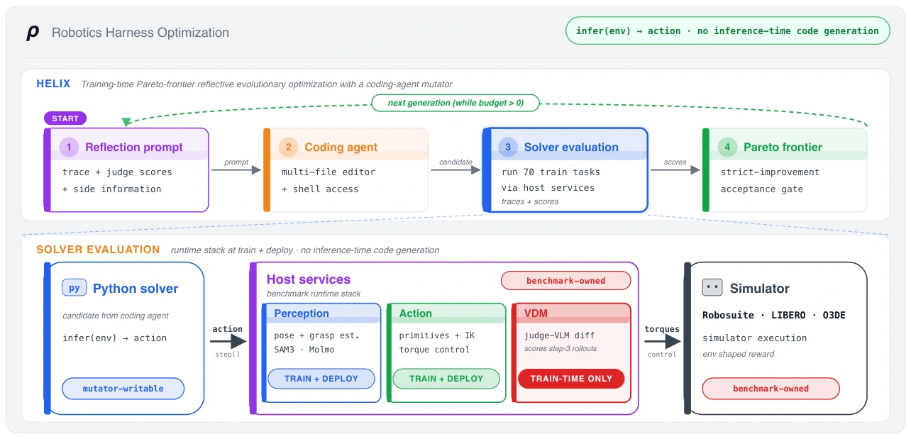

<!-- Generated by scripts/generate.py; edit data/works.json and data/media.json. -->

[← Back to the Awesome index](../../../README.md) · [Interactive website](https://chang-xinhai.github.io/Awesome-RGBDT-Manipulation/?collection=policy&item=rho#library)

# RHO

RHO: Your Coding Agent is Secretly a Roboticist

**2026-06-15 · Preprint · Not reported**

**[Paper](https://arxiv.org/abs/2606.16458)** · [Project](https://rho-robotics.github.io)

A tool-enabled coding agent mutates complete robot-policy repositories; gated evaluation and a Pareto frontier retain useful program variants.

*RHO authors · [Figure source](https://arxiv.org/abs/2606.16458) · Original rights retained.*

| Field | Reported value and source scope |
| :-- | :-- |
| Record type | policy |
| Policy family | Robot agent [1](https://arxiv.org/abs/2606.16458)  |
| Base model and architecture | Coding agents including GPT-5.5 through Codex in the reported CaP-Bench setup. [1](https://arxiv.org/abs/2606.16458)  |
| Model size and component | Not reported [1](https://arxiv.org/abs/2606.16458)  |
| Deployment inputs | Task specification, repository context, permitted robot-environment tools and rollout / evaluation feedback. [1](https://arxiv.org/abs/2606.16458)  |
| Action outputs and horizon | Versioned multi-file robot-control repositories, executed through the configured perception, grasping and motion interfaces. [1](https://arxiv.org/abs/2606.16458)  |
| Training method | Frozen model; HELIX repository evolution, isolated candidate execution, training gates and Pareto-frontier selection. [1](https://arxiv.org/abs/2606.16458)  |
| Training data | Repository-search rollouts and reflective feedback; no task-specific base-model weight updates. [1](https://arxiv.org/abs/2606.16458)  |
| Training duration | The reported benchmark configuration uses ten generations per cell and minibatches of three; wall-clock model-training time is not applicable. [1](https://arxiv.org/abs/2606.16458)  |
| Training hardware | Not reported [1](https://arxiv.org/abs/2606.16458)  |
| Inference and control rates | Not reported [1](https://arxiv.org/abs/2606.16458)  |
| Evaluation scope | LIBERO-Pro, Robosuite and an O3DE / RAI-ROS2 deployment study, with protocol-specific interfaces. [1](https://arxiv.org/abs/2606.16458)  |
| Observations / modalities | RGB · Proprioception · Language |
| Evaluation domain | Simulation · Real world |
| Embodiment | Parallel-jaw gripper |
| Release: code | Not verified |
| Release: weights | Not applicable |
| Release: data | Not verified |
| Release: license | Not verified |
| Release: notes | The official project links HELIX, a general codebase-evolution framework. Its source and BSD-3-Clause LICENSE do not independently establish release of the robot-specific Rho runtime, task checkpoints or corpus; those remain unverified. |

**Scope and qualifications**

- Frozen generated-code execution and the separate RAI-ROS2 language-model-in-the-loop condition are different controller variants.
- Perception and grasp services are part of the execution interface; the coding model is not necessarily producing every actuator command.

**Primary evidence**

1. [Primary paper, full text](https://arxiv.org/abs/2606.16458) — Publication date is the first arXiv submission. Policy fields distinguish model calls, controller execution and learning.
