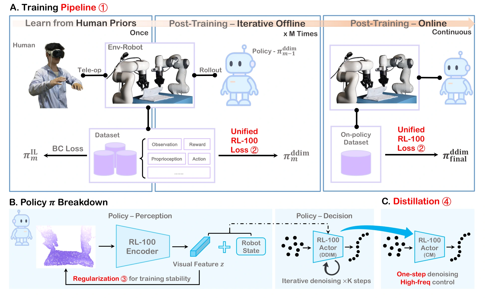

<!-- Generated by scripts/generate.py; edit data/works.json and data/media.json. -->

[← Back to the Awesome index](../../../README.md) · [Interactive website](https://chang-xinhai.github.io/Awesome-RGBDT-Manipulation/?collection=policy&item=rl100#library)

# RL-100

RL-100: Performant Robotic Manipulation with Real-World Reinforcement Learning

**2025-10-16 · Science Robotics 2026 (official repository) · Shanghai Qi Zhi Institute / Tsinghua University**

**[Paper](https://arxiv.org/abs/2510.14830)** · [Project](https://lei-kun.github.io/RL-100/) · [Code](https://github.com/Lei-Kun/RL-100) · [Data](https://huggingface.co/datasets/leokk/RL-100-adroit-door-medium)

Builds an imitation-to-RL data flywheel with iterative offline optimization, online refinement and one-step policy distillation.

*Lei et al. · [Figure source](https://arxiv.org/abs/2510.14830) · Original rights retained.*

| Field | Reported value and source scope |
| :-- | :-- |
| Record type | policy |
| Policy family | RL [1](https://arxiv.org/abs/2510.14830)  |
| Base model and architecture | 3D point-cloud or RGB encoder + diffusion/flow actor; critic and consistency-model distillation [1](https://arxiv.org/abs/2510.14830) [2](https://github.com/Lei-Kun/RL-100)  |
| Model size and component | Not reported [1](https://arxiv.org/abs/2510.14830)  |
| Deployment inputs | Measured-depth point clouds or RGB plus proprioception, depending on policy variant [1](https://arxiv.org/abs/2510.14830)  |
| Action outputs and horizon | Action chunks or single-action commands; one-step deployed consistency/flow actor [1](https://arxiv.org/abs/2510.14830)  |
| Training method | Behavior cloning → iterative offline policy-gradient RL → optional online RL → one-step distillation [1](https://arxiv.org/abs/2510.14830)  |
| Training data | Task-specific teleoperation initialization plus repeated real robot rollout aggregation; exact counts vary by task [1](https://arxiv.org/abs/2510.14830)  |
| Training duration | Full training wall-clock not reported; additional fine-tuning on each tested task variation takes1–3 h (excludes base-policy training) [1](https://arxiv.org/abs/2510.14830) [5](https://arxiv.org/pdf/2510.14830)  |
| Training hardware | Not reported [1](https://arxiv.org/abs/2510.14830)  |
| Inference and control rates | Real UR5: 30 Hz relative commands interpolated to 125 Hz; single-step camera pipeline capped at 30 Hz [1](https://arxiv.org/abs/2510.14830)  |
| Evaluation scope | Current v4: eight real tasks, including dynamic unscrewing, pouring, towel/box folding, Push-T, bowling and juicing [1](https://arxiv.org/abs/2510.14830)  |
| Observations / modalities | RGB · Depth · Proprioception |
| Evaluation domain | Simulation · Real world |
| Embodiment | Parallel-jaw gripper |
| Release: code | Available [2](https://github.com/Lei-Kun/RL-100)  |
| Release: weights | Not verified [2](https://github.com/Lei-Kun/RL-100)  |
| Release: data | Partial [2](https://github.com/Lei-Kun/RL-100)  |
| Release: license | Apache-2.0 (code); model and data terms not verified [2](https://github.com/Lei-Kun/RL-100) [4](https://raw.githubusercontent.com/Lei-Kun/RL-100/main/LICENSE)  |
| Release: notes | Official training/deployment library and an Adroit smoke-test dataset are released; complete real data/weights not verified. [2](https://github.com/Lei-Kun/RL-100)  |

**Scope and qualifications**

- Current v4 PDF reports eight tasks / 1,000 trials; older project and abstract versions report seven / 900.
- 100% is the observed evaluated success, not a guarantee of universal reliability.
- Released smoke-test dataset is Adroit simulation, not the complete real-robot collection.

**Primary evidence**

1. [Paper / technical report](https://arxiv.org/abs/2510.14830) — Main paper and supplementary implementation sections; v1 date retained.
2. [Official repository](https://github.com/Lei-Kun/RL-100) — Release and deployment scope checked in README.
3. [Author project page](https://lei-kun.github.io/RL-100/) — Official project, not an independent replication.
4. [Code license](https://raw.githubusercontent.com/Lei-Kun/RL-100/main/LICENSE) — Code license only; separately named pretrained models may have additional terms.
5. [Independent review:currentv4 generalization/few-shot adaptation experiments](https://arxiv.org/pdf/2510.14830) — The 1–3 h figure is additional training per task variation, not total real-world RL training cost.
