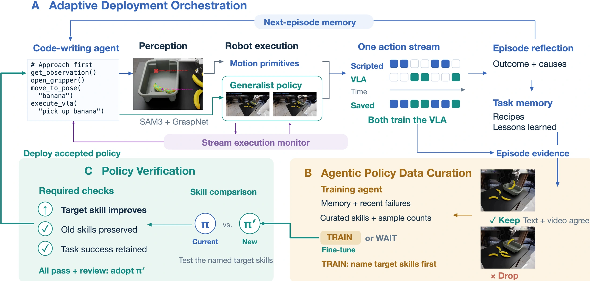

<!-- Generated by scripts/generate.py; edit data/works.json and data/media.json. -->

[← Back to the Awesome index](../../../README.md) · [Interactive website](https://chang-xinhai.github.io/Awesome-RGBDT-Manipulation/?collection=policy&item=robo-cop#library)

# Robo-COP

Co-Evolving Robot Orchestrators and Policies through Deployment

**2026-10-06 · Preprint · Not reported**

**[Paper](https://arxiv.org/abs/2610.09228)** · [Project](https://robo-cop.pages.dev)

Co-evolves a robot orchestrator and learned policy by selectively collecting skill-level data, training candidates and verifying whether to deploy them.

*Robo-COP authors · [Figure source](https://arxiv.org/abs/2610.09228) · Original rights retained.*

| Field | Reported value and source scope |
| :-- | :-- |
| Record type | policy |
| Policy family | Hybrid [1](https://arxiv.org/abs/2610.09228)  |
| Base model and architecture | Gemini 3.8 Flash orchestrator; π0.5-DROID initial VLA. [1](https://arxiv.org/abs/2610.09228)  |
| Model size and component | Not reported [1](https://arxiv.org/abs/2610.09228)  |
| Deployment inputs | Task, robot observations, memory, skill-level execution traces and training / verification outcomes. [1](https://arxiv.org/abs/2610.09228)  |
| Action outputs and horizon | Orchestrated scripted-motion and VLA calls; curated demonstrations, candidate policy checkpoints and deployment / rollback decisions. [1](https://arxiv.org/abs/2610.09228)  |
| Training method | Both memory / harness and VLA weights can change. A controller decides whether to wait, train, accept or revert rather than fine-tuning on a fixed schedule. [1](https://arxiv.org/abs/2610.09228)  |
| Training data | Skill-level successful segments can be recovered from episodes that fail overall; deployment traces accumulate for selective fine-tuning. [1](https://arxiv.org/abs/2610.09228)  |
| Training duration | Not reported [1](https://arxiv.org/abs/2610.09228)  |
| Training hardware | Not reported [1](https://arxiv.org/abs/2610.09228)  |
| Inference and control rates | Not reported [1](https://arxiv.org/abs/2610.09228)  |
| Evaluation scope | Ten selected RoboLab tasks with randomized objects and three real-robot tasks; memory-only and fixed-schedule comparisons. [1](https://arxiv.org/abs/2610.09228)  |
| Observations / modalities | RGB · Proprioception · Language |
| Evaluation domain | Simulation · Real world |
| Embodiment | Parallel-jaw gripper |
| Release: code | Not verified |
| Release: weights | Not verified |
| Release: data | Not verified |
| Release: license | Not verified |
| Release: notes | The paper is public; implementation and artifact availability require separate verification. |

**Scope and qualifications**

- The ten RoboLab tasks are a preselected subset covering the paper's operating regimes.
- Candidate training does not automatically imply deployment; verification and rollback are part of the method.

**Primary evidence**

1. [Primary paper, full text](https://arxiv.org/abs/2610.09228) — Publication date is the first arXiv submission. Policy fields distinguish model calls, controller execution and learning.
