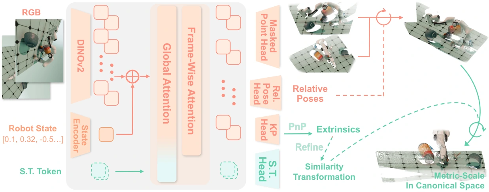

<!-- Generated by scripts/generate.py; edit data/works.json and data/media.json. -->

[← Back to the Awesome index](../../../README.md) · [Interactive website](https://chang-xinhai.github.io/Awesome-RGBDT-Manipulation/?collection=policy&item=robo3r#library)

# Robo3R

Robo3R: Enhancing Robotic Manipulation with Accurate Feed-Forward 3D Reconstruction

**2026-02-10 · arXiv preprint · Shanghai AI Laboratory; Chinese University of Hong Kong; USTC; Tsinghua University**

**[Paper](https://arxiv.org/abs/2602.10101)** · [Project](https://yangsizhe.github.io/robo3r/) · [Code](https://github.com/InternRobotics/Robo3R) · [Data](https://huggingface.co/datasets/yangsizhe/Robo3R) · [Weights](https://huggingface.co/yangsizhe/Robo3R)

Robot-conditioned feed-forward reconstruction provides metric geometry from RGB without a depth sensor.

*Robo3R authors · [Figure source](https://arxiv.org/html/2602.10101) · Original rights retained.*

| Field | Reported value and source scope |
| :-- | :-- |
| Record type | model |
| Model role and downstream interface | Robot-grounded metric 3D reconstruction front end [1](https://arxiv.org/abs/2602.10101)  |
| Model family | Geometry representation [1](https://arxiv.org/abs/2602.10101)  |
| Model architecture | Frozen DINOv2 ViT-L and π³-initialized 18-block alternating-attention transformer; robot-state fusion, masked point heads and robot-keypoint PnP. [1](https://arxiv.org/abs/2602.10101)  |
| Model size and component | Not reported in the inspected primary-source sections [1](https://arxiv.org/abs/2602.10101)  |
| Model inputs | RGB images and robot states/kinematic geometry. [1](https://arxiv.org/abs/2602.10101)  |
| Model outputs | Metric scene geometry and camera extrinsics aligned to the robot frame. [1](https://arxiv.org/abs/2602.10101)  |
| Training method | Synthetic geometry supervision and robot-grounded reconstruction learning. [1](https://arxiv.org/abs/2602.10101)  |
| Training data and scale | Robo3R-4M: four million annotated synthetic frames. [1](https://arxiv.org/abs/2602.10101)  |
| Training duration | Approximately six days [1](https://arxiv.org/abs/2602.10101)  |
| Training hardware | 32 NVIDIA RTX 4090 GPUs [1](https://arxiv.org/abs/2602.10101)  |
| Inference setting and runtime | Downstream system configured at 10 Hz on RTX 4090; reconstruction-only inference timings depend on view count (see Appendix C). [1](https://arxiv.org/abs/2602.10101)  |
| Downstream evaluation and scope | Downstream imitation learning, sim-to-real, grasp synthesis and collision-free planning with substituted geometry. [1](https://arxiv.org/abs/2602.10101)  |
| Observations / modalities | RGB · Proprioception |
| Evaluation domain | Simulation · Real world |
| Embodiment |  |
| Release: code | Available [2](https://github.com/InternRobotics/Robo3R) [4](https://github.com/InternRobotics/Robo3R/tree/main)  |
| Release: weights | Available [2](https://github.com/InternRobotics/Robo3R) [5](https://huggingface.co/yangsizhe/Robo3R)  |
| Release: data | Available [2](https://github.com/InternRobotics/Robo3R) [6](https://huggingface.co/datasets/yangsizhe/Robo3R)  |
| Release: license | Apache-2.0 for repository code; pretrained models, data and figure rights remain separate [2](https://github.com/InternRobotics/Robo3R) [3](https://github.com/InternRobotics/Robo3R/blob/main/LICENSE.txt)  |
| Release: notes | Official README links published Robo3R geometry checkpoints and Robo3R-4M data; downstream task policy artifacts are separate. [2](https://github.com/InternRobotics/Robo3R)  |

**Scope and qualifications**

- Geometry is RGB/robot-prior inferred; depth-sensor comparisons do not make model output a measured observation.
- Downstream agents/planners remain separate from the reconstruction model.

**Primary evidence**

1. [Original manuscript and first submission history](https://arxiv.org/abs/2602.10101) — Full author HTML method/evaluation/appendix inspected; depth observations, pseudo-labels and generated outputs retain distinct roles.
2. [Official implementation and release scope](https://github.com/InternRobotics/Robo3R) — Availability of research implementation does not establish public task-policy checkpoints.
3. [Actual license file in released source](https://github.com/InternRobotics/Robo3R/blob/main/LICENSE.txt) — Only source code covered by this file; not a blanket license for paper figures or upstream weights.
4. [Actual repository content inventory](https://github.com/InternRobotics/Robo3R/tree/main) — 73 tracked paths inspected; code release is distinguished from a README/project/figure-only repository.
5. [Official weights release destination](https://huggingface.co/yangsizhe/Robo3R) — Destination linked by the official project/repository; component release scope is retained in release notes.
6. [Official data release destination](https://huggingface.co/datasets/yangsizhe/Robo3R) — Destination linked by the official project/repository; component release scope is retained in release notes.
