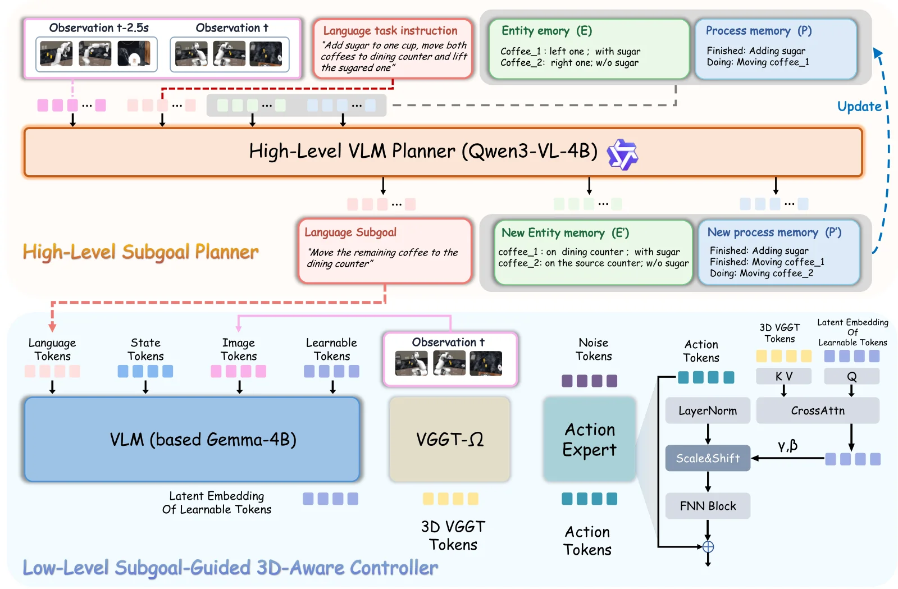

<!-- Generated by scripts/generate.py; edit data/works.json and data/media.json. -->

[← Back to the Awesome index](../../../README.md) · [Interactive website](https://chang-xinhai.github.io/Awesome-RGBDT-Manipulation/?collection=policy&item=robocasa-mem#library)

# RoboCasa-Mem

RoboCasa-Mem: Benchmarking Environment and Process Memory in Long-Horizon Mobile Manipulation

**2026-11-04 · Preprint · University of Science and Technology of China**

**[Paper](https://arxiv.org/abs/2611.06475)** · [Project](https://sihhangchen.github.io/RoboCasa-Mem/) · [Code](https://github.com/SiHhangChen/RoboCasa-Mem) · [Data](https://modelscope.cn/datasets/ouhebai/RoboCasa-Mem)

Nine mobile manipulation tasks and a hierarchical memory-augmented policy test decisions dependent on past observations and actions.

*RoboCasa-Mem authors · [Figure source](https://arxiv.org/abs/2611.06475) · Original rights retained.*

| Field | Reported value and source scope |
| :-- | :-- |
| Record type | policy |
| Policy family | Memory-augmented hierarchical policy [1](https://arxiv.org/abs/2611.06475)  |
| Base model and architecture | Qwen3-VL-4B planner, Gemma-based controller and VGGT-Ω geometry [1](https://arxiv.org/abs/2611.06475)  |
| Model size and component | Not reported [1](https://arxiv.org/abs/2611.06475)  |
| Deployment inputs | Current multi-view RGB and state, language subgoal and maintained entity/process memories. [1](https://arxiv.org/abs/2611.06475)  |
| Action outputs and horizon | Subgoals and low-level robot action commands. [1](https://arxiv.org/abs/2611.06475)  |
| Training method | Hierarchical symbolic memory planning with learned geometry-conditioned action controller. [1](https://arxiv.org/abs/2611.06475)  |
| Training data | Training on RoboCasa-Mem demonstrations; see original paper for schedules. [1](https://arxiv.org/abs/2611.06475)  |
| Training duration | Not reported [1](https://arxiv.org/abs/2611.06475)  |
| Training hardware | Not reported [1](https://arxiv.org/abs/2611.06475)  |
| Inference and control rates | Not reported [1](https://arxiv.org/abs/2611.06475)  |
| Evaluation scope | Nine simulated memory tasks; distinct physical mobile manipulation experiments. [1](https://arxiv.org/abs/2611.06475)  |
| Observations / modalities | RGB · Proprioception · Language |
| Evaluation domain | Simulation · Real world |
| Embodiment | Not reported |
| Release: code | Partial — simulation evaluation and configurations [2](https://github.com/SiHhangChen/RoboCasa-Mem)  |
| Release: weights | Not verified [2](https://github.com/SiHhangChen/RoboCasa-Mem)  |
| Release: data | Listed — simulator assets and demonstrations on ModelScope [2](https://github.com/SiHhangChen/RoboCasa-Mem)  |
| Release: license | MIT for code; asset and model licenses separate [2](https://github.com/SiHhangChen/RoboCasa-Mem)  |
| Release: notes | Repository version 0.1.0rc1 needs installed-wheel acceptance; real-robot integration removed. [2](https://github.com/SiHhangChen/RoboCasa-Mem)  |

**Scope and qualifications**

- The nine-task benchmark and 1,800 demonstrations are simulation; physical experiments are a separate setting.
- VGGT-derived geometry is inferred from images, not evidence of measured depth sensing.

**Primary evidence**

1. [Author paper or official project: methods and evaluation scope](https://arxiv.org/abs/2611.06475)
2. [Official repository: release inventory and scope](https://github.com/SiHhangChen/RoboCasa-Mem) — Release availability, assets and third-party licenses are independently scoped; no end-to-end reproduction is implied.
