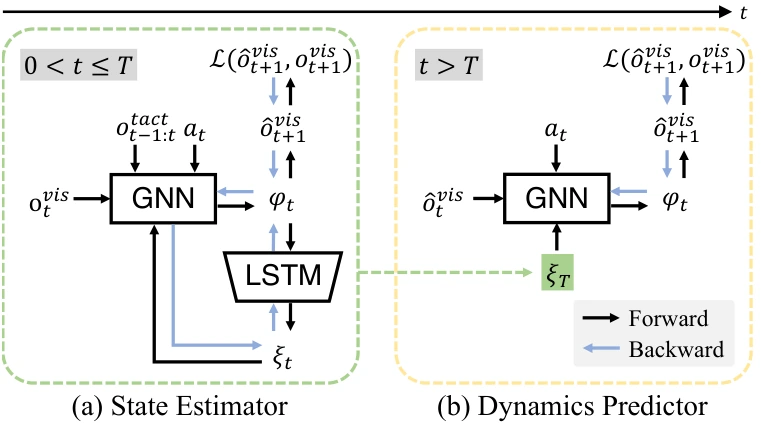

<!-- Generated by scripts/generate.py; edit data/works.json and data/media.json. -->

[← Back to the Awesome index](../../../README.md) · [Interactive website](https://chang-xinhai.github.io/Awesome-RGBDT-Manipulation/?collection=policy&item=robopack#library)

# RoboPack

RoboPack: Learning Tactile-Informed Dynamics Models for Dense Packing

**2024-07-01 · RSS 2024 · Stanford University / University of Illinois Urbana-Champaign / A*STAR**

**[Paper](https://arxiv.org/abs/2407.01418)** · [Project](https://robo-pack.github.io) · [Code](https://github.com/BoAi01/robopack)

Tactile-informed recurrent graph dynamics support predictive control for tool-use pushing and dense packing.

*RoboPack: Learning Tactile-Informed Dynamics Models for Dense Packing authors · [Figure source](https://arxiv.org/abs/2407.01418) · Original rights retained.*

| Field | Reported value and source scope |
| :-- | :-- |
| Record type | policy |
| Policy family | Model-based planning [1](https://arxiv.org/abs/2407.01418)  |
| Base model and architecture | Recurrent GNN particle/state/latent physics model with sampling-based MPC. [1](https://arxiv.org/abs/2407.01418)  |
| Model size and component | Not reported [1](https://arxiv.org/abs/2407.01418)  |
| Deployment inputs | Multi-viewRGB-D object key points and Soft Bubble tactile geometry/flow history. [1](https://arxiv.org/abs/2407.01418)  |
| Action outputs and horizon | Future object states for planning and robot motion actions. [1](https://arxiv.org/abs/2407.01418)  |
| Training method | Offline dynamics learning from teleoperated random interactions; online MPC. [1](https://arxiv.org/abs/2407.01418)  |
| Training data | Approximately 30 min real interaction/task on average; detailed cohorts include~12 k box-pushing frames and~6 k packing frames. [1](https://arxiv.org/abs/2407.01418)  |
| Training duration | Dynamics training converges within 25 h for non-prehensile pushing and 8 h for dense packing. [1](https://arxiv.org/abs/2407.01418)  |
| Training hardware | One NVIDIA RTX A5000 GPU. [1](https://arxiv.org/abs/2407.01418)  |
| Inference and control rates | Not reported [1](https://arxiv.org/abs/2407.01418)  |
| Evaluation scope | Franka Panda non-prehensile tool-use pushing and dense packing of rigid/deformable objects. [1](https://arxiv.org/abs/2407.01418)  |
| Observations / modalities | RGB · Depth · Tactile · Proprioception |
| Evaluation domain | Real world |
| Embodiment | Parallel-jaw gripper |
| Release: code | Available [2](https://robo-pack.github.io) [3](https://github.com/BoAi01/robopack)  |
| Release: weights | Not verified [2](https://robo-pack.github.io) [3](https://github.com/BoAi01/robopack)  |
| Release: data | Not verified [2](https://robo-pack.github.io) [3](https://github.com/BoAi01/robopack)  |
| Release: license | Not verified; no unambiguous repository license identified. [2](https://robo-pack.github.io) [3](https://github.com/BoAi01/robopack)  |
| Release: notes | Author-linked repository and actual LICENSE inspected; code, checkpoints anddatasets have independent availability. [2](https://robo-pack.github.io) [3](https://github.com/BoAi01/robopack)  |

**Scope and qualifications**

- Learned latent physics captures partially observed properties; not full-state oracle planning.

**Primary evidence**

1. [Original paper and supplementary implementation details](https://arxiv.org/abs/2407.01418) — Primary full text reviewed; dataset, deployment modalities and training-only privileges are scoped separately.
2. [Official author project](https://robo-pack.github.io) — Live artifact status reviewed separately from paper claims.
3. [Official released implementation and LICENSE](https://github.com/BoAi01/robopack) — Repository metadata,README and actualNone inspected; availability scoped to the listed component.
