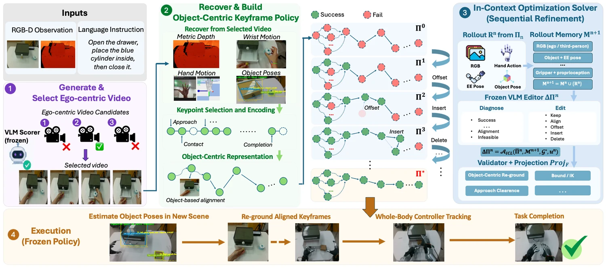

<!-- Generated by scripts/generate.py; edit data/works.json and data/media.json. -->

[← Back to the Awesome index](../../../README.md) · [Interactive website](https://chang-xinhai.github.io/Awesome-RGBDT-Manipulation/?collection=policy&item=roboreact#library)

# RoboReact

RoboReact: Agentic Skill Distillation from Generated Egocentric Videos for Generalizable Whole-Body Manipulation

**2026-08-04 · Preprint · The Chinese University of Hong Kong, Shenzhen**

**[Paper](https://arxiv.org/abs/2608.03387)** · [Project](https://roboreact.github.io/)

Generated interaction videos become object-centric dexterous keyframe programs; offline VLM refinement precedes frozen, perception-grounded execution.

*RoboReact authors; original rights retained · [Figure source](https://arxiv.org/abs/2608.03387) · Original rights retained.*

| Field | Reported value and source scope |
| :-- | :-- |
| Record type | policy |
| Policy family | Hybrid [1](https://arxiv.org/html/2608.03387)  |
| Base model and architecture | Video generator, VLM keyframe selector/code editor, WildDet3D pose estimation and HOMIE whole-body controller. [1](https://arxiv.org/html/2608.03387)  |
| Model size and component | Not reported [1](https://arxiv.org/html/2608.03387)  |
| Deployment inputs | Initial egocentric RGB-D/task; generated-video keyframes and calibration traces; current object pose/robot state during frozen execution. [1](https://arxiv.org/html/2608.03387)  |
| Action outputs and horizon | Object-centric end-effector/hand keyframes projected into feasible whole-body targets. [1](https://arxiv.org/html/2608.03387)  |
| Training method | Generate/select video, recover and retarget interaction keyframes; bounded VLM code edits from calibration rollouts; freeze skill before test. [1](https://arxiv.org/html/2608.03387)  |
| Training data | Generated interaction videos and task-specific calibration rollouts; no human task demonstration or policy-weight update is required by the reported refinement. [1](https://arxiv.org/html/2608.03387)  |
| Training duration | Not reported [1](https://arxiv.org/html/2608.03387)  |
| Training hardware | Offboard RTX 4080 Super for perception/high-level execution. [1](https://arxiv.org/html/2608.03387)  |
| Inference and control rates | Not reported [1](https://arxiv.org/html/2608.03387)  |
| Evaluation scope | G1 29DoF + dual Revo2 Touch hands; Hand Over, Open Box, Pour Water, Open Drawer and robustness/object/pose variants. [1](https://arxiv.org/html/2608.03387)  |
| Observations / modalities | RGB · Depth · Proprioception · Language |
| Evaluation domain | Real world |
| Embodiment | Dexterous hand · Bimanual · Humanoid |
| Release: code | Not verified |
| Release: weights | Not verified |
| Release: data | Not verified |
| Release: license | Not verified |
| Release: notes | The inspected primary sources do not establish a public implementation, model checkpoint or dataset download. Paper figures retain their original rights. |

**Scope and qualifications**

- The VLM participates in offline calibration/refinement and is absent from the test-time control loop. Online feedback re-grounds the frozen keyframe program.
- A BrainCo Revo2 Touch hand name does not establish tactile feedback in the reported policy.
- Real RGB-D is supplied by head RealSense D435i; a third-person D435 records calibration feedback.

**Primary evidence**

1. [Original full paper, methods and evaluation](https://arxiv.org/html/2608.03387) — Publication date is arXiv v1; implementation and deployment observations are distinguished from training supervision, generated geometry and base-model identity.
