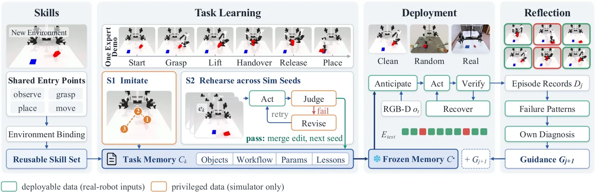

<!-- Generated by scripts/generate.py; edit data/works.json and data/media.json. -->

[← Back to the Awesome index](../../../README.md) · [Interactive website](https://chang-xinhai.github.io/Awesome-RGBDT-Manipulation/?collection=policy&item=roboscript-wicl#library)

# RoboScript / WICL

World In-Context Learning for Agentic Robot Manipulation

**2026-11-09 · Preprint · Huazhong University of Science and Technology**

**[Paper](https://arxiv.org/abs/2611.12885)** · [Project](https://archeone-ai.github.io/RoboScript/) · [Code](https://github.com/ArcheOne-AI/RoboScript)

A frozen model builds task memory from demonstration and simulated rehearsal, then deploys reusable skills.

*RoboScript / WICL authors · [Figure source](https://arxiv.org/abs/2611.12885) · Original rights retained.*

| Field | Reported value and source scope |
| :-- | :-- |
| Record type | policy |
| Policy family | Robot agent with in-context memory [1](https://arxiv.org/abs/2611.12885)  |
| Base model and architecture | Frozen foundation model [1](https://arxiv.org/abs/2611.12885)  |
| Model size and component | Not reported [1](https://arxiv.org/abs/2611.12885)  |
| Deployment inputs | Task instruction, demonstration, scene observations and rehearsal feedback; real system uses RGB-D. [1](https://arxiv.org/abs/2611.12885)  |
| Action outputs and horizon | Tool-mediated manipulation and task-memory updates. [1](https://arxiv.org/abs/2611.12885)  |
| Training method | Frozen model rehearses in simulation and stores task steps and corrections in context, not weight gradients. [1](https://arxiv.org/abs/2611.12885)  |
| Training data | One demonstration per task and simulation interaction; frozen task memory at evaluation. [1](https://arxiv.org/abs/2611.12885)  |
| Training duration | Not reported [1](https://arxiv.org/abs/2611.12885)  |
| Training hardware | Not reported [1](https://arxiv.org/abs/2611.12885)  |
| Inference and control rates | Not reported [1](https://arxiv.org/abs/2611.12885)  |
| Evaluation scope | 50 RoboTwin tasks in clean and randomized simulation; physical dual-arm cross-embodiment transfer. [1](https://arxiv.org/abs/2611.12885)  |
| Observations / modalities | RGB · Depth · Proprioception · Language |
| Evaluation domain | Simulation · Real world |
| Embodiment |  |
| Release: code | Available — public task runtime, simulation and real-robot adapters [2](https://archeone-ai.github.io/RoboScript/) [3](https://github.com/ArcheOne-AI/RoboScript)  |
| Release: weights | External foundation-model access varies [2](https://archeone-ai.github.io/RoboScript/) [3](https://github.com/ArcheOne-AI/RoboScript)  |
| Release: data | Not verified [2](https://archeone-ai.github.io/RoboScript/) [3](https://github.com/ArcheOne-AI/RoboScript)  |
| Release: license | Apache-2.0 repository; third-party components retain their terms [2](https://archeone-ai.github.io/RoboScript/) [3](https://github.com/ArcheOne-AI/RoboScript)  |
| Release: notes | Actual executable source tree inspected; hosted model and robot hardware require separate access. [2](https://archeone-ai.github.io/RoboScript/) [3](https://github.com/ArcheOne-AI/RoboScript)  |

**Scope and qualifications**

- Author score combines clean and randomized simulation and must not be interpreted as physical-robot success.

**Primary evidence**

1. [Original paper and first submission](https://arxiv.org/abs/2611.12885)
2. [Official project and release scope](https://archeone-ai.github.io/RoboScript/)
3. [Official code and release scope](https://github.com/ArcheOne-AI/RoboScript)
