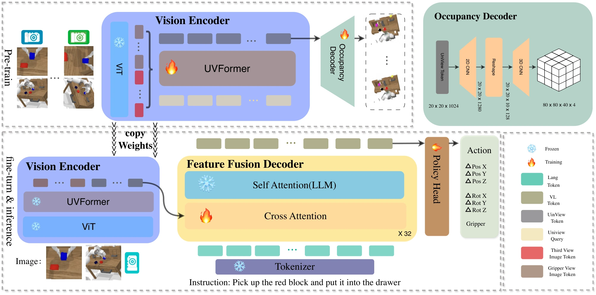

<!-- Generated by scripts/generate.py; edit data/works.json and data/media.json. -->

[← Back to the Awesome index](../../../README.md) · [Interactive website](https://chang-xinhai.github.io/Awesome-RGBDT-Manipulation/?collection=policy&item=robouniview#library)

# RoboUniView

RoboUniView: Visual-Language Model with Unified View Representation for Robotic Manipulation

**2024-06-27 · arXiv preprint · Meituan and collaborating authors; exact affiliations in primary manuscript**

**[Paper](https://arxiv.org/abs/2406.18977)** · [Code](https://github.com/liufanfanlff/RoboUniview)

A view-unified 3D representation decouples multi-camera perception from language-conditioned robot action learning.

*RoboUniView authors · [Figure source](https://arxiv.org/html/2406.18977) · Original rights retained.*

| Field | Reported value and source scope |
| :-- | :-- |
| Record type | policy |
| Policy family | VLA [1](https://arxiv.org/abs/2406.18977)  |
| Base model and architecture | UVFormer occupancy-pretrained representation with RoboFlamingo-derived policy. [1](https://arxiv.org/abs/2406.18977)  |
| Model size and component | Not reported in the inspected primary-source sections [1](https://arxiv.org/abs/2406.18977)  |
| Deployment inputs | Multi-view RGB, camera intrinsics/extrinsics, language and robot proprioception. [1](https://arxiv.org/abs/2406.18977)  |
| Action outputs and horizon | Continuous robot manipulation actions. [1](https://arxiv.org/abs/2406.18977)  |
| Training method | 3D occupancy view-representation pretraining followed by imitation action learning. [1](https://arxiv.org/abs/2406.18977)  |
| Training data | CALVIN and multi-camera/multi-dataset robot data. [1](https://arxiv.org/abs/2406.18977)  |
| Training duration | CALVIN D→D ~2 days; ABC→D ~5 days; camera experiments ~3 days [1](https://arxiv.org/abs/2406.18977)  |
| Training hardware | 8 NVIDIA A100 80GB GPUs [1](https://arxiv.org/abs/2406.18977)  |
| Inference and control rates | Not reported in the inspected primary-source sections [1](https://arxiv.org/abs/2406.18977)  |
| Evaluation scope | CALVIN D→D/ABC→D and unseen camera calibration settings. [1](https://arxiv.org/abs/2406.18977)  |
| Observations / modalities | RGB · Language · Proprioception |
| Evaluation domain | Simulation |
| Embodiment | Parallel-jaw gripper |
| Release: code | Available [2](https://github.com/liufanfanlff/RoboUniview) [3](https://github.com/liufanfanlff/RoboUniview/tree/main)  |
| Release: weights | Not verified [2](https://github.com/liufanfanlff/RoboUniview)  |
| Release: data | Not verified [2](https://github.com/liufanfanlff/RoboUniview)  |
| Release: license | Not verified [2](https://github.com/liufanfanlff/RoboUniview)  |
| Release: notes | Code, data and weights are checked independently; an upstream pretrained model is not a released task policy. [2](https://github.com/liufanfanlff/RoboUniview)  |

**Scope and qualifications**

- A calibrated 3D feature representation is not necessarily a measured depth observation; depth may provide occupancy supervision.

**Primary evidence**

1. [Original manuscript and first submission history](https://arxiv.org/abs/2406.18977) — Full author HTML method/evaluation/appendix inspected; depth observations, pseudo-labels and generated outputs retain distinct roles.
2. [Official implementation and release scope](https://github.com/liufanfanlff/RoboUniview) — Availability of research implementation does not establish public task-policy checkpoints.
3. [Actual repository content inventory](https://github.com/liufanfanlff/RoboUniview/tree/main) — 195 tracked paths inspected; code release is distinguished from a README/project/figure-only repository.
