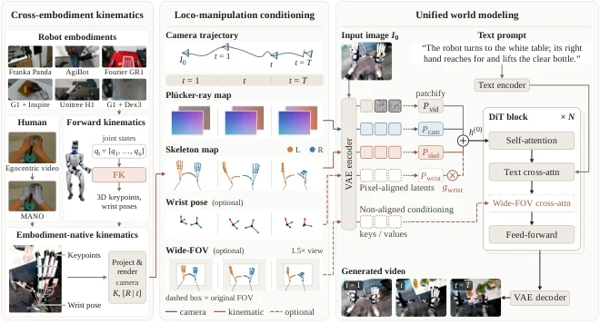

<!-- Generated by scripts/generate.py; edit data/works.json and data/media.json. -->

[← Back to the Awesome index](../../../README.md) · [Interactive website](https://chang-xinhai.github.io/Awesome-RGBDT-Manipulation/?collection=policy&item=ropedia-w0#library)

# Ropedia W0

Ropedia W0: Scaling Loco-Manipulation World Models across Embodiments with Human Experience

**2026-10-19 · Preprint · Nanyang Technological University**

**[Paper](https://arxiv.org/abs/2610.26855)** · [Project](https://ropedia.github.io/ropedia-w0/) · [Code](https://github.com/Ropedia/ropedia-w0) · [Data](https://huggingface.co/datasets/ropedia-ai/Xp-Teleop) · [Weights](https://huggingface.co/ropedia-ai/Ropedia-W0)

A cross-embodiment egocentric world model predicts visual consequences from shared camera-pose and projected-skeleton conditions.

*Ropedia W0 authors; original rights retained · [Figure source](https://arxiv.org/abs/2610.26855) · Original rights retained.*

| Field | Reported value and source scope |
| :-- | :-- |
| Record type | model |
| Model role and downstream interface | Kinematics-conditioned egocentric video world model, separate from downstream action-policy demonstrations. [1](https://arxiv.org/html/2610.26855)  |
| Model family | Video world model [1](https://arxiv.org/html/2610.26855)  |
| Model architecture | Wan2.2-TI2V-5B and A14B configurations; shared camera and skeleton conditioning. [1](https://arxiv.org/html/2610.26855)  |
| Model size and component | 5B and A14B; current public checkpoints 5B only. [1](https://arxiv.org/html/2610.26855)  |
| Model inputs | Initial RGB, text, camera intrinsics/extrinsics and projected human/robot skeletons; optional wide-FOV/wrist conditions. [1](https://arxiv.org/html/2610.26855)  |
| Model outputs | Predicted egocentric video under the supplied motion conditions. [1](https://arxiv.org/html/2610.26855)  |
| Training method | Human pretraining, robot/human midtraining and separate benchmark post-training; causal distillation for interactive streaming. [1](https://arxiv.org/html/2610.26855)  |
| Training data and scale | Xp-Data:≈10K human +3K robot hours; Xp-Teleop dexterous humanoid teleoperation held-out benchmark. [1](https://arxiv.org/html/2610.26855)  |
| Training duration | Not reported [1](https://arxiv.org/html/2610.26855)  |
| Training hardware | Release 5B inference verified by authors on H200; ≥40GBGPU,≈31GBpeak for 640×480/81 frames. [1](https://arxiv.org/html/2610.26855)  |
| Inference setting and runtime | Released diffusion clip generation and separate distilled-streaming application; video 30 fps is a recording/output rate. [1](https://arxiv.org/html/2610.26855)  |
| Downstream evaluation and scope | Five robot video benchmarks, held-out human clips and separately scoped planning/policy-evaluation applications. [1](https://arxiv.org/html/2610.26855)  |
| Observations / modalities | RGB · Proprioception · Language |
| Evaluation domain | Human interaction recordings · Real-world recordings |
| Embodiment |  |
| Release: code | Partial —5B inference [2](https://github.com/Ropedia/ropedia-w0) [3](https://huggingface.co/ropedia-ai/Ropedia-W0) [4](https://huggingface.co/datasets/ropedia-ai/Xp-Teleop)  |
| Release: weights | Partial —5B pretrained and midtrained safetensors [2](https://github.com/Ropedia/ropedia-w0) [3](https://huggingface.co/ropedia-ai/Ropedia-W0) [4](https://huggingface.co/datasets/ropedia-ai/Xp-Teleop)  |
| Release: data | Partial —Xp-Teleop; not the full 13K-hour mixed corpus [2](https://github.com/Ropedia/ropedia-w0) [3](https://huggingface.co/ropedia-ai/Ropedia-W0) [4](https://huggingface.co/datasets/ropedia-ai/Xp-Teleop)  |
| Release: license | Apache-2.0 code; CC BY-NC 4.0 model weights; CC BY 4.0 Xp-Teleop. Upstream model/data retain separate terms. [2](https://github.com/Ropedia/ropedia-w0) [3](https://huggingface.co/ropedia-ai/Ropedia-W0) [4](https://huggingface.co/datasets/ropedia-ai/Xp-Teleop)  |
| Release: notes | Actual 5B inference modules, two safetensor files and Xp-Teleop data are public. A14B, benchmark-finetuned checkpoints, post-training/evaluation code and benchmark data remain planned. [2](https://github.com/Ropedia/ropedia-w0) [3](https://huggingface.co/ropedia-ai/Ropedia-W0) [4](https://huggingface.co/datasets/ropedia-ai/Xp-Teleop)  |

**Scope and qualifications**

- The released world model generates video conditioned on kinematics, not direct motor actions. Paper downstream planning/WAM applications do not establish release of those policies.
- Camera poses, skeleton projections and metricized annotations are not a measured depth image input.
- 10K human +3K robot hours are a mixed training corpus; the released Xp-Teleop dataset is a distinct smaller contribution.

**Primary evidence**

1. [Original full paper, methods and evaluation](https://arxiv.org/html/2610.26855) — Publication date is arXiv v1; implementation and deployment observations are distinguished from training supervision, generated geometry and base-model identity.
2. [Official artifact: actual source files, inventory and license](https://github.com/Ropedia/ropedia-w0) — 144 real files and Apache LICENSE; two HF .safetensors, model-specific CC BY-NC license and 4,354 Xp-Teleop entries inspected.
3. [Official artifact inventory / model or dataset card](https://huggingface.co/ropedia-ai/Ropedia-W0) — Actual file inventory and artifact-specific terms checked independently; upstream checkpoints and equivalent dataset layouts are not double-counted.
4. [Official artifact inventory / model or dataset card](https://huggingface.co/datasets/ropedia-ai/Xp-Teleop) — Actual file inventory and artifact-specific terms checked independently; upstream checkpoints and equivalent dataset layouts are not double-counted.
