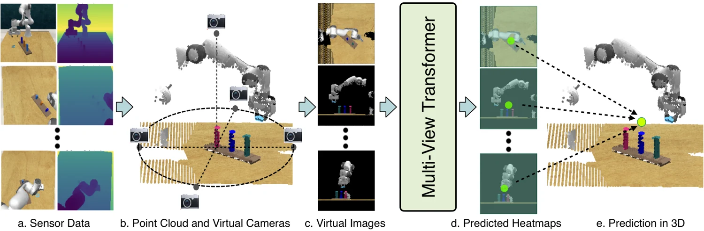

<!-- Generated by scripts/generate.py; edit data/works.json and data/media.json. -->

[← Back to the Awesome index](../../../README.md) · [Interactive website](https://chang-xinhai.github.io/Awesome-RGBDT-Manipulation/?collection=policy&item=rvt#library)

# RVT

RVT: Robotic View Transformer for 3D Object Manipulation

**2023-06-26 · CoRL 2023 · NVIDIA**

**[Paper](https://arxiv.org/abs/2306.14896)** · [Project](https://robotic-view-transformer.github.io/) · [Code](https://github.com/NVlabs/RVT) · [Weights](https://huggingface.co/ankgoyal/rvt/tree/main/rvt)

Projects RGB-D point clouds into virtual views and predicts 3 D keyposes with a multi-view Transformer.

*RVT authors · [Figure source](https://arxiv.org/abs/2306.14896) · Original rights retained.*

| Field | Reported value and source scope |
| :-- | :-- |
| Record type | policy |
| Policy family | Other [1](https://arxiv.org/abs/2306.14896)  |
| Base model and architecture | Multi-view Transformer + CLIP text encoder [1](https://arxiv.org/abs/2306.14896) [2](https://github.com/NVlabs/RVT)  |
| Model size and component | Not reported [1](https://arxiv.org/abs/2306.14896)  |
| Deployment inputs | Calibrated RGB-D, instruction and proprioceptive state [1](https://arxiv.org/abs/2306.14896)  |
| Action outputs and horizon | End-effector keypose, rotation, gripper and collision flag [1](https://arxiv.org/abs/2306.14896)  |
| Training method | Supervised keypose behavior cloning [1](https://arxiv.org/abs/2306.14896)  |
| Training data | 1,800 RLBench demos (100 × 18 tasks); 51 real demos over five tasks / 13 variations [1](https://arxiv.org/abs/2306.14896)  |
| Training duration | 24 h full RLBench training; matches PerAct peak earlier [1](https://arxiv.org/abs/2306.14896)  |
| Training hardware | 8 NVIDIA V100 GPUs [1](https://arxiv.org/abs/2306.14896)  |
| Inference and control rates | 11.6 FPS network inference on RTX 3090; motion-planning execution is separate [1](https://arxiv.org/abs/2306.14896)  |
| Evaluation scope | 18 RLBench tasks and real Franka manipulation [1](https://arxiv.org/abs/2306.14896)  |
| Observations / modalities | RGB · Depth · Proprioception · Language |
| Evaluation domain | Simulation · Real world |
| Embodiment | Parallel-jaw gripper |
| Release: code | Available [2](https://github.com/NVlabs/RVT)  |
| Release: weights | Available [2](https://github.com/NVlabs/RVT)  |
| Release: data | Not verified [2](https://github.com/NVlabs/RVT)  |
| Release: license | NVIDIA custom license (code); model and data terms not verified [2](https://github.com/NVlabs/RVT) [4](https://raw.githubusercontent.com/NVlabs/RVT/master/LICENSE)  |
| Release: notes | Availability refers to linked author release; no installation or training was performed. [2](https://github.com/NVlabs/RVT)  |

**Scope and qualifications**

- Virtual projections use measured depth and calibrated geometry.
- Training and network FPS exclude the physical duration of motion-planner execution.

**Primary evidence**

1. [Paper / technical report](https://arxiv.org/abs/2306.14896) — Main paper and supplementary implementation sections; v1 date retained.
2. [Official repository](https://github.com/NVlabs/RVT) — Release and deployment scope checked in README.
3. [Author project page](https://robotic-view-transformer.github.io/) — Official project, not an independent replication.
4. [Code license](https://raw.githubusercontent.com/NVlabs/RVT/master/LICENSE) — Code license only; separately named pretrained models may have additional terms.
