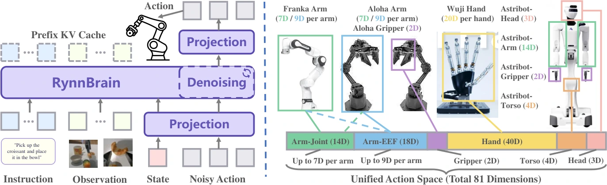

<!-- Generated by scripts/generate.py; edit data/works.json and data/media.json. -->

[← Back to the Awesome index](../../../README.md) · [Interactive website](https://chang-xinhai.github.io/Awesome-RGBDT-Manipulation/?collection=policy&item=rynnbrain-11-vla#library)

# RynnBrain 1.1 / RynnBrain-VLA

RynnBrain 1.1: Towards More Capable and Generalizable Embodied Foundation Model

**2026-07-20 · arXiv preprint · DAMO Academy, Alibaba Group; Hupan Lab**

**[Paper](https://arxiv.org/abs/2607.17977)** · [Project](https://alibaba-damo-academy.github.io/RynnBrain/) · [Code](https://github.com/alibaba-damo-academy/RynnBrain) · [Weights](https://huggingface.co/collections/Alibaba-DAMO-Academy/rynnbrain-11)

Native 3D/contact-point grounding supports a cross-embodiment VLA across humanoid and dexterous bimanual robots.

*RynnBrain 1.1 / RynnBrain-VLA authors · [Figure source](https://arxiv.org/html/2607.17977) · Original rights retained.*

| Field | Reported value and source scope |
| :-- | :-- |
| Record type | policy |
| Policy family | VLA [1](https://arxiv.org/abs/2607.17977)  |
| Base model and architecture | Qwen3.5-derived embodied brain with single-stream flow-matching DiT action adaptation and embodiment masking. [1](https://arxiv.org/abs/2607.17977)  |
| Model size and component | Foundation 2B / 9B / 122B-A10B; do not assign the largest model to every VLA experiment [1](https://arxiv.org/abs/2607.17977)  |
| Deployment inputs | RGB views, language and robot proprioception; no skin tactile observation claimed. [1](https://arxiv.org/abs/2607.17977)  |
| Action outputs and horizon | Unified padded action chunks with embodiment-specific masks. [1](https://arxiv.org/abs/2607.17977)  |
| Training method | Embodied 3D/contact pretraining followed by joint multi-task and multi-embodiment robot finetuning. [1](https://arxiv.org/abs/2607.17977)  |
| Training data | Embodied image/video grounding corpus plus separate physical robot demonstrations. [1](https://arxiv.org/abs/2607.17977)  |
| Training duration | Not reported in the inspected primary-source sections [1](https://arxiv.org/abs/2607.17977)  |
| Training hardware | Not reported in the inspected primary-source sections [1](https://arxiv.org/abs/2607.17977)  |
| Inference and control rates | Not reported in the inspected primary-source sections [1](https://arxiv.org/abs/2607.17977)  |
| Evaluation scope | Unitree G1, Astribot-S1 and Tianji-Wuji; long-horizon and cross-embodiment task comparisons. [1](https://arxiv.org/abs/2607.17977)  |
| Observations / modalities | RGB · Language · Proprioception |
| Evaluation domain | Real world |
| Embodiment | Humanoid · Dexterous hand · Bimanual |
| Release: code | Partial [2](https://alibaba-damo-academy.github.io/RynnBrain/) [3](https://github.com/alibaba-damo-academy/RynnBrain) [5](https://github.com/alibaba-damo-academy/RynnBrain/tree/main)  |
| Release: weights | Partial [2](https://alibaba-damo-academy.github.io/RynnBrain/) [3](https://github.com/alibaba-damo-academy/RynnBrain) [6](https://huggingface.co/collections/Alibaba-DAMO-Academy/rynnbrain-11)  |
| Release: data | Not verified [2](https://alibaba-damo-academy.github.io/RynnBrain/) [3](https://github.com/alibaba-damo-academy/RynnBrain)  |
| Release: license | Apache-2.0 for repository code; pretrained models, data and figure rights remain separate [2](https://alibaba-damo-academy.github.io/RynnBrain/) [3](https://github.com/alibaba-damo-academy/RynnBrain) [4](https://github.com/alibaba-damo-academy/RynnBrain/blob/main/LICENSE)  |
| Release: notes | Public 1.1 brain checkpoints and pretraining/evaluation tools; task-specific VLA-head checkpoints/deployment implementation not independently identified. [2](https://alibaba-damo-academy.github.io/RynnBrain/) [3](https://github.com/alibaba-damo-academy/RynnBrain)  |

**Scope and qualifications**

- Contact-point prediction is an image-based grounding target, not a tactile input stream.

**Primary evidence**

1. [Original manuscript and first submission history](https://arxiv.org/abs/2607.17977) — Full author HTML method/evaluation/appendix inspected; depth observations, pseudo-labels and generated outputs retain distinct roles.
2. [Official author project](https://alibaba-damo-academy.github.io/RynnBrain/) — Public author-linked project; figure and downstream scope verified separately.
3. [Official implementation and release scope](https://github.com/alibaba-damo-academy/RynnBrain) — Availability of research implementation does not establish public task-policy checkpoints.
4. [Actual license file in released source](https://github.com/alibaba-damo-academy/RynnBrain/blob/main/LICENSE) — Only source code covered by this file; not a blanket license for paper figures or upstream weights.
5. [Actual repository content inventory](https://github.com/alibaba-damo-academy/RynnBrain/tree/main) — 133 tracked paths inspected; code release is distinguished from a README/project/figure-only repository.
6. [Official weights release destination](https://huggingface.co/collections/Alibaba-DAMO-Academy/rynnbrain-11) — Destination linked by the official project/repository; component release scope is retained in release notes.
