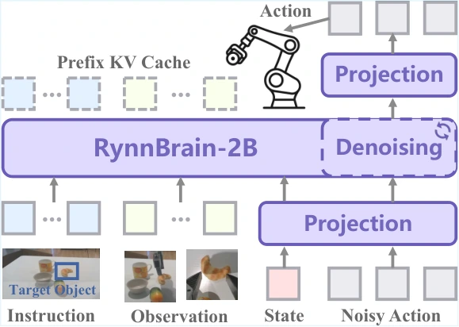

<!-- Generated by scripts/generate.py; edit data/works.json and data/media.json. -->

[← Back to the Awesome index](../../../README.md) · [Interactive website](https://chang-xinhai.github.io/Awesome-RGBDT-Manipulation/?collection=policy&item=rynnbrain-vla#library)

# RynnBrain / RynnBrain-VLA

RynnBrain: Open Embodied Foundation Models

**2026-02-13 · arXiv preprint · DAMO Academy, Alibaba Group; affiliated collaborators as original manuscript**

**[Paper](https://arxiv.org/abs/2602.14979)** · [Project](https://alibaba-damo-academy.github.io/RynnBrain/) · [Code](https://github.com/alibaba-damo-academy/RynnBrain/tree/rynnbrain1.0)

Embodied spatial pretraining is adapted to flow-matching robot control and point-grounded hierarchical planning.

*RynnBrain / RynnBrain-VLA authors · [Figure source](https://arxiv.org/html/2602.14979) · Original rights retained.*

| Field | Reported value and source scope |
| :-- | :-- |
| Record type | policy |
| Policy family | VLA [1](https://arxiv.org/abs/2602.14979)  |
| Base model and architecture | Qwen3-VL-derived RynnBrain; RynnBrain-2B used as single-stream flow-matching action transformer. [1](https://arxiv.org/abs/2602.14979)  |
| Model size and component | VLA uses 2B backbone; foundation family 2B/8B/30B-A3B is separate [1](https://arxiv.org/abs/2602.14979)  |
| Deployment inputs | Multi-view RGB, language/pointing instruction, initial frame and proprioception. [1](https://arxiv.org/abs/2602.14979)  |
| Action outputs and horizon | Continuous action chunks; base brain separately returns text, pointing and plans. [1](https://arxiv.org/abs/2602.14979)  |
| Training method | Embodied pretraining then 60K-step VLA finetuning; optional RynnBrain-Plan high-level loop. [1](https://arxiv.org/abs/2602.14979)  |
| Training data | Six teleoperated Franka pick-place tasks across three objects for VLA adaptation. [1](https://arxiv.org/abs/2602.14979)  |
| Training duration | VLA finetuning 60K steps; wall-clock not reported [1](https://arxiv.org/abs/2602.14979)  |
| Training hardware | Not reported in the inspected primary-source sections [1](https://arxiv.org/abs/2602.14979)  |
| Inference and control rates | Not reported in the inspected primary-source sections [1](https://arxiv.org/abs/2602.14979)  |
| Evaluation scope | Three multi-object physical task settings; ten trials/model/setting plus qualitative long-horizon planning. [1](https://arxiv.org/abs/2602.14979)  |
| Observations / modalities | RGB · Language · Proprioception |
| Evaluation domain | Real world |
| Embodiment | Parallel-jaw gripper |
| Release: code | Partial [2](https://alibaba-damo-academy.github.io/RynnBrain/) [3](https://github.com/alibaba-damo-academy/RynnBrain/tree/rynnbrain1.0) [5](https://github.com/alibaba-damo-academy/RynnBrain/tree/main)  |
| Release: weights | Partial [2](https://alibaba-damo-academy.github.io/RynnBrain/) [3](https://github.com/alibaba-damo-academy/RynnBrain/tree/rynnbrain1.0)  |
| Release: data | Not verified [2](https://alibaba-damo-academy.github.io/RynnBrain/) [3](https://github.com/alibaba-damo-academy/RynnBrain/tree/rynnbrain1.0)  |
| Release: license | Apache-2.0 for repository code; pretrained models, data and figure rights remain separate [2](https://alibaba-damo-academy.github.io/RynnBrain/) [3](https://github.com/alibaba-damo-academy/RynnBrain/tree/rynnbrain1.0) [4](https://github.com/alibaba-damo-academy/RynnBrain/blob/main/LICENSE)  |
| Release: notes | Open brain inference/model weights are verified; a complete physical VLA training/deployment stack and task-policy checkpoint are not identified. [2](https://alibaba-damo-academy.github.io/RynnBrain/) [3](https://github.com/alibaba-damo-academy/RynnBrain/tree/rynnbrain1.0)  |

**Scope and qualifications**

- Spatial/contact grounding is inferred from images, not skin tactile sensing or measured depth input.

**Primary evidence**

1. [Original manuscript and first submission history](https://arxiv.org/abs/2602.14979) — Full author HTML method/evaluation/appendix inspected; depth observations, pseudo-labels and generated outputs retain distinct roles.
2. [Official author project](https://alibaba-damo-academy.github.io/RynnBrain/) — Public author-linked project; figure and downstream scope verified separately.
3. [Official implementation and release scope](https://github.com/alibaba-damo-academy/RynnBrain/tree/rynnbrain1.0) — Availability of research implementation does not establish public task-policy checkpoints.
4. [Actual license file in released source](https://github.com/alibaba-damo-academy/RynnBrain/blob/main/LICENSE) — Only source code covered by this file; not a blanket license for paper figures or upstream weights.
5. [Actual repository content inventory](https://github.com/alibaba-damo-academy/RynnBrain/tree/main) — 133 tracked paths inspected; code release is distinguished from a README/project/figure-only repository.
