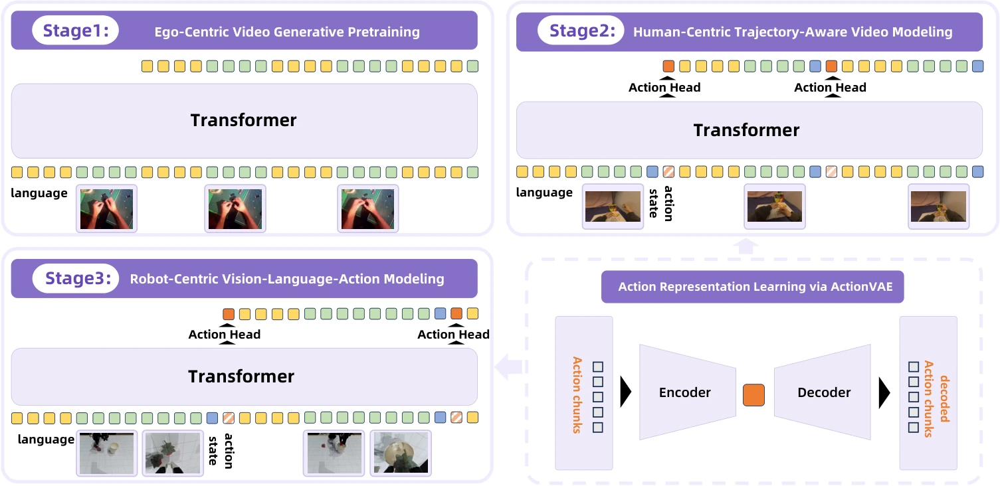

<!-- Generated by scripts/generate.py; edit data/works.json and data/media.json. -->

[← Back to the Awesome index](../../../README.md) · [Interactive website](https://chang-xinhai.github.io/Awesome-RGBDT-Manipulation/?collection=policy&item=rynnvla-001#library)

# RynnVLA-001

RynnVLA-001: Using Human Demonstrations to Improve Robot Manipulation

**2025-09-18 · ICRA 2026 · DAMO Academy, Alibaba Group; Hupan Lab**

**[Paper](https://arxiv.org/abs/2509.15212)** · [Project](https://alibaba-damo-academy.github.io/RynnVLA-001/) · [Code](https://github.com/alibaba-damo-academy/RynnVLA-001)

Human-video generative priors are transferred into a robot action policy.

*RynnVLA-001 authors · [Figure source](https://arxiv.org/html/2509.15212) · Original rights retained.*

| Field | Reported value and source scope |
| :-- | :-- |
| Record type | policy |
| Policy family | VLA [1](https://arxiv.org/abs/2509.15212)  |
| Base model and architecture | Lumina-mGPT / Chameleon-derived image-video-action architecture. [1](https://arxiv.org/abs/2509.15212)  |
| Model size and component | Not reported in the inspected primary-source sections [1](https://arxiv.org/abs/2509.15212)  |
| Deployment inputs | RGB observations, language and robot state as required by the released control setting. [1](https://arxiv.org/abs/2509.15212)  |
| Action outputs and horizon | Robot action sequences. [1](https://arxiv.org/abs/2509.15212)  |
| Training method | Human-demonstration generative pretraining followed by robot action finetuning. [1](https://arxiv.org/abs/2509.15212)  |
| Training data | Human demonstrations and robot manipulation trajectories; exact subset counts in manuscript. [1](https://arxiv.org/abs/2509.15212)  |
| Training duration | Not reported in the inspected primary-source sections [1](https://arxiv.org/abs/2509.15212)  |
| Training hardware | Not reported in the inspected primary-source sections [1](https://arxiv.org/abs/2509.15212)  |
| Inference and control rates | Not reported in the inspected primary-source sections [1](https://arxiv.org/abs/2509.15212)  |
| Evaluation scope | Simulated and physical manipulation transfer. [1](https://arxiv.org/abs/2509.15212)  |
| Observations / modalities | RGB · Language · Proprioception |
| Evaluation domain | Simulation · Real world |
| Embodiment | Parallel-jaw gripper |
| Release: code | Available [2](https://alibaba-damo-academy.github.io/RynnVLA-001/) [3](https://github.com/alibaba-damo-academy/RynnVLA-001) [5](https://github.com/alibaba-damo-academy/RynnVLA-001/tree/main)  |
| Release: weights | Not verified [2](https://alibaba-damo-academy.github.io/RynnVLA-001/) [3](https://github.com/alibaba-damo-academy/RynnVLA-001)  |
| Release: data | Not verified [2](https://alibaba-damo-academy.github.io/RynnVLA-001/) [3](https://github.com/alibaba-damo-academy/RynnVLA-001)  |
| Release: license | Apache-2.0 for repository code; pretrained models, data and figure rights remain separate [2](https://alibaba-damo-academy.github.io/RynnVLA-001/) [3](https://github.com/alibaba-damo-academy/RynnVLA-001) [4](https://github.com/alibaba-damo-academy/RynnVLA-001/blob/main/LICENSE)  |
| Release: notes | Code, data and weights are checked independently; an upstream pretrained model is not a released task policy. [2](https://alibaba-damo-academy.github.io/RynnVLA-001/) [3](https://github.com/alibaba-damo-academy/RynnVLA-001)  |

**Scope and qualifications**

- Included as a related Rynn policy foundation; the method does not establish measured-depth or tactile conditioning.

**Primary evidence**

1. [Original manuscript and first submission history](https://arxiv.org/abs/2509.15212) — Full author HTML method/evaluation/appendix inspected; depth observations, pseudo-labels and generated outputs retain distinct roles.
2. [Official author project](https://alibaba-damo-academy.github.io/RynnVLA-001/) — Public author-linked project; figure and downstream scope verified separately.
3. [Official implementation and release scope](https://github.com/alibaba-damo-academy/RynnVLA-001) — Availability of research implementation does not establish public task-policy checkpoints.
4. [Actual license file in released source](https://github.com/alibaba-damo-academy/RynnVLA-001/blob/main/LICENSE) — Only source code covered by this file; not a blanket license for paper figures or upstream weights.
5. [Actual repository content inventory](https://github.com/alibaba-damo-academy/RynnVLA-001/tree/main) — 72 tracked paths inspected; code release is distinguished from a README/project/figure-only repository.
