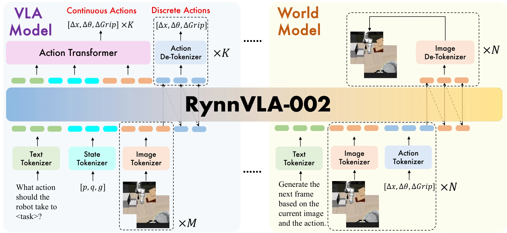

<!-- Generated by scripts/generate.py; edit data/works.json and data/media.json. -->

[← Back to the Awesome index](../../../README.md) · [Interactive website](https://chang-xinhai.github.io/Awesome-RGBDT-Manipulation/?collection=policy&item=rynnvla-002#library)

# RynnVLA-002

RynnVLA-002: A Unified Vision-Language-Action and World Model

**2025-11-21 · arXiv preprint · DAMO Academy, Alibaba Group; collaborating authors**

**[Paper](https://arxiv.org/abs/2511.17502)** · [Project](https://alibaba-damo-academy.github.io/RynnVLA-002/) · [Code](https://github.com/alibaba-damo-academy/RynnVLA-002)

A unified action/world model supports action prediction and imagined robot observations in one autoregressive system.

*RynnVLA-002 authors · [Figure source](https://arxiv.org/html/2511.17502) · Original rights retained.*

| Field | Reported value and source scope |
| :-- | :-- |
| Record type | policy |
| Policy family | World-action model [1](https://arxiv.org/abs/2511.17502)  |
| Base model and architecture | Unified VLA/world architecture with shared robot observations and action-conditioned image prediction. [1](https://arxiv.org/abs/2511.17502)  |
| Model size and component | Not reported in the inspected primary-source sections [1](https://arxiv.org/abs/2511.17502)  |
| Deployment inputs | RGB observations, language, robot state and candidate actions for world-model mode. [1](https://arxiv.org/abs/2511.17502)  |
| Action outputs and horizon | Robot actions or future observation tokens depending on mode. [1](https://arxiv.org/abs/2511.17502)  |
| Training method | Co-training action and world-model objectives with mode-specific attention. [1](https://arxiv.org/abs/2511.17502)  |
| Training data | Robot action data and observation-transition data; corpus scope as original manuscript. [1](https://arxiv.org/abs/2511.17502)  |
| Training duration | Not reported in the inspected primary-source sections [1](https://arxiv.org/abs/2511.17502)  |
| Training hardware | Not reported in the inspected primary-source sections [1](https://arxiv.org/abs/2511.17502)  |
| Inference and control rates | Not reported in the inspected primary-source sections [1](https://arxiv.org/abs/2511.17502)  |
| Evaluation scope | LIBERO and physical manipulation; distinguish action-mode execution from world-mode generation. [1](https://arxiv.org/abs/2511.17502)  |
| Observations / modalities | RGB · Language · Proprioception |
| Evaluation domain | Simulation · Real world |
| Embodiment | Parallel-jaw gripper |
| Release: code | Available [2](https://alibaba-damo-academy.github.io/RynnVLA-002/) [3](https://github.com/alibaba-damo-academy/RynnVLA-002) [4](https://github.com/alibaba-damo-academy/RynnVLA-002/tree/main)  |
| Release: weights | Not verified [2](https://alibaba-damo-academy.github.io/RynnVLA-002/) [3](https://github.com/alibaba-damo-academy/RynnVLA-002)  |
| Release: data | Not verified [2](https://alibaba-damo-academy.github.io/RynnVLA-002/) [3](https://github.com/alibaba-damo-academy/RynnVLA-002)  |
| Release: license | Not verified [2](https://alibaba-damo-academy.github.io/RynnVLA-002/) [3](https://github.com/alibaba-damo-academy/RynnVLA-002)  |
| Release: notes | Code, data and weights are checked independently; an upstream pretrained model is not a released task policy. [2](https://alibaba-damo-academy.github.io/RynnVLA-002/) [3](https://github.com/alibaba-damo-academy/RynnVLA-002)  |

**Scope and qualifications**

- Related Rynn family coverage; future RGB generation alone is not depth or tactile sensing.

**Primary evidence**

1. [Original manuscript and first submission history](https://arxiv.org/abs/2511.17502) — Full author HTML method/evaluation/appendix inspected; depth observations, pseudo-labels and generated outputs retain distinct roles.
2. [Official author project](https://alibaba-damo-academy.github.io/RynnVLA-002/) — Public author-linked project; figure and downstream scope verified separately.
3. [Official implementation and release scope](https://github.com/alibaba-damo-academy/RynnVLA-002) — Availability of research implementation does not establish public task-policy checkpoints.
4. [Actual repository content inventory](https://github.com/alibaba-damo-academy/RynnVLA-002/tree/main) — 209 tracked paths inspected; code release is distinguished from a README/project/figure-only repository.
