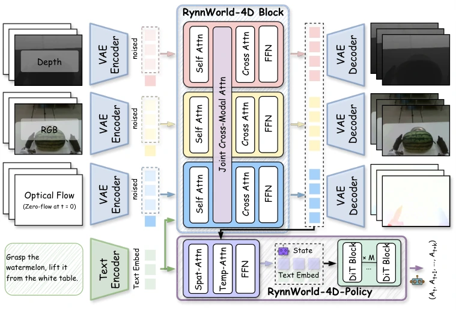

<!-- Generated by scripts/generate.py; edit data/works.json and data/media.json. -->

[← Back to the Awesome index](../../../README.md) · [Interactive website](https://chang-xinhai.github.io/Awesome-RGBDT-Manipulation/?collection=policy&item=rynnworld-4d#library)

# RynnWorld-4D / RynnWorld-4D-Policy

RynnWorld-4D: 4D Embodied World Models for Robotic Manipulation

**2026-07-07 · arXiv preprint · DAMO Academy, Alibaba Group; Hupan Lab; CUHK; Hong Kong Embodied AI Lab**

**[Paper](https://arxiv.org/abs/2607.06559)** · [Project](https://alibaba-damo-academy.github.io/RynnWorld-4D.github.io/) · [Code](https://github.com/alibaba-damo-academy/RynnWorld-4D) · [Weights](https://huggingface.co/Alibaba-DAMO-Academy/RynnWorld-4D)

A tri-branch RGB/depth/flow world model provides frozen 4D latents to a dexterous bimanual flow-matching action head.

*RynnWorld-4D / RynnWorld-4D-Policy authors · [Figure source](https://arxiv.org/html/2607.06559) · Original rights retained.*

| Field | Reported value and source scope |
| :-- | :-- |
| Record type | policy |
| Policy family | World-action model [1](https://arxiv.org/abs/2607.06559)  |
| Base model and architecture | Wan2.2-TI2V-5B-derived tri-branch DiT; Flow Former and VPP-derived action head. [1](https://arxiv.org/abs/2607.06559) [5](https://github.com/alibaba-damo-academy/RynnWorld-4D/blob/main/rynnworld4d_policy/README.md)  |
| Model size and component | Wan 5B initialization; full tri-branch and action-head parameter totals not reported [1](https://arxiv.org/abs/2607.06559)  |
| Deployment inputs | Head RGB, language, 54-D proprioception; current deployment estimates depth with Depth Anything 3 (DA3) rather than requiring measured depth. [1](https://arxiv.org/abs/2607.06559) [5](https://github.com/alibaba-damo-academy/RynnWorld-4D/blob/main/rynnworld4d_policy/README.md)  |
| Action outputs and horizon | Ten-step chunks of 54-D dual-arm/hand joint commands; the world model separately generates RGB, depth and flow. [1](https://arxiv.org/abs/2607.06559) [5](https://github.com/alibaba-damo-academy/RynnWorld-4D/blob/main/rynnworld4d_policy/README.md)  |
| Training method | Three-stage world-model adaptation; frozen backbone with flow-matching head trained for 100 epochs. [1](https://arxiv.org/abs/2607.06559)  |
| Training data | 254.4M video frames with pseudo depth/flow; Tianji demonstrations for the action head. [1](https://arxiv.org/abs/2607.06559)  |
| Training duration | Not reported in the inspected primary-source sections [1](https://arxiv.org/abs/2607.06559)  |
| Training hardware | Not reported in the inspected primary-source sections [1](https://arxiv.org/abs/2607.06559)  |
| Inference and control rates | RTX 5090 FP8: 1,106 ms/forward (~0.9 Hz observation refresh); ten-action chunks yield author-reported ~9 Hz effective action rate. [1](https://arxiv.org/abs/2607.06559)  |
| Evaluation scope | Six real Tianji-Wuji tasks: dual picking, block pushing, hand-over, bimanual lifting, lid placement, bowl stacking; 35 trials each. [1](https://arxiv.org/abs/2607.06559)  |
| Observations / modalities | RGB · Language · Proprioception |
| Evaluation domain | Simulation · Real world |
| Embodiment | Dexterous hand · Bimanual |
| Release: code | Available [2](https://alibaba-damo-academy.github.io/RynnWorld-4D.github.io/) [3](https://github.com/alibaba-damo-academy/RynnWorld-4D) [7](https://github.com/alibaba-damo-academy/RynnWorld-4D/tree/main)  |
| Release: weights | Partial [2](https://alibaba-damo-academy.github.io/RynnWorld-4D.github.io/) [3](https://github.com/alibaba-damo-academy/RynnWorld-4D) [4](https://huggingface.co/api/models/Alibaba-DAMO-Academy/RynnWorld-4D)  |
| Release: data | Partial [2](https://alibaba-damo-academy.github.io/RynnWorld-4D.github.io/) [3](https://github.com/alibaba-damo-academy/RynnWorld-4D) [5](https://github.com/alibaba-damo-academy/RynnWorld-4D/blob/main/rynnworld4d_policy/README.md)  |
| Release: license | Apache-2.0 for repository code; pretrained models, data and figure rights remain separate [2](https://alibaba-damo-academy.github.io/RynnWorld-4D.github.io/) [3](https://github.com/alibaba-damo-academy/RynnWorld-4D) [6](https://github.com/alibaba-damo-academy/RynnWorld-4D/blob/main/LICENSE)  |
| Release: notes | World-model weights verified in HF file listing. Separate trained task-policy head weights not identified; three Tianji sample episodes ship with code. [2](https://alibaba-damo-academy.github.io/RynnWorld-4D.github.io/) [3](https://github.com/alibaba-damo-academy/RynnWorld-4D)  |

**Scope and qualifications**

- Estimated input depth, pseudo depth labels and generated future depth are distinct from sensor-measured depth.
- The advertised 9 Hz is a chunk-derived action rate; the heavy visual backbone does not refresh observations at 9 Hz.

**Primary evidence**

1. [Original manuscript and first submission history](https://arxiv.org/abs/2607.06559) — Full author HTML method/evaluation/appendix inspected; depth observations, pseudo-labels and generated outputs retain distinct roles.
2. [Official author project](https://alibaba-damo-academy.github.io/RynnWorld-4D.github.io/) — Public author-linked project; figure and downstream scope verified separately.
3. [Official implementation and release scope](https://github.com/alibaba-damo-academy/RynnWorld-4D) — Availability of research implementation does not establish public task-policy checkpoints.
4. [Actual checkpoint file inventory](https://huggingface.co/api/models/Alibaba-DAMO-Academy/RynnWorld-4D) — ema_weights.pt and model-state files present; no separate task-policy-head checkpoint identified.
5. [Policy implementation details](https://github.com/alibaba-damo-academy/RynnWorld-4D/blob/main/rynnworld4d_policy/README.md) — DA3 inference dependency, 54-D observation.state, four-step Euler action head and three sample episodes.
6. [Actual license file in released source](https://github.com/alibaba-damo-academy/RynnWorld-4D/blob/main/LICENSE) — Only source code covered by this file; not a blanket license for paper figures or upstream weights.
7. [Actual repository content inventory](https://github.com/alibaba-damo-academy/RynnWorld-4D/tree/main) — 360 tracked paths inspected; code release is distinguished from a README/project/figure-only repository.
8. [Official weights release destination](https://huggingface.co/Alibaba-DAMO-Academy/RynnWorld-4D) — Destination linked by the official project/repository; component release scope is retained in release notes.
