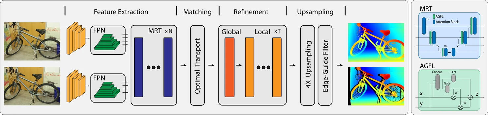

<!-- Generated by scripts/generate.py; edit data/works.json and data/media.json. -->

[← Back to the Awesome index](../../../README.md) · [Interactive website](https://chang-xinhai.github.io/Awesome-RGBDT-Manipulation/?collection=policy&item=s2m2#library)

# S²M²

S²M²: Scalable Stereo Matching Model for Reliable Depth Estimation

**2025-07-17 · ICCV 2025 · Samsung Electronics**

**[Paper](https://arxiv.org/abs/2507.13229)** · [Project](https://junhong-3dv.github.io/s2m2-project/) · [Code](https://github.com/junhong-3dv/s2m2) · [Weights](https://huggingface.co/minimok/s2m2) · [Training Supplement](https://openaccess.thecvf.com/content/ICCV2025/supplemental/Min_S2M2_Scalable_Stereo_ICCV_2025_supplemental.pdf)

A scalable stereo network produces disparity, occlusion and confidence. The public supplement documents the training data and its staged expansion.

*S²M² authors · [Figure source](https://arxiv.org/html/2507.13229v1) · Original rights retained.*

| Field | Reported value and source scope |
| :-- | :-- |
| Record type | model |
| Model role and downstream interface | Geometry perception model [1](https://arxiv.org/html/2507.13229v1)  |
| Model family | Stereo matching [1](https://arxiv.org/html/2507.13229v1)  |
| Model architecture | Global matching, iterative refinement and selective multiscale feature transfer. [1](https://arxiv.org/html/2507.13229v1)  |
| Model size and component | Official current S/M/L/XL checkpoints list 26.5M/80.4M/181M/406M parameters. [1](https://arxiv.org/html/2507.13229v1) [4](https://github.com/junhong-3dv/s2m2)  |
| Model inputs | Rectified left and right RGB frames. [1](https://arxiv.org/html/2507.13229v1)  |
| Model outputs | Dense disparity, occlusion and confidence. [1](https://arxiv.org/html/2507.13229v1)  |
| Training method | Phase 1 single-stage training at 768 × 448, then expanded fixed-resolution fine-tuning and a multiresolution pass. [1](https://arxiv.org/html/2507.13229v1) [3](https://openaccess.thecvf.com/content/ICCV2025/supplemental/Min_S2M2_Scalable_Stereo_ICCV_2025_supplemental.pdf)  |
| Training data and scale | Phase 1: approximately 0.5M pairs from SceneFlow, TartanAir and CREStereo. Benchmark adaptation: up to 2M pairs, including FSD, IRS, Falling Things, Virtual KITTI 2, DrivingStereo and SMD-Net. The complete recipe is in Supplement §1.1. [1](https://arxiv.org/html/2507.13229v1) [3](https://openaccess.thecvf.com/content/ICCV2025/supplemental/Min_S2M2_Scalable_Stereo_ICCV_2025_supplemental.pdf)  |
| Training duration | Not reported [1](https://arxiv.org/html/2507.13229v1)  |
| Training hardware | 8 NVIDIA H100 GPUs for the final multiresolution stage. [1](https://arxiv.org/html/2507.13229v1) [3](https://openaccess.thecvf.com/content/ICCV2025/supplemental/Min_S2M2_Scalable_Stereo_ICCV_2025_supplemental.pdf)  |
| Inference setting and runtime | Optional ONNX/TensorRT export; hardware, model size and refinement steps affect runtime. [1](https://arxiv.org/html/2507.13229v1)  |
| Downstream evaluation and scope | Evaluated on held-out stereo benchmarks including Middlebury, ETH3D and KITTI. Some reported variants differ in training data or benchmark-specific adaptation. [1](https://arxiv.org/html/2507.13229v1)  |
| Observations / modalities | RGB |
| Evaluation domain |  |
| Embodiment |  |
| Release: code | Available — official inference and export source [2](https://junhong-3dv.github.io/s2m2-project/) [4](https://github.com/junhong-3dv/s2m2)  |
| Release: weights | Available — S, M, L and XL checkpoints [2](https://junhong-3dv.github.io/s2m2-project/) [4](https://github.com/junhong-3dv/s2m2)  |
| Release: data | Named constituent datasets; the full mixed package was not identified [2](https://junhong-3dv.github.io/s2m2-project/) [4](https://github.com/junhong-3dv/s2m2)  |
| Release: license | CC BY-NC 4.0 in the repository LICENSE.md; each constituent dataset retains independent terms. [2](https://junhong-3dv.github.io/s2m2-project/) [4](https://github.com/junhong-3dv/s2m2) [5](https://github.com/junhong-3dv/s2m2/blob/main/LICENSE.md)  |
| Release: notes | The manuscript’s experimental mixtures and the current checkpoints are described separately. [2](https://junhong-3dv.github.io/s2m2-project/) [4](https://github.com/junhong-3dv/s2m2)  |

**Scope and qualifications**

- Metric conversion needs the calibrated stereo geometry. Confidence output is a model estimate.

**Primary evidence**

1. [Original author paper or dataset description](https://arxiv.org/html/2507.13229v1)
2. [Author source and artifact entry points](https://junhong-3dv.github.io/s2m2-project/)
3. [ICCV supplement, §1.1, staged training and samples](https://openaccess.thecvf.com/content/ICCV2025/supplemental/Min_S2M2_Scalable_Stereo_ICCV_2025_supplemental.pdf)
4. [Official implementation, published model binaries and sizes](https://github.com/junhong-3dv/s2m2)
5. [Actual source license file](https://github.com/junhong-3dv/s2m2/blob/main/LICENSE.md)
