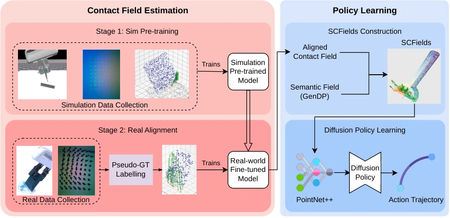

<!-- Generated by scripts/generate.py; edit data/works.json and data/media.json. -->

[← Back to the Awesome index](../../../README.md) · [Interactive website](https://chang-xinhai.github.io/Awesome-RGBDT-Manipulation/?collection=policy&item=scfields#library)

# SCFields

Semantic-Contact Fields for Category-Level Generalizable Tactile Tool Manipulation

**2026-02-14 · RSS2026 · A*STAR / National University of Singapore / Nanyang Technological University**

**[Paper](https://arxiv.org/abs/2602.13833)** · [Project](https://kevinskwk.github.io/SCFields/) · [Code](https://github.com/Kevinskwk/SCFields) · [Data](https://huggingface.co/datasets/Kevinskwk/scfields-release)

Semantic-contact fields combine RGB-D semantics and inferred extrinsic contact force for category-level tactile tool manipulation.

*Semantic-Contact Fields for Category-Level Generalizable Tactile Tool Manipulation authors · [Figure source](https://arxiv.org/abs/2602.13833) · Original rights retained.*

| Field | Reported value and source scope |
| :-- | :-- |
| Record type | policy |
| Policy family | Diffusion [1](https://arxiv.org/abs/2602.13833)  |
| Base model and architecture | GenDP-style diffusion policy conditioned on dense semantic/contact point fields. [1](https://arxiv.org/abs/2602.13833)  |
| Model size and component | Not reported [1](https://arxiv.org/abs/2602.13833)  |
| Deployment inputs | Calibrated RGB-D observations, two GelSight Mini tactile streams and robot state. [1](https://arxiv.org/abs/2602.13833)  |
| Action outputs and horizon | Robot end-effector/gripper actions for tool use. [1](https://arxiv.org/abs/2602.13833)  |
| Training method | Two-stage contact physics/real sensor alignment followed by diffusion imitation. [1](https://arxiv.org/abs/2602.13833)  |
| Training data | Simulation contact pretraining, small real pseudo-labeled contact alignment set; scraper policy 150 demos across 4 tools/3 heights, separate crayon/peeler datasets. [1](https://arxiv.org/abs/2602.13833)  |
| Training duration | Contact-field simulation pretraining400 epochs, real alignment60 epochs; downstream policy1000 epochs. Wall-clock time Not reported. [1](https://arxiv.org/abs/2602.13833)  |
| Training hardware | Not reported [1](https://arxiv.org/abs/2602.13833)  |
| Inference and control rates | Not reported [1](https://arxiv.org/abs/2602.13833)  |
| Evaluation scope | Franka Panda scraping, crayon drawing, peeling; seen/unseen tool variants and surface heights. [1](https://arxiv.org/abs/2602.13833)  |
| Observations / modalities | RGB · Depth · Tactile · Proprioception |
| Evaluation domain | Simulation · Real world |
| Embodiment | Parallel-jaw gripper |
| Release: code | Available [2](https://kevinskwk.github.io/SCFields/) [3](https://github.com/Kevinskwk/SCFields) [4](https://huggingface.co/datasets/Kevinskwk/scfields-release)  |
| Release: weights | Available [2](https://kevinskwk.github.io/SCFields/) [3](https://github.com/Kevinskwk/SCFields) [4](https://huggingface.co/datasets/Kevinskwk/scfields-release)  |
| Release: data | Available [2](https://kevinskwk.github.io/SCFields/) [3](https://github.com/Kevinskwk/SCFields) [4](https://huggingface.co/datasets/Kevinskwk/scfields-release)  |
| Release: license | MIT top-level code; third-party component licenses preserved separately. [2](https://kevinskwk.github.io/SCFields/) [3](https://github.com/Kevinskwk/SCFields) [4](https://huggingface.co/datasets/Kevinskwk/scfields-release)  |
| Release: notes | Author-linked repository and actual LICENSE inspected; code, checkpoints anddatasets have independent availability. [2](https://kevinskwk.github.io/SCFields/) [3](https://github.com/Kevinskwk/SCFields) [4](https://huggingface.co/datasets/Kevinskwk/scfields-release)  |

**Scope and qualifications**

- Real extrinsic contact targets are pseudo-labels from geometric heuristics/force optimization, not dense ground-truth force instrumentation.
- Hosted contact-field checkpoints do not imply every downstream robot policy checkpoint is published.

**Primary evidence**

1. [Original paper and supplementary implementation details](https://arxiv.org/abs/2602.13833) — Primary full text reviewed; dataset, deployment modalities and training-only privileges are scoped separately.
2. [Official author project](https://kevinskwk.github.io/SCFields/) — Live artifact status reviewed separately from paper claims.
3. [Official released implementation and LICENSE](https://github.com/Kevinskwk/SCFields) — Repository metadata,README and actualLICENSE inspected; availability scoped to the listed component.
4. [Author-linked released dataset](https://huggingface.co/datasets/Kevinskwk/scfields-release) — Public repository file inventory inspected; component/data scope follows model/dataset card.
