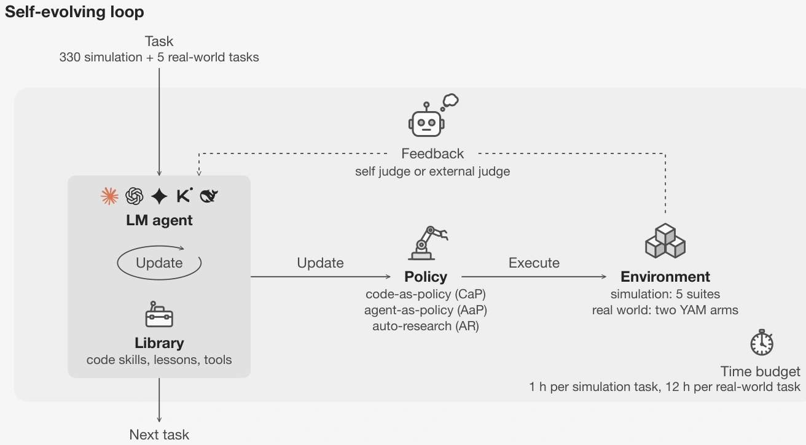

<!-- Generated by scripts/generate.py; edit data/works.json and data/media.json. -->

[← Back to the Awesome index](../../../README.md) · [Interactive website](https://chang-xinhai.github.io/Awesome-RGBDT-Manipulation/?collection=policy&item=sear#library)

# SEAR

SEAR: Self-Evolving Agentic Robotics

**2026-10-13 · Preprint · Luma AI**

**[Paper](https://arxiv.org/abs/2610.18792)** · [Project](https://sear.bot/) · [Code](https://github.com/Self-Evolving-Agentic-Robotics/SEAR)

Studies self-evolving robotics through code policies, online agents and automated learned-policy research, with explicit measurements of transfer and negative transfer.

*SEAR authors · [Figure source](https://arxiv.org/abs/2610.18792) · Original rights retained.*

| Field | Reported value and source scope |
| :-- | :-- |
| Record type | policy |
| Policy family | Hybrid [1](https://arxiv.org/abs/2610.18792)  |
| Base model and architecture | Seven language-model backbones under code-as-policy, agent-as-policy and auto-research configurations; learned robot policies belong to the auto-research branch. [1](https://arxiv.org/abs/2610.18792)  |
| Model size and component | Not reported [1](https://arxiv.org/abs/2610.18792)  |
| Deployment inputs | Robot observations, task context and persistent skills / memory; simulator and tool interfaces depend on the evaluated branch. [1](https://arxiv.org/abs/2610.18792)  |
| Action outputs and horizon | Executable code policies, live agent actions, or revised learned-policy training pipelines, depending on the branch. [1](https://arxiv.org/abs/2610.18792)  |
| Training method | Code / memory evolution in frozen-model branches; auto-research can update learned-policy training. Skill transfer and failure-memory transfer are evaluated separately. [1](https://arxiv.org/abs/2610.18792)  |
| Training data | 330 simulated tasks in two engines and five real-robot tasks; the paper reports over four years of aggregate experiment runtime. [1](https://arxiv.org/abs/2610.18792)  |
| Training duration | Not reported [1](https://arxiv.org/abs/2610.18792)  |
| Training hardware | Not reported [1](https://arxiv.org/abs/2610.18792)  |
| Inference and control rates | Not reported [1](https://arxiv.org/abs/2610.18792)  |
| Evaluation scope | 330 simulation tasks, five real-robot tasks and typing / piano studies across multiple agent and policy configurations. [1](https://arxiv.org/abs/2610.18792)  |
| Observations / modalities | RGB · Proprioception · Language |
| Evaluation domain | Simulation · Real world |
| Embodiment | Parallel-jaw gripper · Bimanual · Dexterous hand |
| Release: code | Partial |
| Release: weights | Not verified |
| Release: data | Not verified |
| Release: license | MIT license is visible in the placeholder repository; downstream artifacts need separate terms. |
| Release: notes | The public repository currently contains a project README / assets and says implementation is coming soon; it is not a full released system. |

**Scope and qualifications**

- The paper combines several distinct control paradigms; its aggregate compute budget is not training time for one policy.
- Persistent memory and skills can transfer mistakes as well as successful strategies.

**Primary evidence**

1. [Primary paper, full text](https://arxiv.org/abs/2610.18792) — Publication date is the first arXiv submission. Policy fields distinguish model calls, controller execution and learning.
2. [Author-linked repository](https://github.com/Self-Evolving-Agentic-Robotics/SEAR) — Repository identity; code and checkpoint release status are stated separately.
