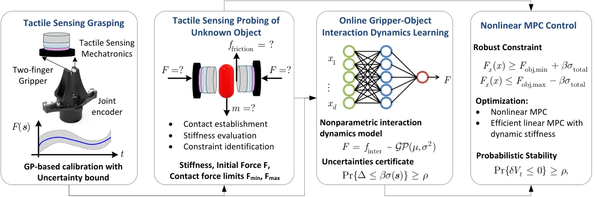

<!-- Generated by scripts/generate.py; edit data/works.json and data/media.json. -->

[← Back to the Awesome index](../../../README.md) · [Interactive website](https://chang-xinhai.github.io/Awesome-RGBDT-Manipulation/?collection=policy&item=secure-gentle-grasping#library)

# Secure and Gentle Grasping

Tactile Sensing-based Secure and Gentle Grasping of Unknown Objects

**2026-10-08 · Preprint · New York Institute of Technology**

**[Paper](https://arxiv.org/abs/2610.12790)**

Online dynamics learning and constrained predictive control regulate secure, gentle grasps of unknown objects.

*Tactile Sensing-based Secure and Gentle Grasping of Unknown Objects authors · [Figure source](https://arxiv.org/abs/2610.12790) · Original rights retained.*

| Field | Reported value and source scope |
| :-- | :-- |
| Record type | policy |
| Policy family | Model-based planning [1](https://arxiv.org/abs/2610.12790)  |
| Base model and architecture | GP tactile calibration, finite-state force probing, online interaction dynamics and predictive controller. [1](https://arxiv.org/abs/2610.12790)  |
| Model size and component | Not reported [1](https://arxiv.org/abs/2610.12790)  |
| Deployment inputs | Two single-channel FSR tactile sensors and gripper interaction history; no vision. [1](https://arxiv.org/abs/2610.12790)  |
| Action outputs and horizon | Gripper motion/force control under identified slip/damage constraints. [1](https://arxiv.org/abs/2610.12790)  |
| Training method | GP sensor calibration plus online object constraint/dynamics identification and predictive control. [1](https://arxiv.org/abs/2610.12790)  |
| Training data | Offline tactile calibration data; task interaction dynamics identified online, no pretrained task policy corpus. [1](https://arxiv.org/abs/2610.12790)  |
| Training duration | Not reported [1](https://arxiv.org/abs/2610.12790)  |
| Training hardware | Not reported [1](https://arxiv.org/abs/2610.12790)  |
| Inference and control rates | 100 Hz real-time control. [1](https://arxiv.org/abs/2610.12790)  |
| Evaluation scope | Unknown rigid/deformable objects, including raw tofu and metal blocks; slip prevention and structural protection. [1](https://arxiv.org/abs/2610.12790)  |
| Observations / modalities | Tactile · Proprioception |
| Evaluation domain | Real world |
| Embodiment | Parallel-jaw gripper |
| Release: code | Not verified |
| Release: weights | Not verified |
| Release: data | Not verified |
| Release: license | Not verified |
| Release: notes | Original paper reviewed; claimed future releases are not treated as currently available. |

**Scope and qualifications**

- No offline task-policy training does not mean no sensor calibration:the GP calibration model uses offline measurements.

**Primary evidence**

1. [Original paper and supplementary implementation details](https://arxiv.org/abs/2610.12790) — Primary full text reviewed; dataset, deployment modalities and training-only privileges are scoped separately.
