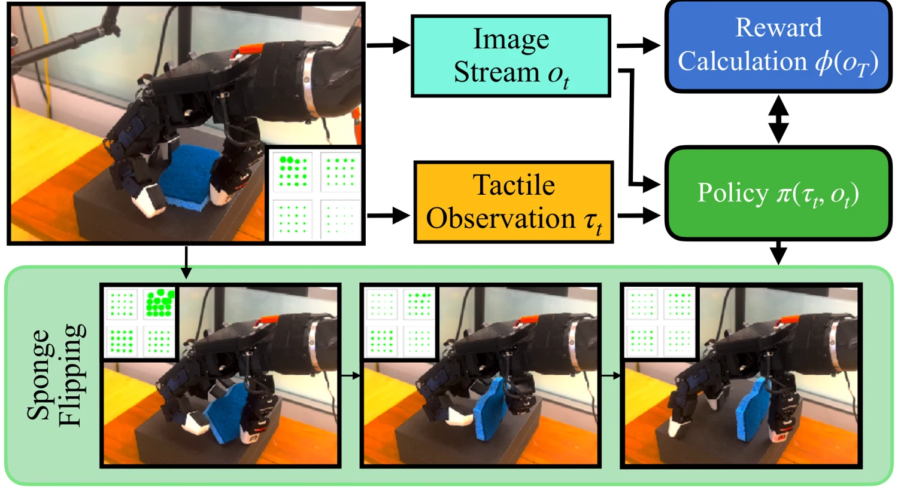

<!-- Generated by scripts/generate.py; edit data/works.json and data/media.json. -->

[← Back to the Awesome index](../../../README.md) · [Interactive website](https://chang-xinhai.github.io/Awesome-RGBDT-Manipulation/?collection=policy&item=see-to-touch#library)

# See to Touch / TAVI

See to Touch: Learning Tactile Dexterity through Visual Incentives

**2023-09-21 · ICRA 2024 · New York University**

**[Paper](https://arxiv.org/abs/2309.12300)** · [Project](https://see-to-touch.github.io/) · [Code](https://github.com/irmakguzey/see-to-touch) · [Data](https://drive.google.com/drive/folders/1IpU97D4nSosdyyWmvuLO-E3phRA-nf8c)

Learns dexterous visuotactile policies using online residual RL with a vision-based optimal-transport reward from one demonstration.

*See to Touch / TAVI authors · [Figure source](https://arxiv.org/html/2309.12300) · Original rights retained.*

| Field | Reported value and source scope |
| :-- | :-- |
| Record type | policy |
| Policy family | RL [1](https://arxiv.org/abs/2309.12300)  |
| Base model and architecture | FISH residual policy; contrastive visual encoder; pretrained tactile encoder [1](https://arxiv.org/abs/2309.12300) [3](https://arxiv.org/html/2309.12300)  |
| Model size and component | Not reported [1](https://arxiv.org/abs/2309.12300) [3](https://arxiv.org/html/2309.12300)  |
| Deployment inputs | RGB observations, Xela tactile measurements and robot state [1](https://arxiv.org/abs/2309.12300) [3](https://arxiv.org/html/2309.12300)  |
| Action outputs and horizon | Dexterous Allegro-hand actions [1](https://arxiv.org/abs/2309.12300) [3](https://arxiv.org/html/2309.12300)  |
| Training method | Self-supervised vision representation + visual optimal-transport reward + online residual RL [1](https://arxiv.org/abs/2309.12300) [3](https://arxiv.org/html/2309.12300)  |
| Training data | One expert trajectory per task; tactile encoder pretrained on 2.5 h robot play [1](https://arxiv.org/abs/2309.12300) [3](https://arxiv.org/html/2309.12300)  |
| Training duration | Not reported [1](https://arxiv.org/abs/2309.12300) [3](https://arxiv.org/html/2309.12300)  |
| Training hardware | Not reported [1](https://arxiv.org/abs/2309.12300) [3](https://arxiv.org/html/2309.12300)  |
| Inference and control rates | Not reported [1](https://arxiv.org/abs/2309.12300) [3](https://arxiv.org/html/2309.12300)  |
| Evaluation scope | Six real dexterous tasks including peg pick-and-place, bowl unstacking and slender-object flipping [1](https://arxiv.org/abs/2309.12300) [3](https://arxiv.org/html/2309.12300)  |
| Observations / modalities | RGB · Tactile · Proprioception |
| Evaluation domain | Real world |
| Embodiment | Dexterous hand |
| Release: code | Available [2](https://github.com/irmakguzey/see-to-touch)  |
| Release: weights | Not verified [2](https://github.com/irmakguzey/see-to-touch)  |
| Release: data | Available [2](https://github.com/irmakguzey/see-to-touch)  |
| Release: license | Not verified [2](https://github.com/irmakguzey/see-to-touch)  |
| Release: notes | Official project links code and data. [2](https://github.com/irmakguzey/see-to-touch)  |

**Scope and qualifications**

- Visual reward is training feedback; tactile and vision are policy inputs.
- Online real-robot interactions are additional to the one demonstration.

**Primary evidence**

1. [Author manuscript and submission history](https://arxiv.org/abs/2309.12300) — Policy facts refer to the full manuscript available on the verification date; date is first arXiv submission.
2. [Official repository](https://github.com/irmakguzey/see-to-touch) — Release status is checked separately from paper claims; a project page alone does not imply released implementation or weights.
3. [Full paper: method and implementation details](https://arxiv.org/html/2309.12300) — Unreported specifications remain explicitly unknown; hardware/rates are scoped to training, inference or low-level control.
