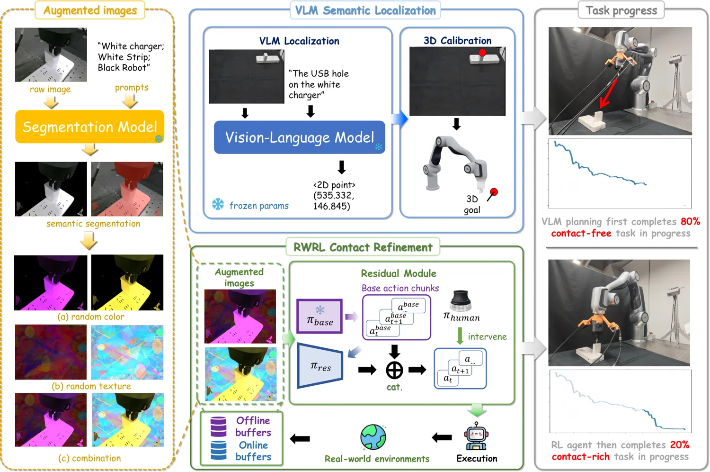

<!-- Generated by scripts/generate.py; edit data/works.json and data/media.json. -->

[← Back to the Awesome index](../../../README.md) · [Interactive website](https://chang-xinhai.github.io/Awesome-RGBDT-Manipulation/?collection=policy&item=semantics-to-contact#library)

# Semantics-to-Contact

Semantics-to-Contact: A Stagewise Framework for Robust Contact-Rich Manipulation

**2026-11-05 · NeurIPS 2026 · The Chinese University of Hong Kong, Shenzhen**

**[Paper](https://arxiv.org/abs/2611.07532)** · [Project](https://edem-ai.github.io/S2C/)

A VLM localizes contact regions before human-in-the-loop force-guided residual reinforcement learning.

*Semantics-to-Contact authors · [Figure source](https://edem-ai.github.io/S2C/) · Original rights retained.*

| Field | Reported value and source scope |
| :-- | :-- |
| Record type | policy |
| Policy family | Force-guided visual RL [1](https://arxiv.org/html/2611.07532v1)  |
| Base model and architecture | See original paper [1](https://arxiv.org/html/2611.07532v1)  |
| Model size and component | Not reported [1](https://arxiv.org/html/2611.07532v1)  |
| Deployment inputs | Task instruction, visual observations, robot state and force feedback. [1](https://arxiv.org/html/2611.07532v1)  |
| Action outputs and horizon | Motion targets and residual control actions. [1](https://arxiv.org/html/2611.07532v1)  |
| Training method | VLM-guided semantic focusing followed by real-world human-in-the-loop residual RL. [1](https://arxiv.org/html/2611.07532v1)  |
| Training data | See original paper [1](https://arxiv.org/html/2611.07532v1)  |
| Training duration | Not reported [1](https://arxiv.org/html/2611.07532v1)  |
| Training hardware | Not reported [1](https://arxiv.org/html/2611.07532v1)  |
| Inference and control rates | Not reported [1](https://arxiv.org/html/2611.07532v1)  |
| Evaluation scope | Six contact-rich real-world tasks under visual and positional perturbations. [1](https://arxiv.org/html/2611.07532v1)  |
| Observations / modalities | RGB · Force · Proprioception · Language |
| Evaluation domain | Real world |
| Embodiment |  |
| Release: code | Not verified |
| Release: weights | Not verified |
| Release: data | Not verified |
| Release: license | Not verified |
| Release: notes | Model, source and data availability are tracked separately. |

**Scope and qualifications**

- Wrist force feedback should not be relabelled as tactile skin sensing.

**Primary evidence**

1. [Author paper and first submission](https://arxiv.org/html/2611.07532v1)
