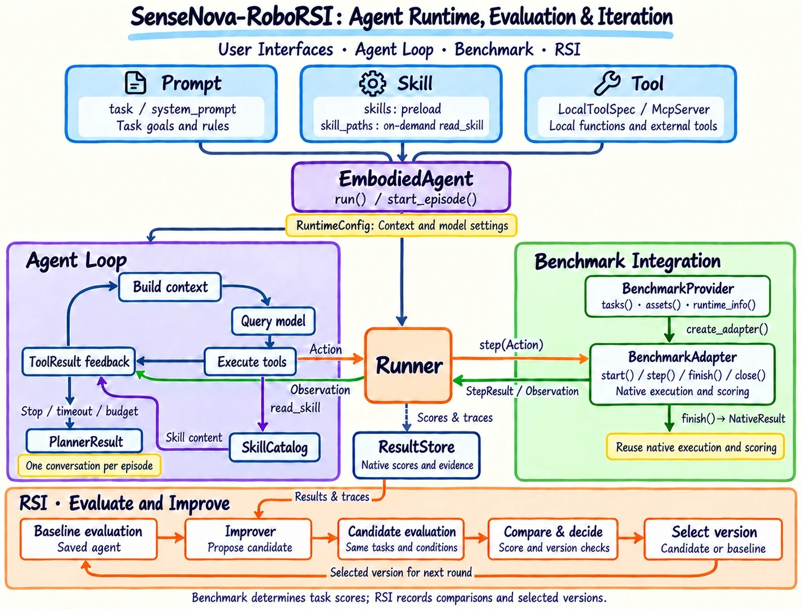

<!-- Generated by scripts/generate.py; edit data/works.json and data/media.json. -->

[← Back to the Awesome index](../../../README.md) · [Interactive website](https://chang-xinhai.github.io/Awesome-RGBDT-Manipulation/?collection=policy&item=sensenova-roborsi#library)

# SenseNova-RoboRSI / 27B Preview

SenseNova-RoboRSI: Recursive Self-Improvement for Embodied Agents

**2026-10-16 · Official project report · Not reported**

**[Project](https://github.com/OpenSenseNova/SenseNova-RoboRSI)** · [Code](https://github.com/OpenSenseNova/SenseNova-RoboRSI) · [Weights](https://huggingface.co/sensenova/sensenova-roborsi-27b-preview) · [Report](https://www.sensenova.ai/has-gpt-6-astra-achieved-embodied-intelligence)

A shared robot-agent runtime improves harnesses from execution traces; a distinct 27B Preview branch converts validated interaction experience into model-training supervision.

*SenseNova-RoboRSI authors · [Figure source](https://github.com/OpenSenseNova/SenseNova-RoboRSI) · Original rights retained.*

| Field | Reported value and source scope |
| :-- | :-- |
| Record type | policy |
| Policy family | Hybrid [1](https://github.com/OpenSenseNova/SenseNova-RoboRSI) [2](https://github.com/OpenSenseNova/SenseNova-RoboRSI/blob/main/robots/behavior_1k/roborsi_adapter.py) [4](https://github.com/OpenSenseNova/SenseNova-RoboRSI/blob/main/docs/sensenova-roborsi-27b-preview.md)  |
| Base model and architecture | Frozen frontier-model harness configurations, including GPT-6 Astra; the learned SenseNova-RoboRSI-27B-Preview is based on Qwen3.8-27B. [1](https://github.com/OpenSenseNova/SenseNova-RoboRSI) [2](https://github.com/OpenSenseNova/SenseNova-RoboRSI/blob/main/robots/behavior_1k/roborsi_adapter.py) [4](https://github.com/OpenSenseNova/SenseNova-RoboRSI/blob/main/docs/sensenova-roborsi-27b-preview.md)  |
| Model size and component | 27B base model for the Preview branch; hosted frontier-model counts are not disclosed. [1](https://github.com/OpenSenseNova/SenseNova-RoboRSI) [2](https://github.com/OpenSenseNova/SenseNova-RoboRSI/blob/main/robots/behavior_1k/roborsi_adapter.py) [4](https://github.com/OpenSenseNova/SenseNova-RoboRSI/blob/main/docs/sensenova-roborsi-27b-preview.md)  |
| Deployment inputs | Task, robot/simulator observations, skill/MCP interfaces, context/memory and traces. The released BEHAVIOR-1K adapter supplies RGB-D and the native 21D interface; other adapters retain benchmark-specific observations. [1](https://github.com/OpenSenseNova/SenseNova-RoboRSI) [2](https://github.com/OpenSenseNova/SenseNova-RoboRSI/blob/main/robots/behavior_1k/roborsi_adapter.py) [4](https://github.com/OpenSenseNova/SenseNova-RoboRSI/blob/main/docs/sensenova-roborsi-27b-preview.md)  |
| Action outputs and horizon | VLA skill calls, scripted robot actions or end-effector tool requests; model training additionally learns goal understanding, decisions and feedback-based correction. [1](https://github.com/OpenSenseNova/SenseNova-RoboRSI) [2](https://github.com/OpenSenseNova/SenseNova-RoboRSI/blob/main/robots/behavior_1k/roborsi_adapter.py) [4](https://github.com/OpenSenseNova/SenseNova-RoboRSI/blob/main/docs/sensenova-roborsi-27b-preview.md)  |
| Training method | Two branches: frozen-model harness revision with retesting, and joint model–harness RSI that updates the Qwen3.8-27B-derived Preview model. [1](https://github.com/OpenSenseNova/SenseNova-RoboRSI) [2](https://github.com/OpenSenseNova/SenseNova-RoboRSI/blob/main/robots/behavior_1k/roborsi_adapter.py) [4](https://github.com/OpenSenseNova/SenseNova-RoboRSI/blob/main/docs/sensenova-roborsi-27b-preview.md)  |
| Training data | Validated multimodal interaction traces support Preview model training. Exact data scale and training budget are not disclosed in the current repository. [1](https://github.com/OpenSenseNova/SenseNova-RoboRSI) [2](https://github.com/OpenSenseNova/SenseNova-RoboRSI/blob/main/robots/behavior_1k/roborsi_adapter.py) [4](https://github.com/OpenSenseNova/SenseNova-RoboRSI/blob/main/docs/sensenova-roborsi-27b-preview.md)  |
| Training duration | Not reported [1](https://github.com/OpenSenseNova/SenseNova-RoboRSI) [2](https://github.com/OpenSenseNova/SenseNova-RoboRSI/blob/main/robots/behavior_1k/roborsi_adapter.py) [4](https://github.com/OpenSenseNova/SenseNova-RoboRSI/blob/main/docs/sensenova-roborsi-27b-preview.md)  |
| Training hardware | Not reported [1](https://github.com/OpenSenseNova/SenseNova-RoboRSI) [2](https://github.com/OpenSenseNova/SenseNova-RoboRSI/blob/main/robots/behavior_1k/roborsi_adapter.py) [4](https://github.com/OpenSenseNova/SenseNova-RoboRSI/blob/main/docs/sensenova-roborsi-27b-preview.md)  |
| Inference and control rates | Not reported [1](https://github.com/OpenSenseNova/SenseNova-RoboRSI) [2](https://github.com/OpenSenseNova/SenseNova-RoboRSI/blob/main/robots/behavior_1k/roborsi_adapter.py) [4](https://github.com/OpenSenseNova/SenseNova-RoboRSI/blob/main/docs/sensenova-roborsi-27b-preview.md)  |
| Evaluation scope | Hosted GPT-6 Astra harness author result: RoboDojo Score 60.08/SR 54.17%, still submitted to the official board. Distinct learned 27B Preview author result: RoboDojo:26.13/20.83% with VLA assistance; LIBERO-Pro:92.5% VLA-assisted and 95% direct VLM; RoboCasa365:26.0% to 46.5% over its Qwen base. Settings and model branches must not be mixed. Current official RoboDojo snapshot does not list SenseNova. [1](https://github.com/OpenSenseNova/SenseNova-RoboRSI) [2](https://github.com/OpenSenseNova/SenseNova-RoboRSI/blob/main/robots/behavior_1k/roborsi_adapter.py) [3](https://huggingface.co/sensenova/sensenova-roborsi-27b-preview)  |
| Observations / modalities | RGB · Depth · Proprioception · Language |
| Evaluation domain | Simulation · Real world |
| Embodiment | Parallel-jaw gripper · Bimanual |
| Release: code | Partial [1](https://github.com/OpenSenseNova/SenseNova-RoboRSI) [2](https://github.com/OpenSenseNova/SenseNova-RoboRSI/blob/main/robots/behavior_1k/roborsi_adapter.py) [3](https://huggingface.co/sensenova/sensenova-roborsi-27b-preview)  |
| Release: weights | Available — 27B Preview, 12 safetensor shards [1](https://github.com/OpenSenseNova/SenseNova-RoboRSI) [2](https://github.com/OpenSenseNova/SenseNova-RoboRSI/blob/main/robots/behavior_1k/roborsi_adapter.py) [3](https://huggingface.co/sensenova/sensenova-roborsi-27b-preview)  |
| Release: data | Not verified [1](https://github.com/OpenSenseNova/SenseNova-RoboRSI) [2](https://github.com/OpenSenseNova/SenseNova-RoboRSI/blob/main/robots/behavior_1k/roborsi_adapter.py) [3](https://huggingface.co/sensenova/sensenova-roborsi-27b-preview)  |
| Release: license | Apache-2.0 public runtime and 27B Preview checkpoint, verified actual LICENSE and upstream Qwen NOTICE; external models, simulators and datasets retain separate terms. [1](https://github.com/OpenSenseNova/SenseNova-RoboRSI) [2](https://github.com/OpenSenseNova/SenseNova-RoboRSI/blob/main/robots/behavior_1k/roborsi_adapter.py) [3](https://huggingface.co/sensenova/sensenova-roborsi-27b-preview)  |
| Release: notes | The 27B Preview endpoint is now public with 12 safetensor shards, index, config/tokenizer, LICENSE and NOTICE; a binary shard Range 206 is verified. Released source adds 27B LIBERO-Pro and RoboCasa365 inference/evaluation. BEHAVIOR-1K, Bench2Dex and DexJoCo runtime integrations remain separately scoped. RoboDojo runtime/reproduction is still coming soon; full training traces are not released. [1](https://github.com/OpenSenseNova/SenseNova-RoboRSI) [2](https://github.com/OpenSenseNova/SenseNova-RoboRSI/blob/main/robots/behavior_1k/roborsi_adapter.py) [3](https://huggingface.co/sensenova/sensenova-roborsi-27b-preview)  |

**Scope and qualifications**

- The date is the explicit initial code-release announcement, not a claimed paper submission date.
- RoboDojo results were still being submitted to the official leaderboard; final official results may differ.
- The README distinguishes LIBERO-Pro Task / Swap aggregates and RoboCasa Target50 from other published leaderboard protocols.
- The distinct learned Preview branch is included once; the generic GPT-6 base product is not a robot-policy record.
- Measured depth is an adapter-specific BEHAVIOR-1K observation, not a universal observation claim for every agent/model branch.

**Primary evidence**

1. [Official project / author report](https://github.com/OpenSenseNova/SenseNova-RoboRSI) — Project-only evidence; any reported date is an explicit public report or code-release event, not a manuscript submission.
2. [Official current source / artifact inventory — 21 October 2026](https://github.com/OpenSenseNova/SenseNova-RoboRSI/blob/main/robots/behavior_1k/roborsi_adapter.py) — Historical source snapshot verified BEHAVIOR-1K RGB-D and Bench2Dex/DexJoCo integrations; the current model release supersedes the earlier unresolved endpoint status.
3. [Official current source / actual release —26October2026](https://huggingface.co/sensenova/sensenova-roborsi-27b-preview) — Actual12model shards and206binary sample, model LICENSE and NOTICE read. This supersedes the earlier401 observation.
4. [Official current source / actual release —26October2026](https://github.com/OpenSenseNova/SenseNova-RoboRSI/blob/main/docs/sensenova-roborsi-27b-preview.md) — Current model guide and runtime source preserve VLA-assisted/direct-VLM evaluation and RoboDojo forthcoming status.
