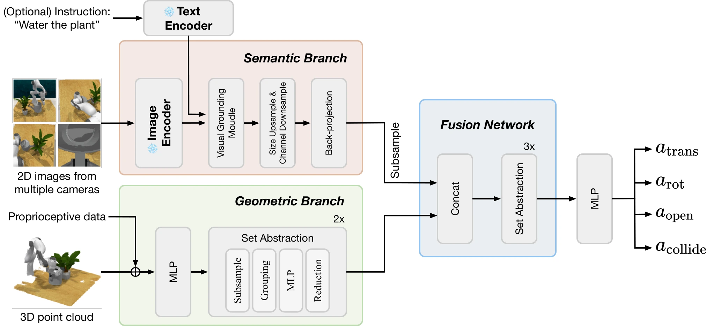

<!-- Generated by scripts/generate.py; edit data/works.json and data/media.json. -->

[← Back to the Awesome index](../../../README.md) · [Interactive website](https://chang-xinhai.github.io/Awesome-RGBDT-Manipulation/?collection=policy&item=sgr#library)

# Semantic-Geometric Representation (SGR)

A Universal Semantic-Geometric Representation for Robotic Manipulation

**2023-06-18 · CoRL 2023 · Tsinghua University; Shanghai AI Laboratory; Shanghai Qi Zhi Institute**

**[Paper](https://arxiv.org/abs/2306.10474)** · [Project](https://semantic-geometric-representation.github.io/) · [Code](https://github.com/TongZhangTHU/sgr)

Fuses pretrained semantic image features with 3D point geometry for language-conditioned manipulation.

*Semantic-Geometric Representation (SGR) authors · [Figure source](https://arxiv.org/html/2306.10474) · Original rights retained.*

| Field | Reported value and source scope |
| :-- | :-- |
| Record type | policy |
| Policy family | Transformer / BC [1](https://arxiv.org/abs/2306.10474)  |
| Base model and architecture | CLIP semantic branch, PointNeXt geometry branch and fused action prediction network. [1](https://arxiv.org/abs/2306.10474)  |
| Model size and component | Not reported in the inspected primary-source sections [1](https://arxiv.org/abs/2306.10474)  |
| Deployment inputs | Calibrated RGB-D point clouds, optional language and robot proprioception. [1](https://arxiv.org/abs/2306.10474)  |
| Action outputs and horizon | 6-DoF keyframe pose, gripper-open and collision-avoidance indicators. [1](https://arxiv.org/abs/2306.10474)  |
| Training method | Behavior cloning with pretrained2D features and geometric fusion. [1](https://arxiv.org/abs/2306.10474)  |
| Training data | Single-/multi-task simulated and real robot demonstrations. [1](https://arxiv.org/abs/2306.10474)  |
| Training duration | Not reported in the inspected primary-source sections [1](https://arxiv.org/abs/2306.10474)  |
| Training hardware | Not reported in the inspected primary-source sections [1](https://arxiv.org/abs/2306.10474)  |
| Inference and control rates | Not reported in the inspected primary-source sections [1](https://arxiv.org/abs/2306.10474)  |
| Evaluation scope | RLBench and physical manipulation, including novel semantic attributes. [1](https://arxiv.org/abs/2306.10474)  |
| Observations / modalities | RGB · Depth · Point cloud · Proprioception |
| Evaluation domain | Simulation · Real world |
| Embodiment | Parallel-jaw gripper |
| Release: code | Available [2](https://semantic-geometric-representation.github.io/) [3](https://github.com/TongZhangTHU/sgr) [5](https://github.com/TongZhangTHU/sgr/tree/main)  |
| Release: weights | Not verified [2](https://semantic-geometric-representation.github.io/) [3](https://github.com/TongZhangTHU/sgr)  |
| Release: data | Not verified [2](https://semantic-geometric-representation.github.io/) [3](https://github.com/TongZhangTHU/sgr)  |
| Release: license | Apache-2.0 for repository code; pretrained models, data and figure rights remain separate [2](https://semantic-geometric-representation.github.io/) [3](https://github.com/TongZhangTHU/sgr) [4](https://github.com/TongZhangTHU/sgr/blob/main/LICENSE)  |
| Release: notes | Code, data and weights are checked independently; an upstream pretrained model is not a released task policy. [2](https://semantic-geometric-representation.github.io/) [3](https://github.com/TongZhangTHU/sgr)  |

**Scope and qualifications**

- SGR is both a perception module and a demonstrated action-learning pipeline; it is not a standalone universal controller checkpoint.

**Primary evidence**

1. [Original manuscript and first submission history](https://arxiv.org/abs/2306.10474) — Full author HTML method/evaluation/appendix inspected; depth observations, pseudo-labels and generated outputs retain distinct roles.
2. [Official author project](https://semantic-geometric-representation.github.io/) — Public author-linked project; figure and downstream scope verified separately.
3. [Official current implementation linked by author project](https://github.com/TongZhangTHU/sgr) — Actual runnable release and model artifacts checked independently.
4. [Actual license file in released source](https://github.com/TongZhangTHU/sgr/blob/main/LICENSE) — Only source code covered by this file; not a blanket license for paper figures or upstream weights.
5. [Actual repository content inventory](https://github.com/TongZhangTHU/sgr/tree/main) — 75 tracked paths inspected; code release is distinguished from a README/project/figure-only repository.
