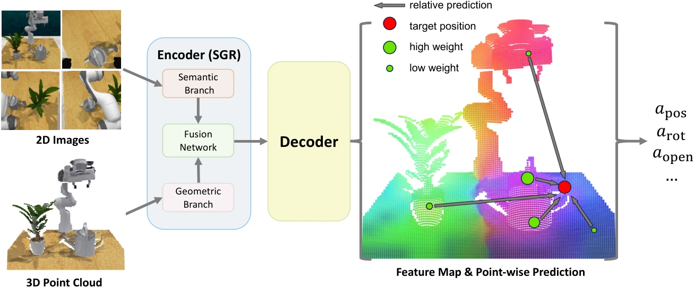

<!-- Generated by scripts/generate.py; edit data/works.json and data/media.json. -->

[← Back to the Awesome index](../../../README.md) · [Interactive website](https://chang-xinhai.github.io/Awesome-RGBDT-Manipulation/?collection=policy&item=sgrv2#library)

# SGRv2

Leveraging Locality to Boost Sample Efficiency in Robotic Manipulation

**2024-06-15 · CoRL 2024 · Tsinghua University; Shanghai AI Laboratory; Shanghai Qi Zhi Institute**

**[Paper](https://arxiv.org/abs/2406.10615)** · [Project](https://sgrv2-robot.github.io/) · [Code](https://github.com/TongZhangTHU/sgr)

Local geometric action prediction improves sample efficiency for both keyframe and dense RGB-D control.

*SGRv2 authors · [Figure source](https://arxiv.org/html/2406.10615) · Original rights retained.*

| Field | Reported value and source scope |
| :-- | :-- |
| Record type | policy |
| Policy family | Transformer / BC [1](https://arxiv.org/abs/2406.10615)  |
| Base model and architecture | SGR CLIP/PointNeXt fusion plus locality-aware per-point action aggregation. [1](https://arxiv.org/abs/2406.10615)  |
| Model size and component | Not reported in the inspected primary-source sections [1](https://arxiv.org/abs/2406.10615)  |
| Deployment inputs | Single/multi-view RGB-D and proprioception; language in language-conditioned settings. [1](https://arxiv.org/abs/2406.10615)  |
| Action outputs and horizon | Sparse 6-DoF keyframes or dense delta-pose/gripper actions according to benchmark. [1](https://arxiv.org/abs/2406.10615)  |
| Training method | Behavior cloning with action-locality inductive bias. [1](https://arxiv.org/abs/2406.10615)  |
| Training data | RLBench: 26 tasks, 5 demos each. ManiSkill2: 4 tasks; MimicGen: 7 tasks, generally 50 demos each. Low-data real settings: 8 demos. [1](https://arxiv.org/abs/2406.10615)  |
| Training duration | Not reported in the inspected primary-source sections [1](https://arxiv.org/abs/2406.10615)  |
| Training hardware | Not reported in the inspected primary-source sections [1](https://arxiv.org/abs/2406.10615)  |
| Inference and control rates | Not reported in the inspected primary-source sections [1](https://arxiv.org/abs/2406.10615)  |
| Evaluation scope | RLBench, ManiSkill2, MimicGen and real manipulation. [1](https://arxiv.org/abs/2406.10615)  |
| Observations / modalities | RGB · Depth · Point cloud · Proprioception |
| Evaluation domain | Simulation · Real world |
| Embodiment | Parallel-jaw gripper |
| Release: code | Available [2](https://sgrv2-robot.github.io/) [3](https://github.com/TongZhangTHU/sgr) [5](https://github.com/TongZhangTHU/sgr/tree/main)  |
| Release: weights | Not verified [2](https://sgrv2-robot.github.io/) [3](https://github.com/TongZhangTHU/sgr)  |
| Release: data | Not verified [2](https://sgrv2-robot.github.io/) [3](https://github.com/TongZhangTHU/sgr)  |
| Release: license | Apache-2.0 for repository code; pretrained models, data and figure rights remain separate [2](https://sgrv2-robot.github.io/) [3](https://github.com/TongZhangTHU/sgr) [4](https://github.com/TongZhangTHU/sgr/blob/main/LICENSE)  |
| Release: notes | Code, data and weights are checked independently; an upstream pretrained model is not a released task policy. [2](https://sgrv2-robot.github.io/) [3](https://github.com/TongZhangTHU/sgr)  |

**Scope and qualifications**

- Keyframe and dense control protocols have different action spaces; demonstration counts are setting-specific.

**Primary evidence**

1. [Original manuscript and first submission history](https://arxiv.org/abs/2406.10615) — Full author HTML method/evaluation/appendix inspected; depth observations, pseudo-labels and generated outputs retain distinct roles.
2. [Official author project](https://sgrv2-robot.github.io/) — Public author-linked project; figure and downstream scope verified separately.
3. [Official current implementation linked by author project](https://github.com/TongZhangTHU/sgr) — Actual runnable release and model artifacts checked independently.
4. [Actual license file in released source](https://github.com/TongZhangTHU/sgr/blob/main/LICENSE) — Only source code covered by this file; not a blanket license for paper figures or upstream weights.
5. [Actual repository content inventory](https://github.com/TongZhangTHU/sgr/tree/main) — 75 tracked paths inspected; code release is distinguished from a README/project/figure-only repository.
