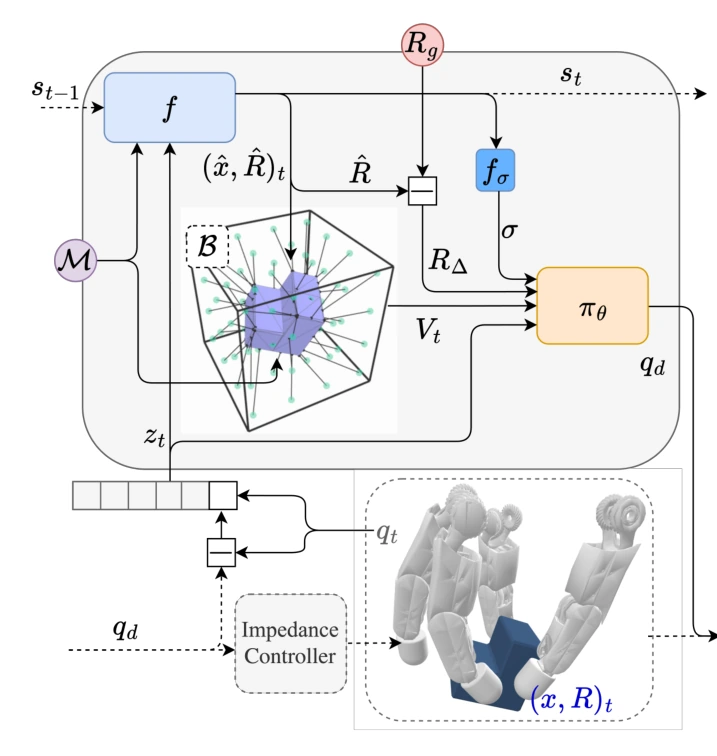

<!-- Generated by scripts/generate.py; edit data/works.json and data/media.json. -->

[← Back to the Awesome index](../../../README.md) · [Interactive website](https://chang-xinhai.github.io/Awesome-RGBDT-Manipulation/?collection=policy&item=shape-conditioned-tactile-agent#library)

# Shape-Conditioned Tactile Agent

Learning a Shape-Conditioned Agent for Purely Tactile In-Hand Manipulation of Various Objects

**2024-07-26 · Preprint · DLR / Technical University of Munich**

**[Paper](https://arxiv.org/abs/2407.18834)**

Shape-conditioned tactile state estimation and control reorient diverse objects without external object tracking.

*Learning a Shape-Conditioned Agent for Purely Tactile In-Hand Manipulation of Various Objects authors · [Figure source](https://arxiv.org/abs/2407.18834) · Original rights retained.*

| Field | Reported value and source scope |
| :-- | :-- |
| Record type | policy |
| Policy family | RL [1](https://arxiv.org/abs/2407.18834)  |
| Base model and architecture | PPO/D2 RL actor, recurrent state estimator and Vec BPS object shape encoding. [1](https://arxiv.org/abs/2407.18834)  |
| Model size and component | Not reported [1](https://arxiv.org/abs/2407.18834)  |
| Deployment inputs | Joint position/control error history, known object shape, estimated pose/uncertainty and orientation goal. [1](https://arxiv.org/abs/2407.18834)  |
| Action outputs and horizon | 12 hand joint targets. [1](https://arxiv.org/abs/2407.18834)  |
| Training method | Estimator-coupled RL with differentiable shape conditioning andsim-to-real transfer. [1](https://arxiv.org/abs/2407.18834)  |
| Training data | 4096 parallel domain-randomized Isaac simulation instances across multiple object shapes. [1](https://arxiv.org/abs/2407.18834)  |
| Training duration | Tactile policy+estimator~60 h; oracle ablation 7–11 h. [1](https://arxiv.org/abs/2407.18834)  |
| Training hardware | Single NVIDIA T4. [1](https://arxiv.org/abs/2407.18834)  |
| Inference and control rates | 60 Hz joint measurements; policy frequency Not reported here. [1](https://arxiv.org/abs/2407.18834)  |
| Evaluation scope | DLR Hand II diverse-object goal-conditioned reorientation. [1](https://arxiv.org/abs/2407.18834)  |
| Observations / modalities | Force/Torque · Proprioception |
| Evaluation domain | Simulation · Real world |
| Embodiment | Dexterous hand |
| Release: code | Not verified |
| Release: weights | Not verified |
| Release: data | Not verified |
| Release: license | Not verified |
| Release: notes | Original paper reviewed; claimed future releases are not treated as currently available. |

**Scope and qualifications**

- Known object shape is an explicit input; vision-free does not mean shape-free.

**Primary evidence**

1. [Original paper and supplementary implementation details](https://arxiv.org/abs/2407.18834) — Primary full text reviewed; dataset, deployment modalities and training-only privileges are scoped separately.
