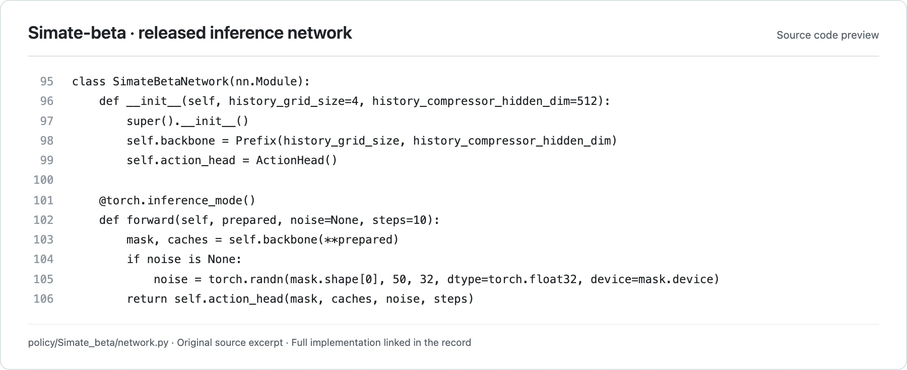

<!-- Generated by scripts/generate.py; edit data/works.json and data/media.json. -->

[← Back to the Awesome index](../../../README.md) · [Interactive website](https://chang-xinhai.github.io/Awesome-RGBDT-Manipulation/?collection=policy&item=simate-beta#library)

# Simate-beta

Simate-beta AE memory policy

**Undated · Official project / technical release · SIPAILab**

**[Project](https://github.com/XPolicyLab/XPolicyLab/tree/main/policy/Simate_beta)** · [Code](https://github.com/XPolicyLab/XPolicyLab/tree/main/policy/Simate_beta) · [Weights](https://huggingface.co/SIPAILab/sipai-robodojo-eval-ae)

Provides an author-contributed inference-only memory policy with compressed history tokens and a released RoboDojo checkpoint.

*SIPAILab / XPolicyLab contributors · [Figure source](https://github.com/XPolicyLab/XPolicyLab/blob/94dbf9505f2f87cf59c3ee8ba5912cd236781771/policy/Simate_beta/network.py#L95-L106) · Original rights retained.*

**Preview scope:** Exact contiguous source excerpt (lines 95–106), rendered for legibility. This is a released implementation interface preview; an original architecture figure was not located in the reviewed sources. Source rights remain with the original authors.

| Field | Reported value and source scope |
| :-- | :-- |
| Record type | policy |
| Policy family | VLA [1](https://github.com/XPolicyLab/XPolicyLab/tree/main/policy/Simate_beta)  |
| Base model and architecture | SigLIP vision encoder, AE history compressor and flow action model; tokenization uses PaliGemma SentencePiece [1](https://github.com/XPolicyLab/XPolicyLab/tree/main/policy/Simate_beta)  |
| Model size and component | Not disclosed; no parameter count inferred from checkpoint byte size [1](https://github.com/XPolicyLab/XPolicyLab/tree/main/policy/Simate_beta)  |
| Deployment inputs | Three current RGB views, language, current joint state and 25 primary-camera history frames at 20 action-step intervals [1](https://github.com/XPolicyLab/XPolicyLab/tree/main/policy/Simate_beta) [2](https://github.com/XPolicyLab/XPolicyLab/tree/main/policy/Simate_beta)  |
| Action outputs and horizon | Relative dual-arm joint commands plus absolute gripper openness; default executes 10 of maximum 50-step chunks [1](https://github.com/XPolicyLab/XPolicyLab/tree/main/policy/Simate_beta) [2](https://github.com/XPolicyLab/XPolicyLab/tree/main/policy/Simate_beta)  |
| Training method | Training procedure not released; AE compresses history 16 × 16 tokens to 4 × 4 at inference [1](https://github.com/XPolicyLab/XPolicyLab/tree/main/policy/Simate_beta)  |
| Training data | Not disclosed; public release is evaluation-only [1](https://github.com/XPolicyLab/XPolicyLab/tree/main/policy/Simate_beta)  |
| Training duration | Not reported [1](https://github.com/XPolicyLab/XPolicyLab/tree/main/policy/Simate_beta)  |
| Training hardware | Not reported [1](https://github.com/XPolicyLab/XPolicyLab/tree/main/policy/Simate_beta)  |
| Inference and control rates | Not reported; history sampling interval and 10 flow integration steps are not feedback rate [1](https://github.com/XPolicyLab/XPolicyLab/tree/main/policy/Simate_beta)  |
| Evaluation scope | RoboDojo ARX X5 joint-action submission; adapter debug checks are not policy-quality evaluation [1](https://github.com/XPolicyLab/XPolicyLab/tree/main/policy/Simate_beta)  |
| Observations / modalities | RGB · Proprioception · Language |
| Evaluation domain | Simulation |
| Embodiment | Parallel-jaw gripper · Bimanual |
| Release: code | Partial [1](https://github.com/XPolicyLab/XPolicyLab/tree/main/policy/Simate_beta) [2](https://github.com/XPolicyLab/XPolicyLab/tree/main/policy/Simate_beta)  |
| Release: weights | Available [1](https://github.com/XPolicyLab/XPolicyLab/tree/main/policy/Simate_beta)  |
| Release: data | Not verified [1](https://github.com/XPolicyLab/XPolicyLab/tree/main/policy/Simate_beta)  |
| Release: license | Apache-2.0 weights/model card; PaliGemma tokenizer access terms apply separately [1](https://github.com/XPolicyLab/XPolicyLab/tree/main/policy/Simate_beta)  |
| Release: notes | Public project and model release; undisclosed training details remain explicitly unknown. A manuscript is not required to identify the released policy. [1](https://github.com/XPolicyLab/XPolicyLab/tree/main/policy/Simate_beta)  |

**Scope and qualifications**

- No paper supplied and no verified architecture image; training data, cost and complete backbone remain unknown.

**Primary evidence**

1. [Official model project / technical release](https://github.com/XPolicyLab/XPolicyLab/tree/main/policy/Simate_beta) — Research-report facts and current executable release are scoped separately; undated releases retain an unknown publication date.
2. [Official implementation / author-contributed adapter](https://github.com/XPolicyLab/XPolicyLab/tree/main/policy/Simate_beta) — Actual deployment contract is checked; adapter presence alone is not evidence of benchmark participation.
