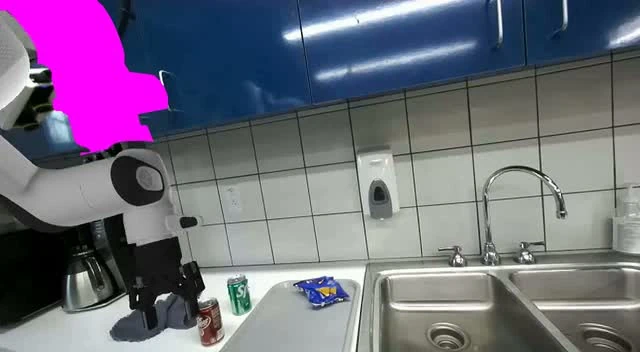

<!-- Generated by scripts/generate.py; edit data/works.json and data/media.json. -->

[← Back to the Awesome index](../../../README.md) · [Interactive website](https://chang-xinhai.github.io/Awesome-RGBDT-Manipulation/?collection=policy&item=simpwm#library)

# SimPWM

Simulator-as-Proxy World Model for Robot Manipulation

**2026-11-24 · Preprint · Mohamed bin Zayed University of Artificial Intelligence; UC San Diego; Pinscreen**

**[Paper](https://arxiv.org/abs/2611.32786)** · [Project](https://sim-pwm.pages.dev/) · [Code](https://github.com/TingtingLiao/SimPWM)

Uses rule-simulated point objects and a synchronized renderer as a proxy for action-conditioned robot video prediction.

*Tingting Liao and coauthors · [Figure source](https://sim-pwm.pages.dev/) · Original rights retained.*

| Field | Reported value and source scope |
| :-- | :-- |
| Record type | model |
| Model role and downstream interface | Action-conditioned robot world model [1](https://arxiv.org/html/2611.32786v1)  |
| Model family | SimPWM [1](https://arxiv.org/html/2611.32786v1)  |
| Model architecture | Rule-based point simulator and video generators H3-Cam and Ctrl-World in separate configurations. [1](https://arxiv.org/html/2611.32786v1)  |
| Model size and component | Not reported [1](https://arxiv.org/html/2611.32786v1)  |
| Model inputs | First calibrated RGB observation (rectified stereo pair on DROID), robot model and joint/gripper commands. FoundationStereo produces metric depth from calibrated stereo; Depth Anything V2 fills gaps or handles monocular views. [1](https://arxiv.org/html/2611.32786v1)  |
| Model outputs | Future video and separate explicit simulated point-state history. Moves points with the supplied robot action rather than choosing a robot action. [1](https://arxiv.org/html/2611.32786v1)  |
| Training method | Parameterized grasp/release/height-map proxy; task or video-specific video adapter variants are evaluated separately. [1](https://arxiv.org/html/2611.32786v1)  |
| Training data and scale | DROID, GR00T-Teleop and WorldArena for distinct experiments. [1](https://arxiv.org/html/2611.32786v1)  |
| Training duration | Not reported [1](https://arxiv.org/html/2611.32786v1)  |
| Training hardware | Not reported [1](https://arxiv.org/html/2611.32786v1)  |
| Inference setting and runtime | Not reported [1](https://arxiv.org/html/2611.32786v1) [3](https://github.com/TingtingLiao/SimPWM#readme)  |
| Downstream evaluation and scope | Video fidelity and action compliance under held-out real robot sequences and controlled changes to command and proxy state. [1](https://arxiv.org/html/2611.32786v1)  |
| Observations / modalities | RGB · Point cloud · Proprioception |
| Evaluation domain | Simulation · Real world |
| Embodiment | Parallel-jaw gripper |
| Release: code | Available — model-independent proxy and evaluation source [3](https://github.com/TingtingLiao/SimPWM#readme)  |
| Release: weights | Linked H3-C weights; public artifact access not independently established |
| Release: data | Uses separately published robot-data sources |
| Release: license | MIT author source |
| Release: notes | The source, base video model requirements and version-specific LoRA availability are separate. |

**Scope and qualifications**

- Geometry is reconstructed from calibrated stereo disparity or monocular inference. The model is given an action sequence, rather than selecting robot actions.

**Primary evidence**

1. [Original paper and evaluation settings](https://arxiv.org/html/2611.32786v1)
2. [Official project with task and method examples](https://sim-pwm.pages.dev/)
3. [Public proxy/rendering setup and model prerequisites](https://github.com/TingtingLiao/SimPWM#readme)
