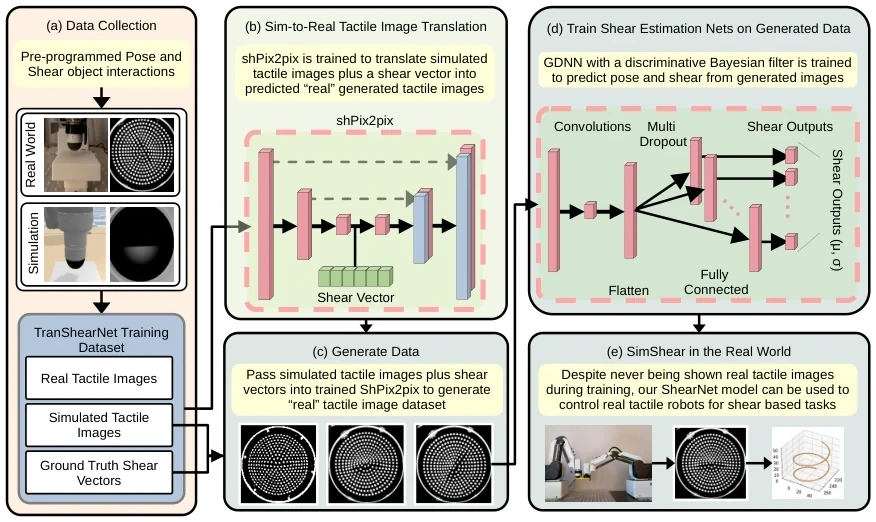

<!-- Generated by scripts/generate.py; edit data/works.json and data/media.json. -->

[← Back to the Awesome index](../../../README.md) · [Interactive website](https://chang-xinhai.github.io/Awesome-RGBDT-Manipulation/?collection=policy&item=simshear#library)

# SimShear

SimShear: Sim-to-Real Shear-based Tactile Servoing

**2025-08-28 · Preprint · University of Bristol / Bristol Robotics Laboratory**

**[Paper](https://arxiv.org/abs/2508.20561)** · [Project](https://yijionglin.github.io/simshear/)

Shear-conditioned sim-to-real tactile translation supports collaborative pose/shear servoing.

*SimShear: Sim-to-Real Shear-based Tactile Servoing authors · [Figure source](https://arxiv.org/abs/2508.20561) · Original rights retained.*

| Field | Reported value and source scope |
| :-- | :-- |
| Record type | policy |
| Policy family | Hybrid [1](https://arxiv.org/abs/2508.20561)  |
| Base model and architecture | sh Pix 2 pix conditional U-Net GAN; Gaussian-density pose/shear estimator and tactile servo controller. [1](https://arxiv.org/abs/2508.20561)  |
| Model size and component | Not reported [1](https://arxiv.org/abs/2508.20561)  |
| Deployment inputs | Optical tactile images; inferred pose/shear fed to feedback controller. [1](https://arxiv.org/abs/2508.20561)  |
| Action outputs and horizon | Follower-arm servo motions for tactile tracking and co-lifting. [1](https://arxiv.org/abs/2508.20561)  |
| Training method | Image translation 100 epochs; pose/shear estimator 50 epochs; feedback-control deployment. [1](https://arxiv.org/abs/2508.20561)  |
| Training data | 5,000 paired training tuples+2,000 validation;130 min real collection and 60 s simulation collection. [1](https://arxiv.org/abs/2508.20561)  |
| Training duration | Not reported [1](https://arxiv.org/abs/2508.20561)  |
| Training hardware | Not reported [1](https://arxiv.org/abs/2508.20561)  |
| Inference and control rates | Not reported [1](https://arxiv.org/abs/2508.20561)  |
| Evaluation scope | Two Dobot MG400arms: collaborative tactile tracking and co-lift. [1](https://arxiv.org/abs/2508.20561)  |
| Observations / modalities | Tactile · Proprioception |
| Evaluation domain | Simulation · Real world |
| Embodiment | Parallel-jaw gripper |
| Release: code | Not verified [2](https://yijionglin.github.io/simshear/)  |
| Release: weights | Not verified [2](https://yijionglin.github.io/simshear/)  |
| Release: data | Not verified [2](https://yijionglin.github.io/simshear/)  |
| Release: license | Not verified [2](https://yijionglin.github.io/simshear/)  |
| Release: notes | Original paper reviewed; claimed future releases are not treated as currently available. [2](https://yijionglin.github.io/simshear/)  |

**Scope and qualifications**

- Co-lift evaluation uses relatively light objects; weight-dependent vertical-shear compensation is a stated limitation.

**Primary evidence**

1. [Original paper and supplementary implementation details](https://arxiv.org/abs/2508.20561) — Primary full text reviewed; dataset, deployment modalities and training-only privileges are scoped separately.
2. [Official author project](https://yijionglin.github.io/simshear/) — Live project artifact links inspected on2026-10-17.
