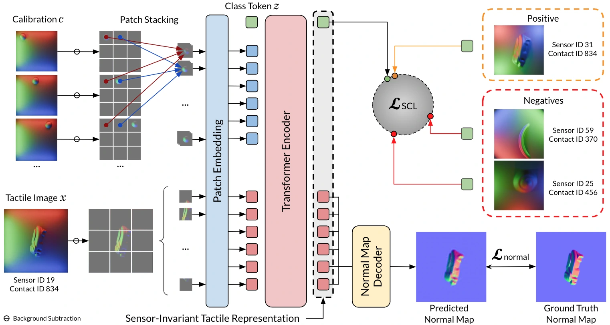

<!-- Generated by scripts/generate.py; edit data/works.json and data/media.json. -->

[← Back to the Awesome index](../../../README.md) · [Interactive website](https://chang-xinhai.github.io/Awesome-RGBDT-Manipulation/?collection=policy&item=sitr#library)

# SITR

Sensor-Invariant Tactile Representation

**2025-02-27 · ICLR 2025 · University of Illinois Urbana-Champaign**

**[Paper](https://arxiv.org/abs/2502.19638)** · [Project](https://hgupt3.github.io/sitr/) · [Code](https://github.com/hgupt3/gsrl) · [Data](https://huggingface.co/datasets/hgupt3/sitr_dataset) · [Weights](https://huggingface.co/datasets/hgupt3/sitr_dataset)

Uses sensor calibration images and simulated optical designs to learn sensor-invariant contact geometry representations.

*sitr authors; original paper figure · [Figure source](https://arxiv.org/html/2502.19638#S3.F2) · Original rights retained.*

| Field | Reported value and source scope |
| :-- | :-- |
| Record type | model |
| Model role and downstream interface | Reusable representation or perception model; downstream controllers are separate systems [1](https://arxiv.org/abs/2502.19638)  |
| Model family | Tactile encoder [1](https://arxiv.org/abs/2502.19638)  |
| Model architecture | Calibration-conditioned Vision Transformer with a normal-map decoder and contrastive embedding head [1](https://arxiv.org/abs/2502.19638)  |
| Model size and component | Not reported [1](https://arxiv.org/abs/2502.19638)  |
| Model inputs | Optical tactile image plus 18 calibration images: a 4 mm ball and a cube corner, pressed at nine locations each [1](https://arxiv.org/abs/2502.19638)  |
| Model outputs | Sensor-invariant embedding and contact normal map; optional downstream classification or pose heads [1](https://arxiv.org/abs/2502.19638)  |
| Training method | Joint normal-map reconstruction and supervised cross-sensor contrastive learning in simulated sensors [1](https://arxiv.org/abs/2502.19638)  |
| Training data and scale | Physics-based rendered optical tactile sensors with varied geometry, material and illumination; held-out real sensors evaluated after calibration. [1](https://arxiv.org/abs/2502.19638)  |
| Training duration | Not reported [1](https://arxiv.org/abs/2502.19638)  |
| Training hardware | Not reported [1](https://arxiv.org/abs/2502.19638)  |
| Inference setting and runtime | Not reported [1](https://arxiv.org/abs/2502.19638)  |
| Downstream evaluation and scope | Real-sensor normal/height reconstruction, object classification, pose estimation and sensor-transfer tests. [1](https://arxiv.org/abs/2502.19638)  |
| Observations / modalities | Tactile |
| Evaluation domain | Simulation · Real world |
| Embodiment |  |
| Release: code | Available [2](https://github.com/hgupt3/gsrl) [3](https://huggingface.co/datasets/hgupt3/sitr_dataset)  |
| Release: weights | Available — pretrained checkpoints in the official dataset repository [2](https://github.com/hgupt3/gsrl) [3](https://huggingface.co/datasets/hgupt3/sitr_dataset)  |
| Release: data | Available — simulation and real-sensor data [2](https://github.com/hgupt3/gsrl) [3](https://huggingface.co/datasets/hgupt3/sitr_dataset)  |
| Release: license | Official code README states MIT; no standalone LICENSE file was found in the inspected code snapshot. The Hugging Face artifact card states MIT. [2](https://github.com/hgupt3/gsrl) [3](https://huggingface.co/datasets/hgupt3/sitr_dataset)  |
| Release: notes | The official model/data repository includes simulation/real-sensor data and pretrained perception weights; no robot policy checkpoint is implied. [2](https://github.com/hgupt3/gsrl) [3](https://huggingface.co/datasets/hgupt3/sitr_dataset)  |

**Scope and qualifications**

- Normal and reconstructed height maps describe tactile contact geometry; they are not measured scene-depth observations.
- Zero-shot transfer still assumes sensor calibration images; it does not mean no target-sensor information.

**Primary evidence**

1. [Original model paper and first submission](https://arxiv.org/abs/2502.19638) — Method, experiments and implementation sections; specifications retain component and evaluation scope.
2. [Official SITR implementation](https://github.com/hgupt3/gsrl) — README and source files inspected.
3. [Official SITR dataset and pretrained models](https://huggingface.co/datasets/hgupt3/sitr_dataset) — Published artifact card and file inventory inspected; card states MIT. Actual code LICENSE was not found despite README claim.
