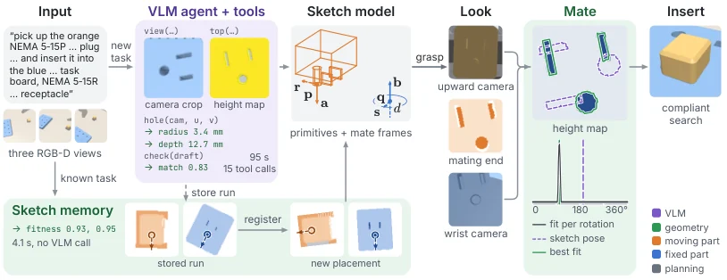

<!-- Generated by scripts/generate.py; edit data/works.json and data/media.json. -->

[← Back to the Awesome index](../../../README.md) · [Interactive website](https://chang-xinhai.github.io/Awesome-RGBDT-Manipulation/?collection=policy&item=sketchmate#library)

# SketchMate

SketchMate: Agentic Geometric Reasoning for Zero-Shot Precision Insertion

**2026-10-30 · Preprint · Not reported**

**[Paper](https://arxiv.org/abs/2610.41844)**

A vision-language agent measures RGB-D geometry, stores reusable mate sketches and executes compliant insertion.

*SketchMate authors · [Figure source](https://arxiv.org/html/2610.41844) · Original rights retained.*

| Field | Reported value and source scope |
| :-- | :-- |
| Record type | policy |
| Policy family | Geometric robot agent [1](https://arxiv.org/abs/2610.41844)  |
| Base model and architecture | VLM with measurement tools, sketch memory, registration and compliant planning [1](https://arxiv.org/abs/2610.41844)  |
| Model size and component | Not reported [1](https://arxiv.org/abs/2610.41844)  |
| Deployment inputs | Three RGB-D views and task instruction; close-range mating-face observations. [1](https://arxiv.org/abs/2610.41844)  |
| Action outputs and horizon | Tool calls, reusable mate frames and compliant insertion trajectories. [1](https://arxiv.org/abs/2610.41844)  |
| Training method | A VLM measures primitives and mate frames; registration retrieves and adapts stored sketches without updating model weights. [1](https://arxiv.org/abs/2610.41844)  |
| Training data | No task-specific policy demonstrations; geometry sketches are stored after agent runs. [1](https://arxiv.org/abs/2610.41844)  |
| Training duration | Not reported [1](https://arxiv.org/abs/2610.41844)  |
| Training hardware | Not reported [1](https://arxiv.org/abs/2610.41844)  |
| Inference and control rates | Not reported [1](https://arxiv.org/abs/2610.41844)  |
| Evaluation scope | 69 development parts and separate held-out connector conditions in simulation. [1](https://arxiv.org/abs/2610.41844)  |
| Observations / modalities | RGB · Depth · Language |
| Evaluation domain | Simulation |
| Embodiment |  |
| Release: code | Not verified |
| Release: weights | Not verified |
| Release: data | Not verified |
| Release: license | Not verified |
| Release: notes | Implementation and checkpoint availability not established; references to baseline repositories are not the SketchMate release. |

**Scope and qualifications**

- Simulated evaluation; strict assembled-pose and physics-simulation results use different tests.
- Sketch memory is in-context/program reuse, not model-weight fine-tuning.

**Primary evidence**

1. [Author paper and first submission](https://arxiv.org/abs/2610.41844)
