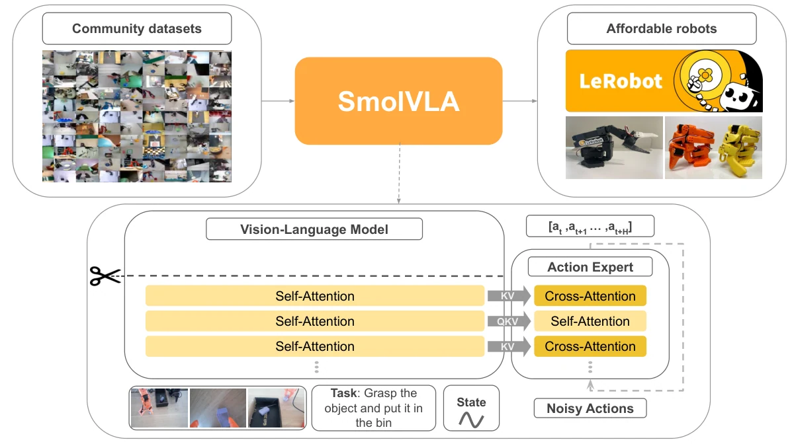

<!-- Generated by scripts/generate.py; edit data/works.json and data/media.json. -->

[← Back to the Awesome index](../../../README.md) · [Interactive website](https://chang-xinhai.github.io/Awesome-RGBDT-Manipulation/?collection=policy&item=smolvla#library)

# SmolVLA

SmolVLA: A Vision-Language-Action Model for Affordable and Efficient Robotics

**2025-06-02 · Technical report · Hugging Face**

**[Paper](https://arxiv.org/abs/2506.01844)** · [Project](https://huggingface.co/blog/smolvla) · [Code](https://github.com/huggingface/lerobot) · [Weights](https://huggingface.co/lerobot/smolvla_base)

Compact VLA combines a small frozen VLM with flow-matching actions and optional asynchronous execution.

*SmolVLA authors · [Figure source](https://arxiv.org/abs/2506.01844) · Original rights retained.*

| Field | Reported value and source scope |
| :-- | :-- |
| Record type | policy |
| Policy family | VLA [1](https://arxiv.org/abs/2506.01844)  |
| Base model and architecture | Truncated SmolVLM2-500M-Video-Instruct + ~100M action expert [1](https://arxiv.org/abs/2506.01844) [2](https://github.com/huggingface/lerobot)  |
| Model size and component | Paper main model450M total /~100M action expert; release named500M [1](https://arxiv.org/abs/2506.01844)  |
| Deployment inputs | RGB views, language and robot state [1](https://arxiv.org/abs/2506.01844)  |
| Action outputs and horizon | 50-step continuous joint/gripper action chunks [1](https://arxiv.org/abs/2506.01844)  |
| Training method | Flow-matching behavior cloning with frozen VLM; synchronous or asynchronous action-queue inference [1](https://arxiv.org/abs/2506.01844)  |
| Training data | 481 community datasets: 22.9k episodes /10.6M frames; downstream SO100/SO101 demos [1](https://arxiv.org/abs/2506.01844)  |
| Training duration | 200k pretraining steps; paper project-wide expenditure~30k GPU-hours includes experiments [1](https://arxiv.org/abs/2506.01844)  |
| Training hardware | Paper supports single-GPU training; exact pretraining GPU model not reported [1](https://arxiv.org/abs/2506.01844)  |
| Inference and control rates | 50-action chunks; asynchronous queue improves runtime, not a universal specified Hz [1](https://arxiv.org/abs/2506.01844)  |
| Evaluation scope | LIBERO, MetaWorld and real SO100/SO101 pick-place, stacking and sorting [1](https://arxiv.org/abs/2506.01844)  |
| Observations / modalities | RGB · Proprioception · Language |
| Evaluation domain | Simulation · Real world |
| Embodiment | Parallel-jaw gripper |
| Release: code | Available [2](https://github.com/huggingface/lerobot)  |
| Release: weights | Available [2](https://github.com/huggingface/lerobot)  |
| Release: data | Partial [2](https://github.com/huggingface/lerobot)  |
| Release: license | Apache-2.0 (LeRobot code and smolvla_base weights); community dataset licenses vary [2](https://github.com/huggingface/lerobot) [4](https://raw.githubusercontent.com/huggingface/lerobot/main/LICENSE)  |
| Release: notes | Community dataset IDs listed in paper appendix; complete unified archive not verified. [2](https://github.com/huggingface/lerobot)  |

**Scope and qualifications**

- Table caption mistakenly calls10.6M frames episodes; the dataset table itself gives22.9k episodes.
- Project-wide GPU-hours are not a single model training bill.

**Primary evidence**

1. [Paper / technical report](https://arxiv.org/abs/2506.01844) — Main paper and supplementary implementation sections; v1 date retained.
2. [Official repository](https://github.com/huggingface/lerobot) — Release and deployment scope checked in README.
3. [Author project page](https://huggingface.co/blog/smolvla) — Official project, not an independent replication.
4. [Code license](https://raw.githubusercontent.com/huggingface/lerobot/main/LICENSE) — Code license only; separately named pretrained models may have additional terms.
