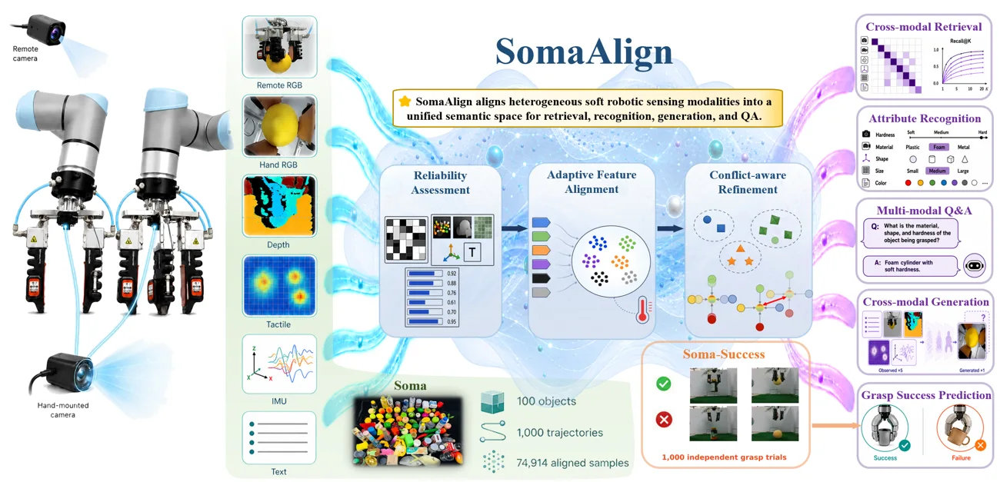

<!-- Generated by scripts/generate.py; edit data/works.json and data/media.json. -->

[← Back to the Awesome index](../../../README.md) · [Interactive website](https://chang-xinhai.github.io/Awesome-RGBDT-Manipulation/?collection=policy&item=somaalign#library)

# SomaAlign

SomaAlign: Reliability-Aware Multimodal Representation Learning for Soft Robotic Grasping

**2026-11-02 · Preprint · Huazhong University of Science and Technology**

**[Paper](https://arxiv.org/abs/2611.02794)** · [Project](https://hijackoo.github.io/SomaAlign/) · [Code](https://github.com/Hijackoo/SomaAlign)

Aligns RGB-D, tactile, inertial and language features into a reliability-aware soft-grasp representation.

*SomaAlign authors · [Figure source](https://arxiv.org/abs/2611.02794) · Original rights retained.*

| Field | Reported value and source scope |
| :-- | :-- |
| Record type | model |
| Model role and downstream interface | Multimodal representation for grasp perception [1](https://arxiv.org/abs/2611.02794)  |
| Model family | Reliability-aware multimodal alignment [1](https://arxiv.org/abs/2611.02794)  |
| Model architecture | ImageBind-derived modality encoders [1](https://arxiv.org/abs/2611.02794)  |
| Model size and component | 1024-dimensional shared embedding; parameter count not verified [1](https://arxiv.org/abs/2611.02794)  |
| Model inputs | Remote and hand RGB, depth, tactile pressure, IMU and structured text. [1](https://arxiv.org/abs/2611.02794)  |
| Model outputs | Aligned multimodal embeddings for retrieval and grasp-outcome prediction. [1](https://arxiv.org/abs/2611.02794)  |
| Training method | Masked reliability estimation, reliability-conditioned contrastive alignment and conflict-aware refinement. [1](https://arxiv.org/abs/2611.02794)  |
| Training data and scale | Paper reports Soma: 100 objects, 1,000 grasp trajectories and 74,914 software-cycle samples; Soma-Success has 998 valid independent trials. [1](https://arxiv.org/abs/2611.02794)  |
| Training duration | Not reported [1](https://arxiv.org/abs/2611.02794)  |
| Training hardware | Not reported [1](https://arxiv.org/abs/2611.02794)  |
| Inference setting and runtime | Frozen encoders with separate lightweight downstream probes. [1](https://arxiv.org/abs/2611.02794)  |
| Downstream evaluation and scope | Cross-modal retrieval, attribute recognition and separate grasp outcome prediction on Soma-Success. [1](https://arxiv.org/abs/2611.02794)  |
| Observations / modalities | RGB · Depth · Tactile · IMU · Language |
| Evaluation domain | Real world |
| Embodiment |  |
| Release: code | Available — inference and evaluation source [2](https://github.com/Hijackoo/SomaAlign) [3](https://github.com/Hijackoo/SomaAlign#datasets)  |
| Release: weights | Not verified [2](https://github.com/Hijackoo/SomaAlign) [3](https://github.com/Hijackoo/SomaAlign#datasets)  |
| Release: data | Announced — dataset repository access returns HTTP 401; files pending paper acceptance [2](https://github.com/Hijackoo/SomaAlign) [3](https://github.com/Hijackoo/SomaAlign#datasets)  |
| Release: license | CC BY-NC-SA 4.0 repository LICENSE; third-party terms separate [2](https://github.com/Hijackoo/SomaAlign) [3](https://github.com/Hijackoo/SomaAlign#datasets)  |
| Release: notes | Official repository has inference and dataset adapters, but points to user-supplied checkpoints; author-listed dataset currently returns HTTP 401. [2](https://github.com/Hijackoo/SomaAlign) [3](https://github.com/Hijackoo/SomaAlign#datasets)  |

**Scope and qualifications**

- A representation, not a closed-loop grasp policy. Software-cycle alignment does not establish hardware-level synchronized timestamps. Dataset files are announced but not publicly verified.

**Primary evidence**

1. [Primary manuscript and first submission](https://arxiv.org/abs/2611.02794)
2. [Official source, license and dataset status](https://github.com/Hijackoo/SomaAlign)
3. [Authors’ dataset availability statement](https://github.com/Hijackoo/SomaAlign#datasets) — The linked Soma dataset access returned HTTP 401 during verification.
