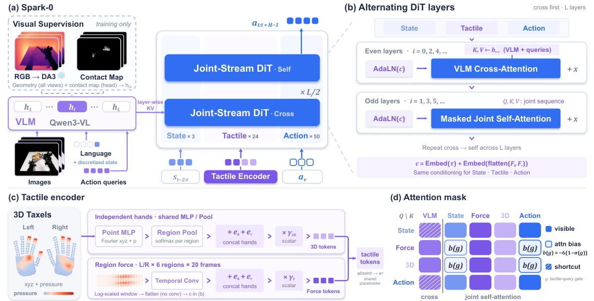

<!-- Generated by scripts/generate.py; edit data/works.json and data/media.json. -->

[← Back to the Awesome index](../../../README.md) · [Interactive website](https://chang-xinhai.github.io/Awesome-RGBDT-Manipulation/?collection=policy&item=spark-0#library)

# Spark-0

Spark-0: Scaling Spatially Aligned Tactile Pretraining for Robot Dexterous Manipulation

**2026-10-15 · Preprint · Xspark AI / Tsinghua University / MMLab, HKU / HKUST (Guangzhou) / Peking University**

**[Paper](https://arxiv.org/abs/2610.22342)** · [Project](https://xsparkai.com/Spark-0/) · [Code](https://github.com/XsparkAI/Spark-0) · [Weights](https://huggingface.co/TianxingChen/Spark-0)

Spatially aligned VTLA pretraining uses human touch as visual supervision and as an optional action-expert input; Spark Arena separates vision-only simulation from real tactile control.

*Spark-0: Scaling Spatially Aligned Tactile Pretraining for Robot Dexterous Manipulation authors · [Figure source](https://arxiv.org/abs/2610.22342) · Original rights retained.*

| Field | Reported value and source scope |
| :-- | :-- |
| Record type | policy |
| Policy family | VLA [1](https://arxiv.org/abs/2610.22342)  |
| Base model and architecture | StarVLA / Qwen 3-VL-4 B-Instruct; 36-layer flow-matching action DiT; frozen Depth Anything 3 geometry teacher only during training. [1](https://arxiv.org/abs/2610.22342)  |
| Model size and component | 4 B VLM backbone; total policy parameters Not reported. [1](https://arxiv.org/abs/2610.22342)  |
| Deployment inputs | Head/wrist RGB, language and three robot-state frames; optional bilateral regional-force history and 3D pressure-taxel tokens. No measured depth input. [1](https://arxiv.org/abs/2610.22342)  |
| Action outputs and horizon | 50-step chunks of 58-dimensional bimanual state/action targets. [1](https://arxiv.org/abs/2610.22342)  |
| Training method | 400 k pretraining steps with geometry/contact alignment and tactile fusion; 80 k downstream fine-tuning steps; frozen geometry teacher and alignment heads are removed at inference. The current XPolicyLab adapter recipe instead lists 500k pretraining steps; this is a separate released recipe, not the paper setting. [1](https://arxiv.org/abs/2610.22342) [8](https://github.com/XPolicyLab/XPolicyLab/tree/94dbf9505f2f87cf59c3ee8ba5912cd236781771/policy/Spark_0)  |
| Training data | Human Touch: 1,000 h, &gt;100 tasks, 32 operators; 460 physical taxels/hand with 140 flex ion points masked, leaving 320 used. Table 5 mixture totals 1,944 source-hours including EgoDex 662 h and separate robot/simulation corpora; sampling weights differ from hours. [1](https://arxiv.org/abs/2610.22342)  |
| Training duration | 400 k pretraining + 80 k downstream steps; wall-clock time Not reported. [1](https://arxiv.org/abs/2610.22342)  |
| Training hardware | 12 nodes × 8 GPUs = 96 GPUs; GPU model Not reported (Table 6). [1](https://arxiv.org/abs/2610.22342)  |
| Inference and control rates | Training-free real-time chunking: 50-action horizon, request after 24 executed steps, nominal eight-step inference delay; physical Hz Not reported. [1](https://arxiv.org/abs/2610.22342)  |
| Evaluation scope | Spark Arena seven simulation task settings without tactile input and five real contact-rich tasks with tactile; additional Ego Humanoid vision-only transfer. Different tactile deployment conditions must be compared within their tracks. [1](https://arxiv.org/abs/2610.22342)  |
| Observations / modalities | RGB · Tactile · Proprioception · Language |
| Evaluation domain | Simulation · Real world |
| Embodiment | Dexterous hand · Bimanual |
| Release: code | Available [2](https://xsparkai.com/Spark-0/) [3](https://github.com/XPolicyLab/XPolicyLab) [4](https://github.com/XPolicyLab/XPolicyLab/blob/main/policy/Spark_0/scripts/download_spark0_pretrained_ckpt.sh)  |
| Release: weights | Available [2](https://xsparkai.com/Spark-0/) [3](https://github.com/XPolicyLab/XPolicyLab) [4](https://github.com/XPolicyLab/XPolicyLab/blob/main/policy/Spark_0/scripts/download_spark0_pretrained_ckpt.sh)  |
| Release: data | Not verified [2](https://xsparkai.com/Spark-0/) [3](https://github.com/XPolicyLab/XPolicyLab) [4](https://github.com/XPolicyLab/XPolicyLab/blob/main/policy/Spark_0/scripts/download_spark0_pretrained_ckpt.sh)  |
| Release: license | Official Spark-0 source MIT, verified from LICENSE; XPolicyLab integration is Apache-2.0 and vendored StarVLA retains MIT notices. Checkpoint and dataset terms are separate. [2](https://xsparkai.com/Spark-0/) [3](https://github.com/XPolicyLab/XPolicyLab) [4](https://github.com/XPolicyLab/XPolicyLab/blob/main/policy/Spark_0/scripts/download_spark0_pretrained_ckpt.sh)  |
| Release: notes | Official standalone Spark-0 source is public. Author-linked XPolicyLab contains vendored Spark-0 implementation,training/evaluation recipes and a download script pointing to the verified pretrain_spark_0 checkpoint. SparkArena-Sim is separately marked Coming soon. [2](https://xsparkai.com/Spark-0/) [3](https://github.com/XPolicyLab/XPolicyLab) [4](https://github.com/XPolicyLab/XPolicyLab/blob/main/policy/Spark_0/scripts/download_spark0_pretrained_ckpt.sh)  |

**Scope and qualifications**

- Depth Anything 3 and contact-map heads supervise visual tokens only during training; inferred teacher geometry is not runtime RGB-D sensing.
- Spark Arena-Sim and Ego Humanoid deploy without touch; Spark Arena-Real deploys with tactile gloves.
- The paper claims released Spark Arena assets, but the live project labels Spark Arena-Sim code Coming soon. Artifact availability is verified separately from paper prose.

**Primary evidence**

1. [Original paper and supplementary implementation details](https://arxiv.org/abs/2610.22342) — Primary full text reviewed; dataset, deployment modalities and training-only privileges are scoped separately.
2. [Official author project](https://xsparkai.com/Spark-0/) — Live artifact status reviewed separately from paper claims.
3. [Official released implementation and LICENSE](https://github.com/XPolicyLab/XPolicyLab) — Repository metadata,README and actualLICENSE inspected; availability scoped to the listed component.
4. [Official adapter checkpoint download script](https://github.com/XPolicyLab/XPolicyLab/blob/main/policy/Spark_0/scripts/download_spark0_pretrained_ckpt.sh) — Explicit author checkpoint identity TianxingChen/Spark-0; public pretrain_spark_0 tensor-file inventory verified.
5. [Public Spark-0 pretraining checkpoint](https://huggingface.co/TianxingChen/Spark-0) — Model repository contains pretraining tensors; this does not establish task-finetuned checkpoints or benchmark assets.
6. [Data collection method and scope](https://arxiv.org/abs/2610.22342) — Original method/data protocol reviewed for the collection mechanism. Data volume, evaluation rollouts and downstream training remain separate; undisclosed or unresolved interfaces are labeled explicitly.
7. [Official standalone Spark-0 source and LICENSE](https://github.com/XsparkAI/Spark-0) — Current standalone repository is public and its actual LICENSE is MIT. The canonical paper’s 400k pretraining steps and the current adapter recipe’s 500k are distinct settings.
8. [XPolicyLab adapter identity and current recipe](https://github.com/XPolicyLab/XPolicyLab/tree/94dbf9505f2f87cf59c3ee8ba5912cd236781771/policy/Spark_0) — Same title/arXiv and XsparkAI upstream as canonical Spark-0. Current adapter recipe lists 500k pretraining steps; retain paper-specific 400k rather than silently overwriting it.
