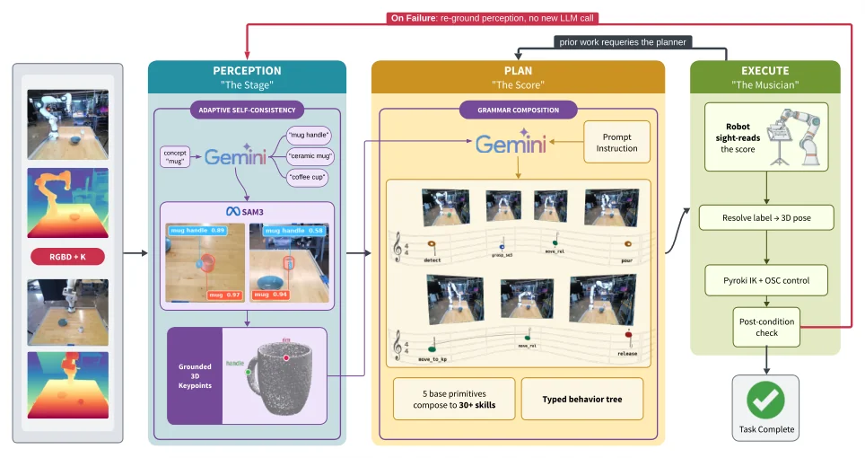

<!-- Generated by scripts/generate.py; edit data/works.json and data/media.json. -->

[← Back to the Awesome index](../../../README.md) · [Interactive website](https://chang-xinhai.github.io/Awesome-RGBDT-Manipulation/?collection=policy&item=spark-keypoints#library)

# SPARK (Anchored Keypoints)

Sequential Planning via Anchored Robotic Keypoints

**2026-06-29 · Preprint · Case Western Reserve University**

**[Paper](https://arxiv.org/abs/2606.30613)** · [Project](https://cwru-aism.github.io/spark-page/) · [Code](https://github.com/CWRU-AISM/sparkbot)

A typed behavior-tree robot agent grounds objects with keypoints and real depth and recovers failed primitives.

*SPARK (Anchored Keypoints) authors · [Figure source](https://arxiv.org/abs/2606.30613) · Original rights retained.*

| Field | Reported value and source scope |
| :-- | :-- |
| Record type | policy |
| Policy family | Robot agent [1](https://arxiv.org/abs/2606.30613)  |
| Base model and architecture | Gemini planner and SAM3 object grounding [1](https://arxiv.org/abs/2606.30613)  |
| Model size and component | Not reported [1](https://arxiv.org/abs/2606.30613)  |
| Deployment inputs | RGB, measured depth, task instruction and robot state. [1](https://arxiv.org/abs/2606.30613)  |
| Action outputs and horizon | Typed behavior tree and grounded motion/grasp primitives. [1](https://arxiv.org/abs/2606.30613)  |
| Training method | Training-free plan composition and perception/primitive retry; no policy-weight updates. [1](https://arxiv.org/abs/2606.30613)  |
| Training data | No task-specific policy fine-tuning reported. [1](https://arxiv.org/abs/2606.30613)  |
| Training duration | Not reported [1](https://arxiv.org/abs/2606.30613)  |
| Training hardware | Not reported [1](https://arxiv.org/abs/2606.30613)  |
| Inference and control rates | Not reported [1](https://arxiv.org/abs/2606.30613)  |
| Evaluation scope | LIBERO-PRO evaluation and separate physical tasks across three embodiments. [1](https://arxiv.org/abs/2606.30613)  |
| Observations / modalities | RGB · Depth · Proprioception · Language |
| Evaluation domain | Simulation · Real world |
| Embodiment | Not reported |
| Release: code | Available — core planner, simulation and real-robot modules [2](https://github.com/CWRU-AISM/sparkbot)  |
| Release: weights | External model weights and APIs; not independently verified [2](https://github.com/CWRU-AISM/sparkbot)  |
| Release: data | Not verified [2](https://github.com/CWRU-AISM/sparkbot)  |
| Release: license | Apache-2.0 for code; models and dependencies retain separate terms [2](https://github.com/CWRU-AISM/sparkbot)  |
| Release: notes | Paper and authors distinguish simulation setting from three physical embodiments. [2](https://github.com/CWRU-AISM/sparkbot)  |

**Scope and qualifications**

- This SPARK is a keypoint robot agent, distinct from Spark-0 visuotactile pretraining.
- RGB-D is an actual sensor in the stated real-robot experiments; not all tasks share identical hardware.

**Primary evidence**

1. [Author paper or official project: methods and evaluation scope](https://arxiv.org/abs/2606.30613)
2. [Official repository: release inventory and scope](https://github.com/CWRU-AISM/sparkbot) — Release availability, assets and third-party licenses are independently scoped; no end-to-end reproduction is implied.
