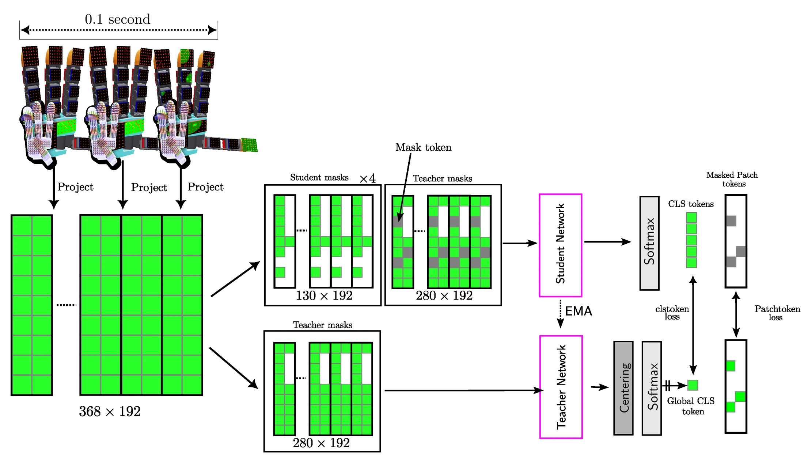

<!-- Generated by scripts/generate.py; edit data/works.json and data/media.json. -->

[← Back to the Awesome index](../../../README.md) · [Interactive website](https://chang-xinhai.github.io/Awesome-RGBDT-Manipulation/?collection=policy&item=sparsh-skin#library)

# Sparsh-skin

Self-supervised perception for tactile skin covered dexterous hands

**2025-05-16 · CoRL 2025 · FAIR at Meta; Carnegie Mellon University; University of Washington**

**[Paper](https://arxiv.org/abs/2505.11420)** · [Code](https://github.com/facebookresearch/sparsh-multisensory-touch) · [Data](https://huggingface.co/datasets/facebook/sparsh-skin-dataset) · [Weights](https://huggingface.co/facebook/sparsh-skin)

Pretrains contextual full-hand magnetic-skin representations from unlabeled play with fingertip, phalanx and palm coverage.

*sparsh-skin authors; original paper figure · [Figure source](https://arxiv.org/html/2505.11420#Ax1.F8) · Original rights retained.*

| Field | Reported value and source scope |
| :-- | :-- |
| Record type | model |
| Model role and downstream interface | Reusable representation or perception model; downstream controllers are separate systems [1](https://arxiv.org/abs/2505.11420)  |
| Model family | Tactile encoder [1](https://arxiv.org/abs/2505.11420)  |
| Model architecture | Taxel-token transformer with kinematic 3D position and hand-region encodings; masked self-distillation [1](https://arxiv.org/abs/2505.11420)  |
| Model size and component | Not reported [1](https://arxiv.org/abs/2505.11420)  |
| Model inputs | 100 ms history from 368 three-axis Xela uSkin taxels, and their 3D positions computed from hand kinematics [1](https://arxiv.org/abs/2505.11420)  |
| Model outputs | Per-taxel latent touch embeddings for force, pose and policy decoders [1](https://arxiv.org/abs/2505.11420)  |
| Training method | Block-masked student–teacher self-distillation; subsequent frozen or fine-tuned task decoders [1](https://arxiv.org/abs/2505.11420)  |
| Training data and scale | Approximately four hours of unlabeled Allegro-hand play with 14 household objects; downstream labels are separate. [1](https://arxiv.org/abs/2505.11420)  |
| Training duration | 500 pretraining epochs; wall-clock duration not reported [1](https://arxiv.org/abs/2505.11420)  |
| Training hardware | 8 NVIDIA A100 80GB GPUs for pretraining; 1 A100 or RTX 4090 for downstream heads [1](https://arxiv.org/abs/2505.11420)  |
| Inference setting and runtime | Approximately 7 ms encoder inference reported; control frequency depends on downstream integration [1](https://arxiv.org/abs/2505.11420)  |
| Downstream evaluation and scope | Force estimation, in-hand pose, object identity, joystick control and plug-insertion policy evaluation. [1](https://arxiv.org/abs/2505.11420)  |
| Observations / modalities | Tactile · Proprioception |
| Evaluation domain | Real world |
| Embodiment | Allegro hand |
| Release: code | Available [2](https://github.com/facebookresearch/sparsh-multisensory-touch)  |
| Release: weights | Available — official download link [2](https://github.com/facebookresearch/sparsh-multisensory-touch)  |
| Release: data | Available — official resource link [2](https://github.com/facebookresearch/sparsh-multisensory-touch)  |
| Release: license | CC BY-NC 4.0 repository LICENSE.md; official dataset and checkpoint terms apply separately. [2](https://github.com/facebookresearch/sparsh-multisensory-touch) [3](https://github.com/facebookresearch/sparsh-multisensory-touch/blob/main/LICENSE.md)  |
| Release: notes | Code, pretrained encoders and downstream task data are separate artifacts; no policy checkpoint is implied by an encoder release. [2](https://github.com/facebookresearch/sparsh-multisensory-touch)  |

**Scope and qualifications**

- Full-hand magnetic sensing is distinct from optical tactile images and from a wrist F/T measurement.
- Hand kinematics determines taxel position; sensor layout/calibration remain part of the input assumptions.

**Primary evidence**

1. [Original model paper and first submission](https://arxiv.org/abs/2505.11420) — Method, experiments and implementation sections; specifications retain component and evaluation scope.
2. [Official implementation and current release instructions](https://github.com/facebookresearch/sparsh-multisensory-touch) — README and repository files inspected on 2026-10-17.
3. [Repository license file](https://github.com/facebookresearch/sparsh-multisensory-touch/blob/main/LICENSE.md) — Applies to repository scope; model/data/base-model terms can differ.
