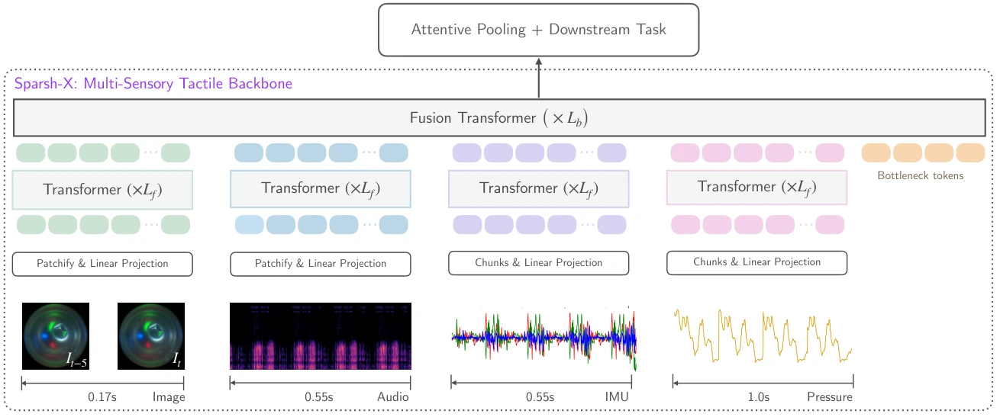

<!-- Generated by scripts/generate.py; edit data/works.json and data/media.json. -->

[← Back to the Awesome index](../../../README.md) · [Interactive website](https://chang-xinhai.github.io/Awesome-RGBDT-Manipulation/?collection=policy&item=sparsh-x#library)

# Sparsh-X

Tactile Beyond Pixels: Multisensory Touch Representations for Robot Manipulation

**2025-06-17 · CoRL 2025 · FAIR at Meta; University of Washington; Carnegie Mellon University**

**[Paper](https://arxiv.org/abs/2506.14754)** · [Project](https://akashsharma02.github.io/sparsh-x-ssl/) · [Code](https://github.com/facebookresearch/sparsh-multisensory-touch) · [Data](https://huggingface.co/datasets/facebook/sparsh-x-dataset) · [Weights](https://huggingface.co/facebook/sparsh-x-all)

Fuses optical touch, contact audio, inertial and pressure measurements into self-supervised tactile embeddings for physical interaction.

*sparsh-x authors; original paper figure · [Figure source](https://arxiv.org/html/2506.14754#S3.F2) · Original rights retained.*

| Field | Reported value and source scope |
| :-- | :-- |
| Record type | model |
| Model role and downstream interface | Reusable representation or perception model; downstream controllers are separate systems [1](https://arxiv.org/abs/2506.14754)  |
| Model family | Tactile encoder [1](https://arxiv.org/abs/2506.14754)  |
| Model architecture | Multisensory transformer with unimodal layers, bottleneck-attention fusion, and self-distillation [1](https://arxiv.org/abs/2506.14754)  |
| Model size and component | Not reported [1](https://arxiv.org/abs/2506.14754)  |
| Model inputs | Digit 360 tactile images, contact microphones, accelerometer and internal pressure; missing-modality variants are available [1](https://arxiv.org/abs/2506.14754)  |
| Model outputs | Unified multisensory touch embeddings; downstream physical-property heads and robot-policy features [1](https://arxiv.org/abs/2506.14754)  |
| Training method | Student–teacher self-distillation with multisensory masking/dropping; separate imitation and sim-policy tactile adaptation [1](https://arxiv.org/abs/2506.14754)  |
| Training data and scale | Approximately 1M samples from 18.6 hours of recordings: 14.1 hours with the handheld picker and 4.5 hours with the Allegro hand. [1](https://arxiv.org/abs/2506.14754)  |
| Training duration | 200 pretraining epochs; wall-clock duration not reported [1](https://arxiv.org/abs/2506.14754)  |
| Training hardware | 16 NVIDIA A100 GPUs; batch size 128 [1](https://arxiv.org/abs/2506.14754)  |
| Inference setting and runtime | Encoder: 50 Hz on RTX 4090 after input preprocessing. Four-finger end-to-end deployment: about 20 Hz; log-mel construction is a bottleneck. [1](https://arxiv.org/abs/2506.14754)  |
| Downstream evaluation and scope | Object/action/surface, material/quantity and force probes; plug insertion imitation and tactile adaptation of sim-trained in-hand rotation. [1](https://arxiv.org/abs/2506.14754)  |
| Observations / modalities | Tactile · Audio · IMU · Pressure |
| Evaluation domain | Simulation · Real world |
| Embodiment | Allegro hand · Handheld picker |
| Release: code | Available [2](https://akashsharma02.github.io/sparsh-x-ssl/) [3](https://github.com/facebookresearch/sparsh-multisensory-touch)  |
| Release: weights | Available — official download link [2](https://akashsharma02.github.io/sparsh-x-ssl/) [3](https://github.com/facebookresearch/sparsh-multisensory-touch)  |
| Release: data | Available — official resource link [2](https://akashsharma02.github.io/sparsh-x-ssl/) [3](https://github.com/facebookresearch/sparsh-multisensory-touch)  |
| Release: license | CC BY-NC 4.0 repository LICENSE.md; model/data cards and upstream controller terms apply separately. [2](https://akashsharma02.github.io/sparsh-x-ssl/) [3](https://github.com/facebookresearch/sparsh-multisensory-touch) [4](https://github.com/facebookresearch/sparsh-multisensory-touch/blob/main/LICENSE.md)  |
| Release: notes | Code, pretrained encoders and downstream task data are separate artifacts; no policy checkpoint is implied by an encoder release. [2](https://akashsharma02.github.io/sparsh-x-ssl/) [3](https://github.com/facebookresearch/sparsh-multisensory-touch)  |

**Scope and qualifications**

- Audio, IMU and internal pressure are Digit 360 tactile channels; they do not indicate a scene-depth sensor.
- Encoder throughput differs from four-fingertip end-to-end controller frequency.
- Sim-trained policies use privileged state; tactile adaptation learns to replace or refine deployment state estimates.

**Primary evidence**

1. [Original model paper and first submission](https://arxiv.org/abs/2506.14754) — Method, experiments and implementation sections; specifications retain component and evaluation scope.
2. [Official project](https://akashsharma02.github.io/sparsh-x-ssl/) — Author project; author-reported release scope is distinguished from an executed reproduction.
3. [Official implementation and current release instructions](https://github.com/facebookresearch/sparsh-multisensory-touch) — README and repository files inspected on 2026-10-17.
4. [Repository license file](https://github.com/facebookresearch/sparsh-multisensory-touch/blob/main/LICENSE.md) — Applies to repository scope; model/data/base-model terms can differ.
