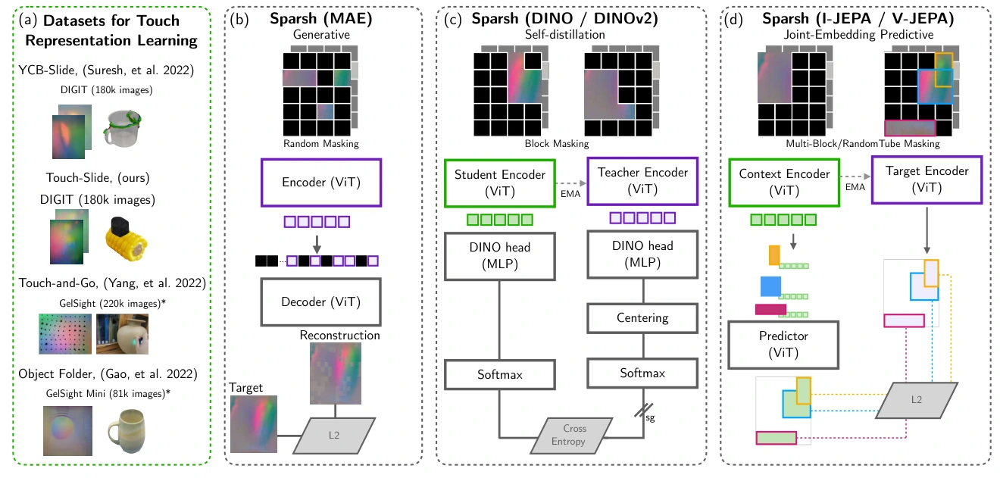

<!-- Generated by scripts/generate.py; edit data/works.json and data/media.json. -->

[← Back to the Awesome index](../../../README.md) · [Interactive website](https://chang-xinhai.github.io/Awesome-RGBDT-Manipulation/?collection=policy&item=sparsh#library)

# Sparsh

Sparsh: Self-supervised touch representations for vision-based tactile sensing

**2024-10-31 · CoRL 2024 · FAIR at Meta**

**[Paper](https://arxiv.org/abs/2410.24090)** · [Project](https://sparsh-ssl.github.io/) · [Code](https://github.com/facebookresearch/sparsh) · [Data](https://huggingface.co/collections/facebook/sparsh-67167ce57566196a4526c328) · [Weights](https://huggingface.co/collections/facebook/sparsh-67167ce57566196a4526c328)

Self-supervised optical-touch encoders plus TacBench, a six-task tactile evaluation suite with one closed-loop bead-maze control task.

*sparsh authors; original paper figure · [Figure source](https://arxiv.org/html/2410.24090#S3.F2) · Original rights retained.*

| Field | Reported value and source scope |
| :-- | :-- |
| Record type | model |
| Model role and downstream interface | Reusable optical tactile encoder; the TacBench benchmark role is retained separately [4](https://arxiv.org/html/2410.24090#S3)  |
| Model family | Tactile encoder [4](https://arxiv.org/html/2410.24090#S3)  |
| Model architecture | ViT backbones trained with MAE, DINO, DINOv2, I-JEPA or V-JEPA adapted to tactile images [4](https://arxiv.org/html/2410.24090#S3)  |
| Model size and component | ViT-Base is the primary configuration (width 768); ViT-Small variants also evaluated. Total parameter count not reported. [4](https://arxiv.org/html/2410.24090#S3)  |
| Model inputs | Optical tactile images or short temporal context, depending on the SSL variant, from DIGIT/GelSight-family sensors [4](https://arxiv.org/html/2410.24090#S3)  |
| Model outputs | Latent touch features for lightweight perception heads or a separately trained manipulation policy [4](https://arxiv.org/html/2410.24090#S3)  |
| Training method | Self-supervised masked reconstruction, self-distillation or latent prediction; frozen encoder with attentive downstream probing [4](https://arxiv.org/html/2410.24090#S3)  |
| Training data and scale | 460K+ tactile images in the original paper: DIGIT Touch-Slide/YCB-Slide and GelSight Touch and Go/ObjectFolder Real. Current release preprocessing can differ. [4](https://arxiv.org/html/2410.24090#S3)  |
| Training duration | Not reported — objective-specific schedules appear in Appendix C [4](https://arxiv.org/html/2410.24090#S3)  |
| Training hardware | 8 NVIDIA A100 80GB GPUs in paper Appendix C [4](https://arxiv.org/html/2410.24090#S3)  |
| Inference setting and runtime | Not reported — depends on encoder variant and downstream head [4](https://arxiv.org/html/2410.24090#S3)  |
| Downstream evaluation and scope | TacBench force, slip, relative pose, grasp stability, textile classification and bead-maze control; six tasks are not six closed-loop robot environments. [4](https://arxiv.org/html/2410.24090#S3)  |
| Observations / modalities | Tactile |
| Evaluation domain | Real world |
| Embodiment | Parallel-jaw gripper · Robot arm tactile fingertip |
| Release: code | Available [3](https://github.com/facebookresearch/sparsh)  |
| Release: weights | Available [3](https://github.com/facebookresearch/sparsh)  |
| Release: data | Available [3](https://github.com/facebookresearch/sparsh)  |
| Release: license | CC BY-NC 4.0 repository LICENSE.md; model/dataset cards and upstream corpora have separate terms. [3](https://github.com/facebookresearch/sparsh) [5](https://github.com/facebookresearch/sparsh/blob/main/LICENSE.md)  |
| Release: notes | Public repository and Hugging Face collection include representation models and benchmark data. [3](https://github.com/facebookresearch/sparsh)  |

**Scope and qualifications**

- Do not describe six tasks as six manipulation environments.
- TacBench is distinct from the 2026 Tac-Bench 14-task simulation suite.

**Primary evidence**

1. [Paper](https://arxiv.org/abs/2410.24090) — Published paper / arXiv record and manuscript.
2. [Official project](https://sparsh-ssl.github.io/) — Public project page.
3. [Official repository](https://github.com/facebookresearch/sparsh) — Current public repository; implementation scope may differ from paper.
4. [Original Sparsh representation and training sections](https://arxiv.org/html/2410.24090#S3) — 460K+ original pretraining corpus; Appendix C specifies eight A100 80GB GPUs. Separate from TacBench labels.
5. [Repository license](https://github.com/facebookresearch/sparsh/blob/main/LICENSE.md) — CC BY-NC 4.0 license file verified.
6. [Data collection method and scope](https://arxiv.org/abs/2410.24090) — Original method/data protocol reviewed for the collection mechanism. Data volume, evaluation rollouts and downstream training remain separate; undisclosed or unresolved interfaces are labeled explicitly.
