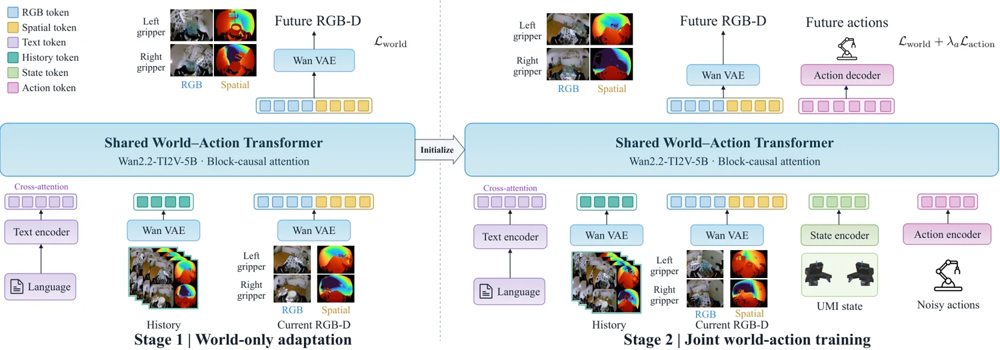

<!-- Generated by scripts/generate.py; edit data/works.json and data/media.json. -->

[← Back to the Awesome index](../../../README.md) · [Interactive website](https://chang-xinhai.github.io/Awesome-RGBDT-Manipulation/?collection=policy&item=spatial-umi-dream#library)

# Spatial-UMI-Dream

Spatial-UMI-Dream: Scaling World Action Models with Metric Geometry for UMI Manipulation

**2026-11-04 · Preprint · University of Southern California**

**[Paper](https://arxiv.org/abs/2611.07229)** · [Project](https://weiduoyuan.com/spatial-umi-dream/)

A world-action model predicts future observations and actions from stereo-derived metric geometry in UMI demonstrations.

*Spatial-UMI-Dream authors · [Figure source](https://weiduoyuan.com/spatial-umi-dream/) · Original rights retained.*

| Field | Reported value and source scope |
| :-- | :-- |
| Record type | policy |
| Policy family | RGB-D world-action policy [1](https://arxiv.org/html/2611.07229v1)  |
| Base model and architecture | See original paper [1](https://arxiv.org/html/2611.07229v1)  |
| Model size and component | Not reported [1](https://arxiv.org/html/2611.07229v1)  |
| Deployment inputs | Dual-gripper RGB and stereo-estimated metric depth with observation history and instruction. [1](https://arxiv.org/html/2611.07229v1)  |
| Action outputs and horizon | Future RGB-D predictions and robot action sequences. [1](https://arxiv.org/html/2611.07229v1)  |
| Training method | Two-stage world-only and joint world-action pretraining. [1](https://arxiv.org/html/2611.07229v1)  |
| Training data | See original paper [1](https://arxiv.org/html/2611.07229v1)  |
| Training duration | Not reported [1](https://arxiv.org/html/2611.07229v1)  |
| Training hardware | Not reported [1](https://arxiv.org/html/2611.07229v1)  |
| Inference and control rates | Not reported [1](https://arxiv.org/html/2611.07229v1)  |
| Evaluation scope | RoboTwin-UMI simulated benchmark and six real-world manipulation tasks. [1](https://arxiv.org/html/2611.07229v1)  |
| Observations / modalities | RGB · Depth · Proprioception · Language |
| Evaluation domain | Simulation · Real world |
| Embodiment |  |
| Release: code | Not verified |
| Release: weights | Not verified |
| Release: data | Not verified |
| Release: license | Not verified |
| Release: notes | Model, source and data availability are tracked separately. |

**Scope and qualifications**

- Depth is reconstructed from stereo, not a separate active depth sensor; external task-suite videos are for visualization.

**Primary evidence**

1. [Author paper and first submission](https://arxiv.org/html/2611.07229v1)
